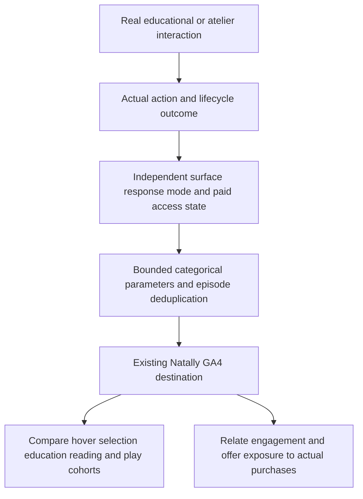
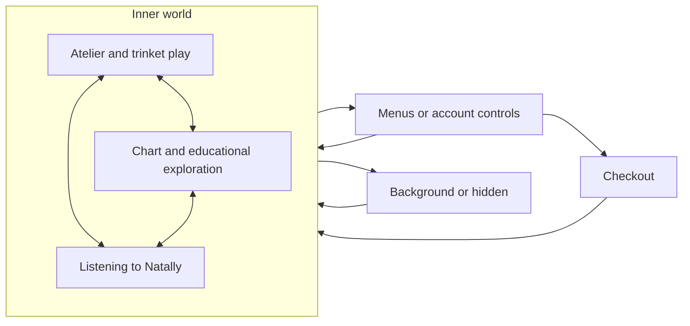

# Natally usage and interaction analytics contract

Operator amendment, 29 October 2026. Extends the GA section of ARCHITECTURE.md.
Destination is the existing newly created Natally property 561516754, measurement
ID G-E3420JFKPB. This specifies intended instrumentation, not received data.

## Independent context fields

| Field | Meaning and permitted source |
| --- | --- |
| `surface` | Actual marketing, live app or frozen keepsake surface. |
| `activity_kind` | education, user_question, horoscope, synastry, room_play, navigation or promotion, according to the action actually executed. |
| `response_mode` | authored_free, paid_personal or no_response, according to the real response path. Free education stays authored_free even for a purchaser. |
| `paid_access_state` | available, unavailable or unknown from the existing current account/access state. Unknown is not silently counted as unpaid; signing in does not itself imply purchase. |
| `input_method` | pointer, touch, keyboard, chat or voice as observed. |
| `entry_point` | Actual button, chart object, chat, voice, scene prop or automatic scene transition. |

These are bounded categories. Do not send names, birthdays, chart coordinates,
question/answer text, lore, arbitrary URLs or raw pointer paths as parameters.
Keep actual product, placement and authored-phrase IDs for offer comparisons.

## Enumerated events and emitting roles

| Event | Actual trigger and required distinctions |
| --- | --- |
| `chart_item_hover` | Meaningful pointer entry/dwell on an educational planet/sign/house/aspect target. Record target kind and existing bounded content ID, not personal placement coordinates. Debounce within one hover episode; never emit per mousemove/frame. |
| `chart_item_focus` | Keyboard focus reaches the same educational target. Keep separate from pointer hover so accessibility usage is not mislabeled. |
| `chart_item_select` | Click/tap/keyboard activation selects the actual chart target. Record input method and target kind; hover alone is not selection. |
| `education_answer` | Actual authored educational answer starts/completes/fails/is cancelled, with bounded status and entry point. Record response_mode authored_free and the independent paid_access_state. Playback is identified separately and does not create a new answered question. |
| `reading_request` | Actual customer-specified personal question enters the paid reading path. Record activity_kind user_question, request entry and eventual status; do not send the question. |
| `horoscope_request` | The My Horoscope/current-sky button requests its existing action. Record button entry and actual started/completed/failed/cancelled outcome; one click is not a completed horoscope. |
| `synastry_request` | Distinguish opening the Synastry form from submitting valid real inputs and completing the reading. No partner identity/date content in analytics. |
| `reading_outcome` | Actual paid reading settles, with the original user_question/horoscope/synastry kind, bounded outcome and elapsed duration. No invented success, fixed debit or extra purchase revenue. |
| `scene_view_change` | Actual change from atelier to chart or chart to atelier, with from_view, to_view and source user_action or automatic_scroll_swap. A click without a successful view change remains an action, not a completed transition. |
| `trinket_interaction` | Real nudge, drag start/end, drop or other supported play action from the existing trinket lifecycle. Record bounded object kind and action, not frame-by-frame physics. |
| `trinket_break` | Actual transition into broken state from the physics/interaction result. One event per break episode; a click or collision without breakage does not count. |
| `crystal_ball_interaction` | Real caress/rub/ripple episode, with bounded action, start/end and aggregate duration. Group continuous gestures rather than reporting every pointer sample. |
| `view_promotion` / `select_promotion` | Real eligible exposure or activation of reading/souvenir/add-on offers. Include placement and phrase variant, completed-free/paid-question buckets and actual paid_access_state. |
| `begin_checkout` / `purchase` / fulfillment outcome | Existing GA architecture: real checkout, authoritative confirmed transaction and actual fulfillment remain distinct, with deduplicated revenue. |

Existing chart hover/selection callbacks, authored explanation/voice lifecycle,
reading dispatch/outcome, scene-view/inset transitions, trinket state transitions
and crystal-ball gesture lifecycle are the emitting roles. Exact symbols/files,
configuration projection, parameter registration and a continuous real-event
demonstration rubric must be enumerated in the checklist before coding. Reuse one
analytics adapter; do not install competing tracking SDKs or a new collector.

## Intended comparisons

### Primary analysis is time and transitions within the inner world

The operator's primary question is how long visitors inhabit the experience and
how they move through it. Event totals are supporting detail. Trinket engagement
is a way of going deeper into that inner world, not an interruption or an exit.
Nudging, dragging, dropping, breakage and crystal-ball caressing remain in-world
activity. The click itself is a material-world interaction: in the operator's
model it marks thinking about an action rather than experiencing. Track that
boundary separately from the subsequent trinket play or other in-world activity.
Do not relabel the click as immersive just because its destination is a trinket.
Keep the action's timestamp and the next observed in-world interaction; do not
invent a duration for a visitor's unobservable mental state.

| Observable state or transition | Measurement responsibility |
| --- | --- |
| Atelier play | Visible room time, deliberate trinket/ball episodes and repeated object exploration; retain this as in-world engagement. |
| Chart exploration and educational reveal | Visible chart/tooltip/explanation time and transitions from room play or other chart targets; still in-world. |
| Listening to Natally | Actual speaking/playback intervals and transitions into/out of listening; no pointer motion is required for listening to count. |
| Menus, account controls and checkout | Distinct interface states and entry/return transitions; distinguish a Top Up menu from external checkout and from exploration within the scene. |
| Hidden/background page | Record visibility boundaries separately; do not count a hidden tab as visible-world time. On return, start the next observed visible interval. |
| Quiet visible time | Preserve separately from deliberate manipulation and listening. Do not automatically discard passive contemplation or call it proven attention/absence based only on lack of input. Any idle threshold must be explicitly configured and reported. |

Derive intervals and ordered transitions from real scene/view/panel, audio and
page-visibility lifecycle boundaries, using timestamps and episode identifiers.
Keep from_state, to_state and actual transition trigger; distinguish user action
from automatic inset swaps. Overlapping states must not double-count total
visible-world time: retain listening/play as dimensions within the same elapsed
interval. Do not infer an unobserved exit at a crash or abrupt disconnect; mark
that interval incomplete rather than fabricating a duration.

Report distributions of uninterrupted visible in-world time, time by in-world
activity, transitions among play/chart/listening, frequency and duration of menu
or checkout excursions, return rate and return latency, and subsequent revisit
time. Relate these trajectories to offers and purchases without treating any one
behavior as proof of a mental state or a causal sale. Scene quality and pacing
must not be altered merely to simplify measurement.

Hover and click are distinct current interactions and must remain separate event
streams, not a combined engagement event or interchangeable counts. Hover serves
passive, private-feeling discovery and immersion; the click is a material-world,
thinking/operating interaction. This is the operator's explicit interaction model;
analytics observes actions and transitions rather than claiming to read a mind.
Record meaningful hover episodes even when they never lead to a click. Preserve
hover-only sessions, click-only actions, hover-to-click transitions and hover dwell
duration as distinct analytical cases. A click must not erase or replace the
preceding hover event; a hover must not be inferred when none was observed.
Keyboard focus and touch activation likewise keep their actual input identity.
Each other named interaction/outcome also retains its separate event identity;
aggregated dashboards supplement rather than replace these event streams.

Trinket play is a deliberate source of stickiness and hypnotic immersion, not
incidental activity to minimize. Preserve every meaningful repeated nudge, drag,
drop, break and return to an object. Do not cap these at one interaction per
visitor/session or sample away repeat play. Episode grouping applies only to
continuous raw pointer/physics updates; it must not merge separate deliberate
actions into one. Record play duration, repeat-interaction counts, distinct
object kinds explored, returns to the room and returns to the same object kind,
so engagement depth remains visible alongside unique audience size. Distinguish
active manipulation from merely leaving the atelier open. Do not alter the
physics, animations, ambience or interaction pacing to simplify analytics.

Compare unique visitors who hover versus select, selection-to-educational-answer
completion, free education with versus without paid access, education-to-first
paid reading, horoscope/synastry entry and completion, both scene navigation
directions, room-play intensity and breakage, and subsequent offer conversion.
Use per-user/session denominators as well as event counts so repeated rubbing,
hovering or flybys do not inflate audience size. Report association rather than
claiming the interaction caused a purchase. Do not introduce experiment assignment
or change offer behavior just to produce measurement data.
