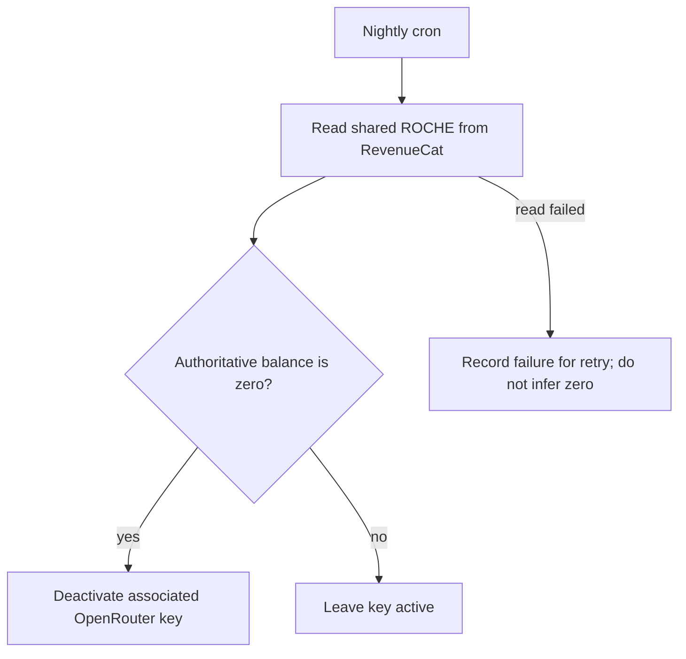

NEVER CREATE PLACEHOLDER CONTENT, PLACEHOLDER FUNCTIONALITY, MOCK CUSTOMER EXPERIENCES, DUMMY PAYMENTS, OR TEMPORARY CUSTOMER-FACING FLOWS. NOT DURING DEVELOPMENT. NOT DURING TESTING. NOT IN PRODUCTION.

## 30 October landing corrections — active independent delivery queue

Status vocabulary: NOT_STARTED, IN_PROGRESS, BLOCKED, COMPLETE. Colors identify
tasks, not completion. The current operator request authorizes web deployment and
continuous recording for this queue; older recording holds below are superseded
only for this scope. Native packaging remains outside this queue.

| Task | State | Current boundary |
| --- | --- | --- |
| 🟣 LC-01 Explicit Sound On / Sound Off action | IN_PROGRESS | Architecture 71771a6b remotely verified; recipe below. |
| 🔵 LC-02 Restore visible inset chart and scroll behavior | NOT_STARTED | Await preceding complete independent cycle. |
| 🟢 LC-03 Omit the single-choice room selector | NOT_STARTED | Await preceding complete independent cycle. |
| 🟠 LC-04 Always-visible first-screen CTA | NOT_STARTED | Await preceding complete independent cycle. |
| 🟡 LC-05 Opening curiosity hook and natal-chart explanation | NOT_STARTED | Await preceding complete independent cycle. |
| 🟤 LC-06 Android Google Play badge and desktop PWA installation | NOT_STARTED | Await preceding complete independent cycle. |

### LC-01 cold-coder recipe

Input: DOCS/ARCHITECTURE.md LC-01a..d and the existing production
MarketingExperience in src/marketing.tsx. Own only that file's voice button and
failure text. Replace disabled voice action with `Sound On 🔊`, enabled action
with `Sound Off 🔇`; keep aria-pressed actual voice state and an accessible name
that identifies the on/off action and Natally's voice. Change stale retry wording
to the visible Sound On name. Preserve all current handlers, playback, Replay,
room ambience and other product behavior. Do not create assets, fixtures, fake
voice state, provider calls, new configuration or unrelated fixes.
Return exact requirement-to-diff mapping to the supervising agent. Parent owns
Git/publication, deployment and recording. The same coder corrects any deficiency.

| Step | State | Acceptance |
| --- | --- | --- |
| LC-01 architecture | COMPLETE | 71771a6b remotely verified before this recipe. |
| LC-01 checklist/rubric | IN_PROGRESS | Publish this recipe before coder execution. |
| LC-01 implementation | NOT_STARTED | Actual scoped source commit pushed. |
| LC-01 semantic review | NOT_STARTED | Supervisor evaluates label/action/state, accessibility, retry references and unchanged real voice routing. |
| LC-01 deployment | NOT_STARTED | Existing coordinator DeployWebFirst, contemporary pointer resolution, source/version and served-byte evidence. |
| LC-01 continuous demonstration | NOT_STARTED | Actual deployed page recording with sound, preserved artifact, implementation SHA, release identity and timecodes. |

### LC-01 preauthored real recording script

Record one continuous actual browser session at https://natally.robin.mba/marketing.html.
Start recording before the page demonstration. Show current release stamp and URL.
1. LC-01a: show initial `Sound On 🔊`; inspect/focus actual control.
2. LC-01a/b: activate it; hear actual Natally welcome/current lesson and observe
   `Sound Off 🔇` and pressed state. Keep enough real playback to establish audio.
3. LC-01b: activate Sound Off during actual speech; observe speech stopping and
   `Sound On 🔊`. Room ambience has an independent existing control.
4. LC-01b/c: activate Replay; hear actual resumed speech and enabled label. Review
   failure copy semantically without forcing a fabricated customer error.
5. LC-01a/d: resize to a narrow viewport and show readable, reachable controls;
   toggle off. Stop recording only after the final result is visible.
Save the continuous recording and requirement/timecode mapping in TEST-RESULTS.
If actual playback or controls fail, send evidence to the same coder, publish the
correction and re-record. Screenshots/typecheck alone cannot complete this cycle.

## Profile account and billing access — ACCOUNT-01..05

Architecture8ec29399 is pushed and remote-verified. Four states only:
NOT_STARTED, IN_PROGRESS, BLOCKED, COMPLETE. Recording remains held here.

| Boundary | State | Evidence/acceptance |
| --- | --- | --- |
| Architecture | COMPLETE |8ec29399; actual entities, authority and structured flow. |
| Checklist and preauthored rubric | COMPLETE |e5c2f65e pushed and remote-verified before coder starts. |
| Coder implementation | COMPLETE | Four scoped files; actual current-owner portal/SDK management metadata. |
| Supervising semantic review/correction | COMPLETE | ACCOUNT-01..05 inspected; same coder corrected effect cleanup lock reset. See account-billing-review-20261030.md. |
| Source publication and verification | COMPLETE |6cefed2b and same-coder keyboard correction74771175 pushed/remote verified; both typechecks passed. |
| Deployed browser acceptance | COMPLETE | Actual current account A1/A3/A4 passes on1.20; A2 null URL is observed, subscriber-link/account-switch branches remain unobserved as recorded below. No native acceptance inferred. |
| Continuous recording | BLOCKED | Explicit operator recording hold; ordinary browser checks continue. |

Cold coder recipe (no other context required):

1. Read DOCS/ARCHITECTURE.md ACCOUNT-01..05, src/marketing.tsx account/credit
   handlers and the full revenueCatCheckout owner/generation guards. Own only
   src/marketing.tsx, src/marketing.css, new src/components/AccountBillingDialog.tsx
   and src/services/revenueCatCheckout.ts. Preserve the concurrent LC sound-label
   change. Do not change inset/room/toolbar yet; those have separate iterations.
2. Add optional nullable managementUrl to CheckoutCustomer; project the installed
   SDK CustomerInfo.managementURL in projectWebCustomer. Preserve native return
   shape and all serialization/auth/checkout guards. Do not invent a URL.
3. Add Account & billing to signed-in Profile. Render a current-User-keyed modal
   directly in marketing. Share the existing matching Credits state/refresh and
   appEntry('conversation') destination rather than creating another balance or
   routing account access through onboarding. Name/email/phone come from User.
4. Dialog initially loads getCheckoutCustomer. Distinguish loading, ready, failed;
   verify matching owner and discard async work after close/account change. A
   provider error gets a Retry action; don't substitute empty purchase history.
   On success, a distinct purchased-product count must be labeled accurately.
   Only an actual valid HTTPS managementUrl becomes Manage subscription & billing.
   Null is no evidence of no purchases or no subscription; omit that link only.
5. Restore purchases calls restoreCheckoutCustomer then the existing real credit
   refresh. Report purchase-record refresh separately from balance success; never
   promise fulfillment/credits from SDK success. Prevent overlapping refresh UI.
   Top Up retains the existing explicit intent. No raw IDs/provider/currency names.
6. Native HTML dialog showModal/close + accessible heading, initial focus, Escape,
   explicit Close, return focus and max-height/overflow responsive styling. Close
   on account switch/unmount without losing underlying chart/voice state. No app
   global CSS import, new dependency, backend, logs or persisted management URL.
7. Return requirement-to-diff mapping and real limitations. Parent owns Git, lint,
   build/deploy/browser. Do not execute changed code before publication.

| Scene | Preauthored actual deployed acceptance |
| --- | --- |
| A1 | Existing signed-in marketing Profile contains Account & billing. Open without page navigation; actual name/contact and Credits agree with header. No customer identity injection or storage clearing. |
| A2 | Real purchase summary completes, accurate distinct-product count; actual management URL is a live management link if returned. If real account has none, record that state without fabricating a subscription/customer. No financial action during verification. |
| A3 | Restore purchases actually reads provider and refreshes Credits independently, with accurate status and no paid inference. Return to same room/chart after Close/Escape; focus returns to opener. |
| A4 |390x844 and desktop: modal within viewport, readable control labels, reachable Close/Top Up/Retry and no background scroll/click trap. Keyboard Tab stays within the open dialog. Restore viewport afterward. |
| A5 | Source review proves stale owner/unmount results discarded, failure isn't zero, native return unchanged and existing checkout guards retained. Actual account-switch and active-subscription branches require genuine sessions; mark unobserved branches honestly. |

Reviewed delivery receipt:1.20.88950 both hosts92/92 served checks, coordinator
exit0. Actual forward Tab wraps Restore→Close, reverse Close→Restore; all focus
stays in dialog. Escape/Close returns focus/unlocks page. Current390x844 actual
provider refresh passed with dialog bounds17..373/100..744. Real account has no
returned management URL; no subscriber was fabricated. Full review record retains
that unobserved branch and initial19 keyboard failure/correction. Recording held.

## Slim marketing inset handle — HANDLE-01..04

Architecture3a594d81 is pushed/remote-verified. Four states only:
NOT_STARTED, IN_PROGRESS, BLOCKED, COMPLETE. Recording remains held.

| Boundary | State | Evidence/acceptance |
| --- | --- | --- |
| Architecture | COMPLETE |3a594d81; size/geometry/gesture entities and flow. |
| Checklist and rubric | COMPLETE |f612ab33 pushed/remote verified before coder starts. |
| Coder implementation | COMPLETE | Only marketing.tsx and marketing.css handle/layout lines. |
| Supervising semantic review/correction | COMPLETE | Single24px CSS source; pane offset/normalized layout/measured drag range consistent; gesture handlers unchanged. |
| Source publication/typecheck | COMPLETE |4ed1c6c0 pushed/remote-verified, then tsc passed. |
| Deployed acceptance | COMPLETE |1.21.88959 actual24px/10px docking, native bar drag/chart rotation/click swap,390px containment and cookie clearance passed. Touch not newly observed. |
| Recording | BLOCKED | Explicit hold; live browser checking continues. |

Cold coder recipe:
1. Read DOCS/ARCHITECTURE.md HANDLE-01..04 and current marketing.tsx/.css.
   Own only their inset handle geometry/style lines. Preserve Account & billing,
   LC Sound On/Off, theme/placement controls and all other work.
2. Define --marketing-inset-handle-height:24px on the existing stage; use it for
   button height/min-height and inactive pane top offset. Reduce padding/type to
   fit while keeping grip/text/focus and touch-action:none. No enlarged invisible
   hitbox over chart. Keep32% scale, pointer-events and gesture code unchanged.
3. Replace hardcoded44/64 vertical layout offsets with CSS-variable-based inset
   position and measured handle height in drag range. Bottom docking equals
   stage bottom minus10px for the complete pane; existing collision code already
   measures rectangles and must remain intact. No new state/storage/dependency.
4. Read back all changed coordinate consumers for consistency, including pointer
   drag/end, keyboard Home/End and saved normalized positions. Return requirement
   mapping. No Git, tests/build/browser or execution; parent publishes first.

| Scene | Preauthored actual live acceptance |
| --- | --- |
| H1 | Signed-in canonical landing: actual handle24px, readable grip/label; dock End then Home using keyboard and measure complete pane/handle within stage10px margins. Chart area/scale preserved. |
| H2 | Drag handle independently; chart canvas still accepts actual mouse rotation and deliberate click foreground swap. Room inset click returns to atelier; signage hidden while chart inset. No overlay or lost drag. |
| H3 |390x844: bar24px, complete inset contained; cookies/popups not newly obstructed. Restore normal viewport. No paid inference/recording. Touch behavior source unchanged; actual touch acceptance only if genuinely observed. |

## Compact landing control row — CONTROLS-01..05

Architecture08f24851 pushed/remote-verified. States NOT_STARTED, IN_PROGRESS,
BLOCKED, COMPLETE. Recording remains held in this chat.

| Boundary | State | Evidence/acceptance |
| --- | --- | --- |
| Architecture | COMPLETE |08f24851; entities/flow and responsive behavior. |
| Checklist/rubric | COMPLETE |effd6905 pushed/remote-verified before coder starts. |
| Coder implementation | COMPLETE | Only marketing.tsx/.css scoped controls. |
| Supervising semantic review/correction | COMPLETE | Complete select bindings moved, obsolete controls/import/styles removed, actual handlers/Account/handle preserved; responsive flex and accessible label inspected. |
| Source publication/typecheck | COMPLETE |5dc3b78d pushed/remote-verified, then tsc exit0. |
| Deployed acceptance | COMPLETE | Actual22.88969 desktop/390px single-row44px controls, authored Sun selection and inset swapping passed. See landing-controls-review-20261030.md. |
| Recording | BLOCKED | Explicit hold. |

Cold coder recipe:
1. Read DOCS/ARCHITECTURE.md CONTROLS-01..05 and current marketing.tsx/.css.
   Own only those two files' control row/placement markup and associated styles.
   Preserve new Account & billing and slim24px inset math/gestures untouched.
2. Remove landing ownedChart toggle Your chart/Room and AtelierThemeSelector JSX
   plus unused import. Do not edit the theme service/modules/assets or main app.
   Preserve explicit Sound On/Off labels/aria-pressed/onVoice and all speech code.
3. Move the complete existing ownedChart placement label/select with unchanged
   value/options/chartTargetLabel/explain handler into controls beside voice.
   Wrap label text in marketing-frame__target-label. Remove old placement row
   from text area. Retain current-chart instruction/lesson/replay and no-intake UI.
4. Controls form one width-efficient flex row. Voice is non-shrinking; placement
   label flexes with min-width:0 and select takes remaining width without the old
  132px select cap. Target label text can remain visible on wide screens; at
   narrow widths use accessible visually-hidden span to give select the space.
   Keep44px control heights and no horizontal overflow; delete obsolete landing
   theme selector CSS only. No new dependency/configuration/price/customer state.
5. Read back requirement mapping and return. No Git/tests/build/browser/execution;
   parent reviews and publishes source before lint/web deployment.

| Scene | Preauthored actual deployed acceptance |
| --- | --- |
| C1 | Real signed-in desktop: controls contain only explicit Sound On/Off and actual Explore a placement dropdown on one line. No Your chart button or Room decoration dropdown. Header section links and inset swapping remain. |
| C2 | Select a real available planet; existing authored educational text/highlight/view updates. No payment or personalized inference invoked. Returning via room inset works; voice/replay handlers source unchanged. |
| C3 |390x844: button and selector share a row,44px height, accessible selector name retained, dropdown usable and no horizontal overflow.24px handle and cookies remain clear. Restore viewport and chosen view; record actual source/release. |

## Existing-cache entry correction — task43

Architecture3a04f2b0, CACHE-01..06. Preserve concurrent LC source/docs and its
independent queue. This correction owns only scripts/pwa-build.mjs and public/pwa.js.
No native packaging, recording, manual release stamps, new dependency/backend,
account changes, price research or unrelated UI changes.

| Boundary | State | Evidence |
| --- | --- | --- |
| Architecture | COMPLETE |3a04f2b0 pushed and remote verified; entity table and flow. |
| Cold recipe and real acceptance rubric | COMPLETE | This section; publish before coder execution. |
| Coder execution | COMPLETE | ad5581f1 pushed and remote verified; only the two existing PWA files. |
| Supervising semantic review/correction | COMPLETE | Install atomicity, exact route fallback, live-client retention and future-install protection inspected. npm run lint and both source JS syntax checks passed after publication. |
| Deployed acceptance | IN_PROGRESS |1.18 deployed; actual old13 to new18 normal reload and retained old static asset observed. Offline worker fallback and anonymous/new-account branches remain unobserved. |

Cold coder:

1. Read CACHE-01..06 and both complete PWA files. Use actual coordinator release
   inputs and existing natally-shell namespace; keep original shell inventory.
2. Emit RELEASE_ID from invocationId. Fetch precache requests with cache:reload,
   validate the three entry HTML invocation markers, and activate/claim only after
   the complete install. Delete only a failed new shell cache, never prior assets
   or account data. Do not force existing documents to reload/navigate.
3. Emit matchesReleaseHtml/respondToNavigation/retainedAsset and dispatch known
   shell navigations before precache hits. Require valid HTML for network success,
   cache it only under its matching invocation, and fall back to the exact installed
   shell offline. API/auth/checkout remain outside this cache interception.
4. Emit clientReleases/requestedClients/pruneUnusedShells. Use actual live window
   IDs and invocation reports, request unknown reports once, retain legacy assets
   conservatively while any live client is unknown, then prune only Natally cache
   versions unused by current worker/live releases. Recheck on activation, shell
   navigation and messages; no recurring timer or per-animation work. Retained
   /assets/ JS/CSS/WASM remain readable by old open documents. Prevent overlapping
   pruning operations from deleting a newly reported live version.
   olderShell compares the actual numeric release tuple; never prune a same/newer
   version that may still be installing, even when it has no window report yet.
5. In existing bootstrap add registerWorker/reportRelease with actual meta only,
   updateViaCache:none and correct before/after-load behavior. Report on ready and
   controllerchange; respond to worker requests even after a worker restart.
   Preserve HTTPS/native guards, install behavior and configured application name.
6. Return scoped diff/requirement mapping. No tests/build/runtime/provider/Git;
   parent reviews, commits/pushes and verifies remote before executing changed code.

| Scene | Preauthored real acceptance rubric |
| --- | --- |
| U1 | Keep a genuine existing-cache17-or-earlier tab open through actual new deployment. Observe new worker activation; subsequent normal reload/navigation loads the published version without cache bypass or clearing account data. |
| U2 | Existing signed-in account remains the same, retains its actual chart/atelier, and main entry opens app without an automatic paywall. A real signed-out session shows root landing and no personal chart. Do not inject user/chart data. |
| U3 | With the actual installed current shell, browser offline navigation to app.html and marketing.html uses their distinct real cached documents. Restore online afterward; no purchase/generation is invoked to simulate success. |
| U4 | Older open tab stays usable during claim, with its real saved/static resources retained. Observe actual browser cache versions/client reports; do not fabricate caches, release IDs or users. |
| U5 | Source review proves incomplete/mismatched install cannot activate, unknown clients retain old caches, and cleanup touches only unused Natally shell caches. Use actual retained release files for any focused check, no mock customer responses. |
| U6 | Existing coordinator web-only path publishes both hosts and verifies served bytes. Record actual invocation/source/version and browser state separately. Run npm run lint and node --check on the actual generated dist-web/sw.js after publication of source. |

Predeployment baseline: an actual existing Chrome session loaded1.13.86779 at
natally.surge.sh/marketing.html, invocationc19c2e74-fa33-43cc-91de-0b7654f83776.
It remains open for the upgrade/continuity observation. No account/cache state
was injected or cleared. Actual browser Network evidence after deployment:
normal reload served1.18.88916 via the worker's network path; the old13 document
stayed open, and its actual marketing-PXePjCjY.js returned200 from cache-storage
natally-shell-1.13.86779-c19c2e74-fa33-43cc-91de-0b7654f83776. After restoring
online and normal reload, real Profile/Robin/Credits:0/Top Up and its chart were
present on18. Page-target offline emulation did not prove worker fallback (the
response still reported network); it was restored online. U3 remains unobserved.
No recording, fake cache/user or storage clearing was performed. See
TEST-RESULTS/pwa-entry-cache-review-20261030.md for original deployment exit1 and
later exact single-file recheck, retained separately from browser evidence.

## Live acceptance correction batch

Architecture22bd311d, LIVE-01..08. Latest operator requests parallel corrections
to the same acceptance iteration. Parent owns Git: commit/push at each prescribed
boundary and every repository-work turn, verifying the remote SHA. The current
operator AGENTS instructions replace the older per-line publication cadence.
Publish reviewed source before executing it. No native packaging or
recording. Preserve unrelated work and all genuine account/balance/location data.

| Scope | Architecture/recipe | Code | Semantic review | Deployed observation |
| --- | --- | --- | --- | --- |
| A: account/entry/inset/navigation/voice | COMPLETE | COMPLETE | COMPLETE | NOT_STARTED |
| B: env seasonal availability | COMPLETE | COMPLETE | COMPLETE | NOT_STARTED |
| C: current observation location/timezone | COMPLETE | COMPLETE | COMPLETE | NOT_STARTED |

Scope C source and supervising review are published at cb6ff784. Actual current
onboarding fields survive recalculation, explicit observation overrides take
priority, saved snapshots preserve their location/IANA context and legacy replay
uses explicit unknown-location/UTC labels. Runtime acceptance is still pending;
no paid generation or account mutations were used to establish source review.

Scope A source and supervising review are published at7e4c5494. The same coder
corrected the customer Credits label, measured cookie/inset collision handling,
transition remeasurement and real touch-tap activation before publication.
Follow-up035c507d corrects nullable observation displays and explicit nudge gate
types; the subsequent npm run lint / tsc --noEmit passed. This is source evidence,
not acceptance of native login, payments or the pending deployed L1..L7 scenes.
Canonical landing-live-frame.md is revision3, exact KStore readback SHA-256
168a9a18a80cce4c73f44f7e01c77788381fddd75c1b467cccccf3f842fe8fde.

Web1.17.88863 is published on both domains, source822bc26d. The coordinator exited0,
all3web outputs verified and184/184 served-file checks passed. Actual observations:
L1 signed-in Profile/Credits/Top Up matches the owner chart on both domains;
L3 the main action entered the existing account's atelier without an automatic
dialog/paywall; L4 mouse/finger rotation, pinch, deliberate click/tap, independent
handle drag and desktop/mobile cookie clearance passed; L5 instruction and Stop
removal observed; L6 only Candlelit available. Detailed record is in the existing
landing-live-frame review. L2 anonymous/new-account and L7 actual current-location
acceptance are not established. Existing caches served older pages until a
cache-bypassing reload, so automatic update/root entry remains incomplete (43).
Recording remains held; no native login or purchase acceptance is inferred.

### A — Same-coder marketing correction

Read top LIVE contract and actual marketing/App entry. Own marketing.html,
src/marketing.tsx, src/marketing.css, src/main.tsx, scripts/build-web.mjs,
scripts/pwa-build.mjs only its app.html shell/cache navigation entries,
Astrolabe3D.tsx, ReadingStage.tsx and AtelierSeason.tsx. App.tsx permits the
Astrolabe click-activation prop AND removal of onboarding's unconditional
maybeAutoShowOfferJourney call/callback/otherwise-unused refs/imports per LIVE-09.
Do not replace it with a new URL marker or automatic offer path. Explicit manual
offers remain. C owns App's separate observation clock line.
No prices/catalog/provider changes or new infrastructure.

1. Drive header from the same real Firebase User as chart loading. Use a header
   portal/mount; signed out Sign In, signed in Profile and actual Credits/Top Up.
   getRocheBalance supplies owner-checked numeric balance; never fabricate zero.
   Show actual loading/error/retry, clear stale values on account change, refresh
   on visible/focus/actual purchase refresh. Profile actions enter app/sign out
   through existing Firebase flow; Top Up preserves existing purchase intent.
2. In build-web.mjs, after fresh Vite output preserve original compiled app index
   as app.html and copy compiled marketing.html to index.html BEFORE generatePwa.
   On reuse never overwrite app.html with marketing: validate both invocation
   identities. Add app.html to pwa-build's actual shell/navigation paths and leave
   all other PWA policy unchanged. main.tsx recognizes app.html. Marketing at root resolves genuine
   auth then routes signed-in to app; explicit app=1/offer/native routes app.html
   preserving query/hash without loops. Explicit marketing.html stays inspectable.
   Existing app profile loader selects atelier versus new/no-intake onboarding.
3. Main marketing actions say exactly Start my reading now! and enter app flow,
   without automatically opening purchase after onboarding. Preserve intentional
   upsell routes, prices and attribution separately. Restore top chart/how/converse/
   prices/Education links with meaningful IDs and interruptible eased scrolling,
   reduced-motion instant behavior and usable mobile navigation.
4. Astrolabe onActivate optional/ref callback executes only actual click/tap AFTER
   mouse-drag and touch suppression; parent supplies it while inset. Do not gate
   rotation/zoom or cover canvas. Apply main-app and marketing caller behavior.
5. Restore visible marketing inset top grab/drag bar with pointer capture, bounded
   saved normalized position, keyboard arrows/Home/End and correct narrow sizing.
   Default bottom-left, clear of cookies/sign. Keep handle outside chart viewport,
   inside frame bounds. Reuse actual shelf-focus events for automatic collision
   avoidance, including when held-cookie controls open. Do not hide cookies.
6. Remove standalone Stop button; existing explicit voice control stops its owned
   utterance/automatic speech. Foreground chart has the exact LIVE-05 instruction
   visibly outside chart geometry. Preserve actual authored lesson and Replay.
7. Return scoped diff/requirement mapping, no build/deploy/record or fixture state.

### B — Seasonal availability and full env annotations

Own atelierTheme.ts, AtelierThemeSelector.tsx, .env and .env.example only. Keep
Halloween/Christmas modules/assets and theme union. Add annotated public flags
VITE_ATELIER_HALLOWEEN_ENABLED=false and VITE_ATELIER_CHRISTMAS_ENABLED=false in
both full annotated files, preserving every existing binding/pointer/comment and
exact pre-edit checkpoint. Example remains portable with no KStore pointers.
Filter choices and normalize disabled stored/cached/programmatic effective themes
to candlelit; preserve the stored seasonal preference for future re-enabling.
No calendar auto-enable, fake theme, provider lookup, price research or other env
changes. Return exact diff plus preserved-schema check; no build/deploy/Git.

### C — Onboarding current location consumers

Own ReadingsModal.tsx, readings.ts, NatalInputForm.tsx, comprehensiveReading.ts and
transits.ts only buildCurrentSkyContext's missing-current-zone fallback to UTC,
App.tsx observation clock ONLY. Use the existing currentLocationName/Latitude/
Longitude/TimezoneId saved by onboarding. Initialize vantage from saved current
location before birth fallback; explicit later vantage selection takes priority.
Use selected current IANA timezone for the requested instant/DST and display;
never overwrite it with browser zone. Preserve fields through all recalculations.
Use null/finite checks preserving valid0 latitude/longitude/UTC offsets. Remove
invented city/country defaults. Label birth versus current observations honestly,
including correct hemisphere letters. When location is missing, request it or
label UTC rather than inventing a city. Keep natal houses/coordinates unchanged;
current planetary snapshot remains geocentric. Coordinate disjoint App line with
A, never overwrite its activation prop. No paid generation, provider/Git/build.

LIVE-10 extension at879de297 also permits ephemeris.ts optional
CurrentSkySnapshot.observationContext, transits.ts snapshot creation and
NatallyChatbot.tsx snapshot validation/replay reconstruction only. Preserve the
actual selected name/coordinates/IANA zone in new saved observations. Reading
override context must be applied before or onto the saved snapshot, not copied
from the wrong owner input. Replay restores saved context; legacy missing context
stays playable with explicit UTC/location-not-recorded labels. Validate optional
metadata and preserve existing geocentric calculations, messages/audio/focus.
Use existing storage only; no fixtures, provider calls or new schema service.

### Preauthored real acceptance rubric

| Scene | Actual evidence required |
| --- | --- |
| L1 | Real signed-in owner: header Profile, matching personal chart, owner-checked Credits state/Top Up. Signed out has no personal chart and shows Sign In; no invented balance. |
| L2 | Root anonymous shows actual landing at root; existing genuine session goes atelier. Existing login skips onboarding; actual new/no-intake follows onboarding. No fake account created for proof. |
| L3 | Every main Start my reading now! action enters correct account/onboarding path; restored top links scroll correctly on desktop/mobile and reduced motion. |
| L4 | Drag inset top bar and chart separately; deliberate click swaps, gesture does not. Foreground/back keeps camera. Cookie popup stays fully visible; default inset clears sign. |
| L5 | Foreground chart shows exact instruction, real click teaches authored general astrology. No standalone Stop or accidental paid inference. |
| L6 | Both seasonal flags false: choices absent and previously selected seasonal room effectively candlelit. Assets retained. Actual configured true can re-enable without new code. |
| L7 | Actual saved onboarding current location matches observation controls/reading/date-zone/labels; natal birthplace remains separately correct. Verify zero-safe fields by source, no invented fixture geography. |

After restored handle has actual proof, implement the operator's cookie-sign
marquee follow-up from architecture: exact souvenir invitation for one turn,
free-cookie sign on the next actual turn, repeated only at configured cadence.

## Clear reading and checkout wording

Architecture a9064f90, COPY-01..03. Scoped customer wording only.

| Task | State | Evidence |
| --- | --- | --- |
| Copy architecture | COMPLETE | Exact required wording/entities pushed before implementation. |
| Copy recipe | COMPLETE | This cold recipe and actual rubric pushed before implementation. |
| Copy code | COMPLETE | Exact three wording changes in marketing.html; no link/price/routing changes. |
| Copy semantic review | COMPLETE | Parent inspected full diff against COPY-01..03; deprecated chips and provider/card reassurance removed as specified. Deployed observation remains separate. |
| Copy deployed observation | NOT_STARTED | Actual canonical-domain reading/checkout sections after current web publication. |

Coder: in marketing.html only, apply exact COPY-01 paragraph, replace the retired
style heading/chips with COPY-02's single sentence, and replace provider/card
reassurance with COPY-03. Preserve links, offers, pricing and all layout/routing
hooks. No tests/build/deploy/record or other edits; parent owns Git.

Actual rubric: on the deployed page read the reading-aloud section beside the
actual room/chart. Confirm clear highlight/listen/read description and one
professional explanation standard, with no style-choice chips. At checkout steps
confirm customer-action copy without processor/card-handling claims. Confirm
existing action links retain their actual destinations. Record screenshots and
observed source/version; recording held.

## Publish web before native packaging

Architecture43240dd2, WEB-FIRST-01..04. Native packaging stopped by operator;
recording held. This changes publication order, not the required final platforms.

| Task | State | Evidence |
| --- | --- | --- |
| Web-first architecture | COMPLETE | Operator order recorded and pushed before source changes. |
| Web-first recipe | COMPLETE | This recipe/rubric published before coder edits. |
| Web-first code | COMPLETE | Three existing scripts implement explicit web publication, original3web outputs and truthful pending-native inventory. |
| Web-first semantic review | COMPLETE | Parent inspected full three-file diff, default all12 verifier, lock/preparation/freeze branch, archive/identity/Surge reuse and return before native work. Actual publication remains pending. |
| Current web publication | NOT_STARTED | Real current source on both existing domains and actual app checks. |

Cold-coder recipe: scope scripts/build-all-platforms.ps1, release-state.mjs and
deploy-existing.mjs. Parent owns Git. Add explicit -DeployWebFirst switch with
-DeployDomains, mutually exclusive with completed-artifact deployment/VerifyOnly/
Continue/Major combinations that would confuse identity. Reuse environment
resolution, lock, canonical fresh stamp, transcript and source freeze. Prepare
Node dependencies as needed, then only existing Build-Web (web/PWA/installer).
Do not initialize native toolchains, run icon preparation/lint/unit tests or any
Windows/Android/Linux build. Exit after the existing actual deployment helper.

Refactor shared inventory validation into verifyInventory and export
verifyWebInventory for exactly the3 verified web targets. Preserve original
12-target required array, source/version/invocation validation, retained path/
hash/size checks. Default verifyCompletedInventory remains all12. Explicit
--web-first in deploy-existing chooses only this verifier; all archive extraction,
release identity, Surge and served-byte verification remain. Report scope web,
native pending; do not mark complete full release or fabricate artifact states.
Use existing flat inventory and no new hosting/deployment tool. Return full diff;
parent checks every path before execution. No builds/deploy/record by coder yet.

Preauthored actual rubric: run the web-first coordinator from the reviewed source;
observe only web outputs, retained native pending status and no cargo/Gradle/WSL
packaging. Check actual served source identity/hashes on both domains, then use
the real signed-in app to drag/zoom the inset with no signage, foreground and
return, and check narration continuity. Check actual guest landing and account
header separately; do not claim unrelated paid/native completion. Screenshot
evidence allowed; no recording. Native packaging waits for operator evaluation.

## Immediate inset 3D interaction repair

Architecture e9acb5e207775855ac7f85c218aca91c0a7c94e1. Operator-reported
regression preempts later features. Recording held; build and actual QA authorized.

| Task | State | Evidence |
| --- | --- | --- |
| Chart controls architecture | COMPLETE | CHART-CONTROL-01..05 published before repair. |
| Chart controls recipe | COMPLETE | This recipe/rubric published before coder edits. |
| Chart controls code | COMPLETE | Five scoped source files correct gesture gates, label visibility and chart interception. |
| Chart controls semantic review | COMPLETE | Full diff and handlers reviewed; same coder corrected drag-release selecting a target. See DOCS/TEST-RESULTS/inset-controls-repair-20261029.md. Runtime acceptance remains separate. |
| Chart controls runtime | NOT_STARTED | Actual owner chart gesture/visibility observations required. |

Cold-coder recipe (parent owns Git):

1. Scope Astrolabe3D.tsx, App.tsx, ReadingStage.tsx/CSS and marketing.tsx/CSS.
   Replace annotationMode with default-true showAnnotations boolean strictly for
   signage creation/visibility; update both callers. Keep compact real glyphs and
   current/natal geometry. No new visible mode, annotation switch or sample chart.
2. Remove the explicit inset guards from drag start/update, mouse down, zoom and
   target selection. In mouse move, process active drag before suppressing hover
   signs. Keep touch binding/pinch/wheel functional in both sizes. No resetting
   camera/orientation or gesture state merely because label visibility changed.
3. Keep slow contemplative idle drift without overwriting active manual gesture.
   Preserve motion pause/reduced motion as limits on automatic movement only.
   No new orientation restrictions or different physics merely because inset.
4. ReadingStage and marketing chart contents must not be inert/aria-hidden in
   inset. Remove the chart's full-card button intercepting gestures. Reuse the
   existing separate toolbar foreground button outside chart content; room inset
   full-card action is unchanged. Check CSS pointer events/z-order so canvas is
   actually hit, and the move-card handle retains its independent function.
5. All inset cards/leaders/NOW plaques/hover signs/captions stay absent after drag,
   zoom, click and narration updates. Foreground labels return. Manual chart
   manipulation does not foreground it or change Follow/speech/focus.
6. Return exact requirement-to-diff mapping. No build/deploy/record, fake account,
   synthetic chart or new services. Parent semantically reviews and requests
   same-coder correction before commit/push.

Preauthored actual rubric:

| Scene | Steps and required result |
| --- | --- |
| C1 | On actual saved owner chart inset, drag horizontally/vertically; wheel zoom and touch drag/pinch change real view while room stays foreground. No sign covers the chart. |
| C2 | Release gesture: quiet idle drift settles; actual narrated highlight/dim continues without returning signage. Manual return during narration stays pinned. |
| C3 | Foreground via separate existing toolbar action, interact with full detail, return to inset: same orientation/zoom retained and signage absent again. |
| C4 | Repeat on actual marketing chart, narrow screen and reduced motion. Deliberate control works while automatic motion follows preference. Move-card handle moves card without stealing chart gestures. |

## MFRAME — Persistent live marketing experience

Architecture pushed at e4ada9a7111ed93b536d4e8f1992050f26a925b5. Requirements
MFRAME-01..06; build authorized, recording held. This iteration covers existing
task-list 10–14 and 25. No catalog, account-header or paid-fulfillment changes.

| Task | State | Evidence |
| --- | --- | --- |
| MFRAME-ARCH | COMPLETE | Root and independent landing contract pushed at the checkpoint above. |
| MFRAME-RECIPE | COMPLETE | This cold-coder recipe and actual demonstration rubric committed before code. |
| MFRAME-CODE | IN_PROGRESS | Live persistent room/chart source checkpoint implemented; inherited inset interaction regression is under immediate correction. |
| MFRAME-REVIEW | IN_PROGRESS | Real guest desktop/mobile room, speech state and persistent breakage observed. Same coder corrected CSS covering props and voice failure handling. Personal-chart interaction acceptance remains pending the operator-reported regression repair. |
| MFRAME-BUILD | NOT_STARTED | Prescribed all-platform batch and actual deployed verification after source freezes. |
| MFRAME-RECORD | NOT_STARTED | Held by operator; do not record or substitute fabricated evidence. |

### Independent coder recipe

1. Work on master, parent owns Git. Read MFRAME in root/landing architecture and
   SPEC, current marketing.html and src/marketing.tsx, AtelierScene/Trinkets/
   Character, authoredNudges and voice service. Scope: marketing.html,
   src/marketing.tsx and new src/marketing.css. Operator clarification at 33a8bc0b
   withdraws the unrelated rehearsal removal. Restore AtelierTrinkets.tsx and
   atelierMemories.ts exactly to their pre-removal HEAD versions; preserve their
   existing development gate, real production shelves and session lifecycle.
   Do not edit credentials,
   providers, shared scene behavior, paid access, chart renderer or other tasks.
2. Replace static hero/attention visual panels and separate chart mount with a
   single persistent visual React root adjacent to the story copy. Use an actual
   sticky responsive story grid, preserve human section IDs, purchase links and
   full-width pricing/how/footer outside the story. No duplicate room or chart.
3. MarketingExperience owns existing Phase/load with strict Firebase owner/stale
   result checks. Immediately reset phase and owned lesson/speech on account
   change, including before asynchronous intake lookup. Use actual authenticated
   UID for room, isolated marketing guest namespace otherwise. Calculate only
   real saved intake; no fabricated chart, auth, data or current-user fallback.
4. Mount actual AtelierScene with current high-resolution assets, real animated
   character, trinkets/breakage/ball/season. Keep it mounted across visual swaps.
   Single Astrolabe3D likewise retains state while swapping with room. Actual
   section observer selects chart for your-chart/reading-aloud and room elsewhere;
   manual choice overrides until section changes. Signed-out/no-intake stays room
   with create-own-chart action. Remove old Pause/Reset controls. Chart inset
   annotationMode inset; foreground full, high contrast, slow drift respecting
   reduced motion/hidden document/visibility. Do not recreate renderer on swap.
5. CSS positions the sticky frame clear of header and copy, with small bounded
   scroll-velocity spring that settles at rest and zero bounce under reduced
   motion. Retain usable desktop/narrow viewport aspect and inset hit targets,
   no horizontal overflow or overlapping price sections. Do not mask trinkets.
6. Wire actual target click through getAuthoredChartExplanation and real selected
   target highlight. Preserve existing attached hover tooltips. Show complete
   authored lesson text with Replay/Stop and existing loadVoiceSettings +
   speakNatallyText + owned AbortController. Real voice-performance mouth events
   animate the same room. Never call chat, LLM or purchase/debit for education.
7. After explicit visitor voice interaction, schedule sparse visible-room nudges
   using existing authoredNudges and SOUL continuity. Reuse public 90–150 second
   configuration. Yield to lesson/preparing/speaking, hidden page and account
   switch. Stop/mute prevents pending speech from resuming unexpectedly. Cancel
   only owned utterance; cleanup timers/observer/RAF/media listeners on unmount.
   Preserve full readable text and retry on actual voice failure.
8. Return scoped diff plus requirement mapping and concrete limitations. Do not
   build, deploy, record, inject fixture state or add ritual unit/lint/typecheck
   gates. Supervisor reviews/corrects before source commit/push.

### Preauthored actual demonstration rubric

| Scene | Actual trajectory and expected evidence | Requirements |
| --- | --- | --- |
| M1 | Open actual marketing URL at desktop and narrow widths. Scroll entire story: high-resolution living room remains visible, spring settles, copy/nav stay clear. Prices/footer do not overlap. | 01,02 |
| M2 | Nudge/drag/drop/break actual trinket and caress ball; scroll to chart and back. Belongings and orientation persist. No static attention illustration remains. | 01,03 |
| M3 | In an actual signed-in owner session scroll to chart; use hover and click on planet, sign, house, aspect. Tooltips attach to actual geometry, text/voice teach general meaning with actual coordinates; mouth and highlight agree. Rapid reselection cancels old voice. | 03,04,05 |
| M4 | Manually return room during lesson; compact chart inset has no blocking signs. Next section transition restores automatic layout. No Pause/Reset clutter. Reduced motion removes bounce/rotation; keyboard actions remain usable. | 02,03,05 |
| M5 | Actual signed-out/no-intake state shows live room/create-own action, no personal chart/caption. Account switch removes old chart/text/audio before replacement loads. Error offers actual retry. | 04 |
| M6 | Enable voice and remain visibly quiet through configured nudge interval. Established story facts are continuous; chart lessons take priority. Stop, hidden tab and account switch cancel owned utterance with no surprise restart. No inference/payment request in education/nudge network path. | 05,06 |
| M7 | Preserve the intentional rehearsal capability behind its original development gate; verify it remains absent from the built customer interface. It is not a placeholder for unfinished product behavior. | 07 |

Record real URL/build/source, observations and screenshots separately from held
continuous recording. No source-only or compile-only acceptance claim.

## INSET — Clean high contrast chart preview

Architecture checkpoint `9d125712be3a62983a6d9c6911f9123cc08b2089`, INSET-01..06.
Current operator instruction authorizes building this round; only recording is
held. Source and semantic review proceed before the coordinated batch build.

| Task | State | Completion evidence |
| --- | --- | --- |
| INSET-ARCH | COMPLETE | Contract/flow and build authorization pushed at the checkpoint above. |
| INSET-RECIPE | COMPLETE | Recipe/rubric pushed at a0483292 before source edits. |
| INSET-CODE | COMPLETE | Four-file source implements annotation modes, compact glyphs, inset backdrop/caption cleanup and bounded drift; published with this review checkpoint. |
| INSET-REVIEW | COMPLETE | Supervisor inspected full scoped source against INSET-01..06. Actual deployed before state observed; local new-state observation awaits deployed/coordinated verification because real local sign-in returns unauthorized-domain. See DOCS/TEST-RESULTS/inset-source-review-20261029.md. |
| INSET-BUILD | NOT_STARTED | Included in the prescribed all-platform batch after required changes are ready; no manual version/build. |
| INSET-RECORD | NOT_STARTED | Continuous actual app/canonical-domain trajectory below after operator lifts recording hold. |

### Independent coder recipe

1. Work on master. Scope: `src/components/Astrolabe3D.tsx`, `src/App.tsx`,
   `src/components/ReadingStage.tsx` and `ReadingStage.css` only. Parent owns Git.
   Read root INSET requirements and current renderer/endpoint labels, NOW canvas
   plaques, tooltip handlers, chart slot and existing follow/presentation wiring.
2. Add optional annotationMode full|inset, default full, to Astrolabe3D. App derives
   it from actual presentation.view. In inset suppress HTML endpoint cards AND
   leaders and large rectangular NOW plaques. Use compact planet glyphs/beads for
   the actual current-sky layer instead; preserve underlying natal/current bodies,
   aspect lines, highlighted endpoints and current CHART_FOCUS dim/glow treatment.
   No changed data, demo chart, duplicated scene or pointer-width heuristic.
3. Keep inset tooltip signage suppressed even if focus/hover updates arrive while
   it is inset. Restore full cards/leaders/plaques and interactive tooltips when
   foregrounded. Mode changes may rebuild dynamic detail but must not recreate
   outer renderer/camera/wheel or reset orientation/zoom, selections or speech.
4. Gate App's Now focusing on overlay on foreground view. Remove visible inset
   chart Your chart/Calculated positions/Bring into focus copy and its covering
   gradient; retain accessible named full-card foreground button, visible keyboard
   focus and existing draggable inset affordance. Room inset behavior stays intact.
5. Give the inset a dark clean backdrop with sharp bright geometry. Preserve slow
   existing drift; prevent residual foreground fling speed carrying into the
   preview. Respect motion pause, drift-off and reduced motion. Keep foreground
   drag/pinch/hover/selection behavior and other renderer consumers' full default.
6. Preserve existing auto view cues and manual Follow pinning. Manual return to
   atelier during speech keeps the chart inset, signage hidden and actual narrated
   focus active. Do not change camera policy, clear focus or create a new focus
   controller. If current wiring blocks this, report the concrete dependency.
7. Return scoped diff and requirement map for supervisor semantic review; parent
   commits/pushes after corrections. Do not run builds, deploy, record, create
   synthetic fixture accounts/charts or add ritual unit/lint/typecheck gates.

### Preauthored actual demonstration rubric

Use actual saved intake/chart and real retained reading or funded live response.
Do not inject selections, account state, cue offsets or chart data. Development
observation is separate from deployed verification and held continuous recording.

| Scene | Actual steps and expected observation | Mapping |
| --- | --- | --- |
| I1 | Open real atelier with chart inset. Observe slow drift with all large annotation cards/plaques and covering captions absent. | INSET-01,02,04 |
| I2 | Replay an actual retained chart reading. With Follow active, chart foregrounds and full detail returns; highlighted planet/aspect endpoints and dim context remain correct. | INSET-03,05,06 |
| I3 | During that playback manually return to atelier. Observe continued speech and correct inset focus/dim with no signage returning on later cues. | INSET-02,03,05 |
| I4 | Foreground chart again using keyboard and pointer; exercise real hover/selection then return. Verify signs/tooltip restored only foreground, preserved orientation/focus, usable full-card action and drag handle. | INSET-03,04,06 |
| I5 | Check actual pause/drift-off and reduced-motion behavior, then desktop and narrow viewport. No stale card/leader/tooltip overlay, full-wheel obstruction or background spin contrary to controls. | INSET-01,02,04,06 |

Retain actual source/build/URL, observations and screenshot evidence; record
continuous timecodes only when recording is resumed. Any defect returns to the
same coder. Source and local rendering do not prove a published release.

## NUDGE — Restore continuous Madlib character stories

Architecture pushed at `23816c07121ecdb427042c2f3ee4bf922f0ff1fe`, NUDGE-01..06.
This is authored spontaneous character speech, not paid inference or sales cadence.

| Task | State | Required evidence |
| --- | --- | --- |
| NUDGE-ARCH | COMPLETE | Pushed architecture checkpoint above. |
| NUDGE-RECIPE | COMPLETE | Recipe/rubric pushed at 0c9e3348, with scoped refinements at b0197a47 and 25a7372a before dependent edits. |
| NUDGE-CODE | COMPLETE | Actual scoped source and public settings implemented; published in the checkpoint containing the review record below. |
| NUDGE-REVIEW | COMPLETE | Supervisor compared source against NUDGE-01..06, returned lost session-only prompt continuity to the same coder and verified its correction. See DOCS/TEST-RESULTS/nudge-source-review-20261029.md; partial runtime evidence is tracked separately below. |
| NUDGE-RUNTIME | IN_PROGRESS | 1.25.89030: N1 partial quiet story delivery/speech lifecycle and N3 exact story text once after normal reload. Audio/lip-sync, exact trigger time, funded continuation and other variants remain unproven; see the review receipt. |
| NUDGE-RECORD | NOT_STARTED | Recording alone held. Ordinary actual browser QA and the current authorized batch build may proceed. |

### Independent coder recipe

Scope refinement pushed at `a7ad13899eff790b3ae331a7483c2c2d9ee0cb34`:
allow `soul.ts` character retention to preserve fixed authored-story IDs inside
the existing 80 entries, evicting ordinary developments first; native Web Locks
serialize story read/write/readback where available, with truthful session-only
fallback if absent; and allow the one `App.tsx` chatbot prop binding
`nudgeSuppressed={quickReadingBusy || isGeneratingMultiReading || showReadingsModal}`.
The chatbot must honor that signal before starting and while preparing a nudge,
without cancelling another reading. No DOM polling, separate store or schema.
These precise refinements supersede the narrower soul-comment-only scope below.
Speech ownership refinement: architecture `141b38c24c34f1036f0b38ebeffdf7d7c11a246a`
enumerates `voiceService.ts` optional AbortSignal in NatallySpeechOptions. Permit
that bounded edit: already-aborted input returns before stopSpeaking; subsequent
abort cancels only its captured current voice generation, and finally removes
the listener. The nudge owns its AbortController. Existing other callers retain
behavior; verify stale-nudge cancellation cannot stop a later modal/quick reading.

1. Read root NUDGE contract and current `soul.ts`, `atelierMemories.ts`, and
   `NatallyChatbot.tsx`. Scope: new `src/services/authoredNudges.ts`, chat component,
   narrowly updated character-memory API comments if necessary, room-memory prompt,
   `.env.example` and ignored live `.env` public nudge settings. No new service,
   dependency, backend, key, provider or separate memory store. Parent owns Git.
2. Author real grammatical school/hotline anecdotes with compatible selectable
   sentence parts, stable story IDs and several variants. Psychic school and
   one year on the hotline are fixed anchors. Random selection is at first story
   creation only. Reuse the persisted winning entry on future sessions and before
   presentation, including another tab's existing choice. Existing SOUL idempotency
   must prevent incompatible rewrites. Every later paid prompt already includes
   the same character entries. Do not conflate surface wording with story facts.
3. Include occasional armillary/gem reminiscences only when actual broken/taped
   room memory supports them; never save current damage as permanent user
   biography. Narrow the old only-when-asked instruction to allow this operator-
   requested behavior, retaining no blame/distress/repair pitches/interruption.
4. Add one owned scheduler to the live chatbot session with annotated public
   environment settings: enabled true, minimum 90 seconds, maximum 150 seconds.
   Preserve full annotated env files and credentials; never regenerate/replace
   them as lists. Parse/validate settings without a second hidden timing default.
   Delay starts only while visible, reading aloud enabled, and conversationally
   quiet. Room play is not a reason to suppress nudges indefinitely. Guard typing,
   speech preparation/playback, generation, mic listening and session invalidation.
5. Use existing actual voice/lip-sync callbacks. Deliver a visible lore message
   without opening chat or changing camera/chart/focus. Do not call the normal
   paid send-message path. Avoid `presentMessage` side effects that show the chart;
   adapt/reuse existing lower-level speech functions as necessary. Avoid recent
   story repetition; timer and speech cleanup must not cancel another reading.
6. Cancel/rearm cleanly on hidden/visible, account/chart change, mute, erasure and
   unmount. Snapshot/readOnly mode never schedules, writes memory or changes its
   preserved content. No catch-up burst, synthetic user message, fake inference
   output or invented damage. Preserve in-session chosen story if persistence
   fails and return actual persistence notice instead of claiming durable storage.
7. Return exact scoped diff and requirement map for semantic review. Do not stage,
   commit, push, run build/deploy/recording or add synthetic fixture/unit tests.
   Resolve actual source errors encountered; do not use lint/typecheck rituals as
   acceptance. Parent reviews then publishes; same coder handles corrections.

### Preauthored real continuous demonstration

Use the actual Windows app or canonical domain with the matching coordinated
source after the hold lifts. Retain real account, chart, timing and voice settings;
do not shorten intervals for a synthetic demonstration or inject memory/damage.

| Scene | Actual action and required observation | Requirements |
| --- | --- | --- |
| N1 | Remain in the visible atelier with speech enabled and actual conversation quiet for the configured interval. Hear a grammatical school/hotline anecdote, lip-sync and visible lore message; camera remains in room. No paid reading request or balance deduction. | 01,04,06 |
| N2 | Continue genuine trinket play and wait for subsequent eligible nudges. Verify story variation without immediate repeats; no nudge starts during an actual question, reading, educational speech or mic listening. | 04,06 |
| N3 | Reload under the same account, revisit the story and ask about a detail in a genuine funded conversation if access exists. Previously established names/incidents/outcomes remain identical and the same SOUL entry is used. Report unavailable funded continuation as unobserved, not fabricated. | 01,03,06 |
| N4 | Actually break a supported armillary/gem and later revisit its taped history; verify gentle truthful reminiscence, no guilt/repair offer and no invented damage for intact objects. | 02 |
| N5 | Mute, hide/return, switch actual account if available and open an actual frozen keepsake. No muted/hidden backlog, cross-account lore leak, snapshot mutation or continued old-session timer. | 03,05 |

Keep source/semantic evidence separate from the held continuous runtime proof.
Record exact source, actual milestones/timecodes and any unobserved cases; return
failures to the same coder and re-record after correction.

## URL — Customer readable landing links — 29 October 2026

Architecture checkpoint: `a644065b62d0e0765b02db3ca1915acd8dc63de0`.
Authority: root architecture URL-01 through URL-03 and landing specification LP17.
This iteration corrects public section fragments only. The operator's recording
hold remains in force. Continue source execution and semantic review as directed;
do not claim held deployment/recording evidence. Use only the four states below.

| Task | State | Required completion evidence |
| --- | --- | --- |
| URL-ARCH | COMPLETE | Architecture contract and LP17 pushed at the checkpoint above. |
| URL-CHECKLIST | COMPLETE | Independent recipe and rubric pushed at `6cd00adb3482a63726e3c1fa49dec22b40b80cc7` before source edits. |
| URL-CODE | COMPLETE | Coder implemented URL-01..03 in `marketing.html`; reviewed source is published with this checkpoint. |
| URL-REVIEW | COMPLETE | Supervisor reviewed the full scoped diff against URL-01..03 and observed all five legacy URLs plus Prices/Back in the actual local page. See `DOCS/TEST-RESULTS/landing-public-fragments-20261029.md`; deployed/recorded acceptance remains separate. |
| URL-RECORD | NOT_STARTED | Continuous actual Windows or canonical-domain recording, with commit/requirement/scene/timecodes, after the operator lifts the hold and matching source is deployed. |

### URL-CODE — Cold context recipe

1. Work on `master` from the pushed architecture/checklist. Scope is
   `marketing.html` only; preserve concurrent files and retain existing encoding
   and line endings. The supervisor owns Git publication for this iteration.
2. Rename these actual section IDs and update their same-page navigation links:
   `usp-hero` -> `meet-natally`; `usp-precision` -> `your-chart`;
   `usp-attention` -> `reading-aloud`; `usp-conversation` -> `talk-with-natally`;
   `offer-scope` -> `prices`. Keep `top` and `how-it-works` as they are. Leave
   `data-od-id`, `data-usp`, `data-source`, product hooks and all offer/action text
   unchanged; those hooks do not define public fragment names.
3. In the existing final inline initialization IIFE, add the enumerated
   `legacySectionFragments` mapping and `normalizeSectionFragment` function. On
   initial execution and `hashchange`, normalize only an exact known old
   fragment for which the mapped actual element exists. Use the current URL to
   preserve path/query and `history.replaceState(history.state, ...)` so no
   additional history entry is introduced. Scroll to that actual element.
   Leave unknown and already-canonical fragments untouched. Add no service,
   dependency, synthetic destination, separate router or app-entry redirect.
4. Keep primary navigation and brand-home behavior intact. Preserve the existing
   selected-product query, campaign parameters, legal links and build badge.
   Do not implement queued pricing, auth, layout, smooth-scroll, chart controls,
   animation or account changes in this correction.
5. Return the exact scoped diff and requirement-by-requirement reasoning for
   supervisor semantic review. Do not substitute synthetic fixtures, compilation
   or an isolated script for the real page behavior. The supervisor returns any
   insufficiency to this same coder, then commits/pushes reviewed source and
   records explicit evidence limits. Do not build, deploy or record while held.

### URL-REVIEW and URL-RECORD — Preauthored real demonstration

Before recording, review that every target ID exists exactly once, each old ID
maps to its corresponding section, normal links use the new IDs, existing design
and purchase hooks remain unchanged, and both initial arrival and hash changes
use the same normalizer. Review that replacement retains the query and supplied
history state, creates no new entry, and does not intercept unknown fragments.

After recording is resumed, use the actual Windows app's landing view or
`https://natally.robin.mba/marketing.html` with the matching coordinated release.
Do not inject auth, prices, charts, history or fake state. Record one continuous
trajectory, the actual URL/viewport/source commit and observed results. Existing
normal query parameters may be carried through; do not invent a campaign record.

| Scene | Real action | Required observation and mapping |
| --- | --- | --- |
| URL-S1 | Open the landing page and use How she reads, then Prices. | Correct actual sections and `#your-chart` / `#prices`; no `usp-*` URL. Brand-home still reaches `#top`. URL-01,03. |
| URL-S2 | Open each previously published legacy-fragment URL in the same continuous recording. | Five old links reach the corresponding real sections and replace the address fragment with its mapped readable name. Any existing query string is retained. URL-02,03. |
| URL-S3 | From the actual page, navigate between two normal sections, use an old link, then browser Back and Forward. | No normalization-created intermediate history step, app redirect or lost query. Same real sections remain reachable. URL-02,03. |
| URL-S4 | Open an unknown fragment, then a canonical `#your-chart` link; inspect actual purchase and legal link destinations without purchasing. | Unknown fragment remains unchanged; canonical link resolves normally; existing product intent, footer and design hooks preserved. URL-01,03. |

Publish the real recording reference and requirement/task/scene/timecode mapping.
Until then, URL-RECORD stays NOT_STARTED and source review does not assert that
the deployed page has changed. Any defect returns to URL-CODE with the same coder.

## RDG — Readings group: independent iteration — 29 October 2026

Architecture checkpoint: `9033d05ed86d1d0daa4f68f0c5fe4bc2606ef8d8`.
Authority: DOCS/ARCHITECTURE.md, RDG-01 through RDG-05. This iteration changes
the reading controls only. Do not begin the ROCHE balance/Top Up architecture
amendment until this iteration's implementation, semantic review and recording
are complete. States: NOT_STARTED, IN_PROGRESS, BLOCKED, COMPLETE.

| Task | Requirements | State | Completion evidence |
| --- | --- | --- | --- |
| RDG-ARCH | RDG-01..05 | COMPLETE | Architecture amendment committed and pushed at the checkpoint above. |
| RDG-CHECKLIST | RDG-01..05 | IN_PROGRESS | This cold-context recipe and preauthored demonstration rubric committed and pushed before coder execution. |
| RDG-CODE | RDG-01..05 | NOT_STARTED | Exact scoped changes below implemented by the coder subagent and committed/pushed. |
| RDG-REVIEW | RDG-01..05 | NOT_STARTED | Supervisor's semantic comparison of actual code and reachable behavior against each requirement; deficiencies returned to the same coder. |
| RDG-RECORD | RDG-01..05 | NOT_STARTED | Real continuous screencast, stills and requirement/task/commit/timecode mapping; actual outcomes and unobserved cases recorded honestly. |

### RDG-CODE: complete recipe for an independent coder

1. Start from the pushed architecture/checklist baseline on `master`. Preserve
   unrelated files and concurrent remote work. Scope is `src/App.tsx`,
   `src/components/ReadingStage.css`, and `src/components/ReadingsModal.tsx` only.
   Read the RDG architecture section and
   the existing `ReadingStage.extraControls`, `handleInstaNow`,
   `handleOpenReading`, and `ReadingsModal.initialType` before editing.
2. Replace the single toolbar Insta-now button with one visibly labelled,
   accessibly named `Readings` group. Its buttons are `My Horoscope`, then
   `Synastry`, with the same names in every atelier theme. Use the enumerated
   `reading-stage__readings`, `reading-stage__readings-label` and
   `reading-stage__readings-buttons` CSS classes and existing palette/buttons.
3. Wire `My Horoscope` directly to `handleInstaNow`. Preserve that handler,
   `quickNow: true`, all real access/session/concurrency checks, seasonal content,
   progress, result and retry behavior. Do not add a provider, static response,
   sample chart, separate calculation or checkout detour.
4. Wire `Synastry` to `handleOpenReading('synastry')`. Correct `ReadingsModal` to
   use `initialType` for its actual active tab, preserving horoscope/entity modes
   and entity targeting. Start partner name/date segments/time/place blank, with
   no sample person/date or current-customer location assumed for another person.
   Validate the visible year/month/day fields as a real date, required name,
   valid time and explicitly chosen city before calculation. Clearing any date
   segment must not submit a stale `partnerDate`. Merely opening the form must
   not generate or invent a partner chart.
5. Disable both actions during `quickReadingBusy || isGeneratingMultiReading`;
   expose busy state accessibly. Retain visible focus and at least 44px button
   touch height. Wrap on narrow screens without overlapping or hiding adjacent
   Share chart, Room, view and motion controls. Preserve current error/retry UI.
6. Execute through the actual application; resolve real execution errors.
   The continuous recording in the next section is the acceptance method.
   Commit and push the scoped implementation before handing it to the supervisor.
   Verify the remote SHA. Do not stage unrelated assets or generated builds.
7. Supply the implementation commit, exact files and a requirement-by-requirement
   explanation of the actual change. Return any concrete unresolved condition;
   do not call tests, a source checkpoint or compilation the customer outcome.

### RDG-REVIEW and RDG-RECORD: preauthored continuous trajectory

The supervisor first evaluates the actual implementation semantically against
every RDG requirement. Insufficiencies go back to the same coder; fixes are
committed and pushed, then reviewed again. Record only after that review is
sufficient. Use the real integrated app, its actual signed-in account/chart and
existing recording tooling. Do not inject account, balance, clock, network or
reading state. Record the exercised source commit, URL, viewport and access
condition. A development instance proves that instance only, not deployment.

| Scene | Entry and actual actions, in sequence | Required observation / mapping |
| --- | --- | --- |
| RDG-S1 | Start recording with the actual account's chart/atelier open. Show the whole reading toolbar. | Visible Readings label; My Horoscope then Synastry; no Insta-now label. Share chart/Room/view/motion remain usable. RDG-01,04; RDG-CODE/REVIEW/RECORD. |
| RDG-S2 | Use keyboard focus to activate My Horoscope once. Keep recording through the real access check and resulting response. | Visible focus; one existing action; pending controls disabled and then restored; actual response/error and retry preserved. If access is free, record its real authored close; that does not prove a funded reading. If funded, record actual current-sky output and timestamp. RDG-02,04,05. |
| RDG-S3 | Without changing account/chart, activate Synastry. Inspect the existing partner-entry form and attempt submission with blank inputs; then close it. | Synastry mode selected, original chart retained, blank genuine partner fields, visible validation without calculation/inference, no invented partner/result or automatic generation. Coder review also verifies clearing a date segment cannot submit stale date state. Close returns to the same reading stage. RDG-03,04. |
| RDG-S4 | In the same recording, resize to a 360px-wide phone portrait viewport, then a 640px-wide landscape viewport; navigate to both group buttons by keyboard. | Label/buttons legible, touch height at least 44px, no group-caused horizontal overflow/overlap, visible focus and reachable adjacent controls. Reset viewport afterward. RDG-01,05. |

Store the actual recording and named stills, then publish a mapping of each RDG
requirement/task/scene to its observed timecodes and implementation commit.
Distinguish source-established behavior from recorded observations. Missing or
failed observations remain unfinished; defects return to RDG-CODE/REVIEW and
require a new coherent recording. Commit/push recording references and status.

## Billing-bridge matrix checkpoint — 28 October 2026

- 🟩 BUILD-PLAY-BRIDGE — COMPLETE (compilation/package verification): prescribed
  coordinator v1.13.86779 / versionCode 100013 completed at 17:31:59.641Z with all
  12 outputs and matching frozen source. Actual APK contains mba.robin.natally
  and com.android.vending.BILLING. Inventory is
  dist/natally-ai-studio-v1.13.86779-test-build-inventory.json.
- 🟦 UX-PLAY-1 and UX-PAY-2 — IN_PROGRESS: the successful matrix does not prove
  real store products, monthly selection, purchase/restore, ROCHE grants or usable
  managed inference. Provider choices and runtime observations remain explicit.
- 🟪 DEPLOY-BILLING-BRIDGE — COMPLETE (artifact publication): v1.13.86779's retained
  web ZIP was published through -DeployExisting to both existing domains;
  178/178 HTTP byte checks passed. Runtime proof is limited: normal Chrome refresh
  retained v1.12, while a temporary service-worker bypass rendered v1.13. That
  setting was reset. A real Restore lookup returned no purchases/0 ROCHE for the
  inspected account and separately unconnected reading access. This does not
  close known-purchaser restoration, Play purchasing, or the normal PWA update path.

## Identity source checkpoint and parallel build authorization — 28 October 2026

- 🟪 IDENTITY-1 — COMPLETE (source): required `.env` APP_NAME/APP_IDENTIFIER
  project through the web/PWA/Tauri/Android consumers enumerated in architecture.
  This installation is Natally / mba.robin.natally; forks supply their own values.
  All 248 source-line checkpoints and 3 package-path relocations are pushed with
  remote readback through 8356c2163665a0dc1479f97deda5a8a9aa6572e8.
- 🟢 IDENTITY-VERIFY-1 — COMPLETE (non-build): repeated native projection is
  byte-identical; Aurora Reader/org.aurora.reader projects native paths, five HTML
  titles and PWA identity; missing/example/test input rejects before stamp writes.
  Thirteen Kotlin/ProGuard files preserve nonidentity bytes. Evidence is
  DOCS/TEST-RESULTS/app-identity-20261028.json; this is not sign-in acceptance.
- 🟪 AUTH-FUNCTIONAL-1 — IN_PROGRESS: Android, deployed web and Windows sign-in
  must each finish to the same Firebase account and return correctly. Android's
  desktop-only native branch still leaves WebView popup/reCAPTCHA behavior.
- ⬜ BUILD-RESTART-1 — COMPLETE (test matrix): latest operator instruction explicitly lifts
  the earlier hold and orders a parallel full coordinator run. v1.12.86707 finished
  with all twelve targets verified and exit 0 under invocation
  812bd895-8bfe-4cfc-aae0-35c5bd7a46d6; exact mirrors and inventory are published
  at 7f54efa762fcaaf04e903b669250c2d251aeade2. Retain the earlier
  failed/consumed v1.11.86659 evidence; it is not a release. Platform compilation
  and packaging do not close sign-in, native Play purchasing or Restore defects.

## Active goal — Play payments, branded sign-in and analytics — 28 October 2026

Latest operator correction restores **$1 Google Play billing alongside $5/$10/$25**,
superseding the earlier $5-only interpretation. Monthly subscriptions remain
primary, with matching one-off tiers available through actual configured products.
Monthly subscriptions give a better ROCHE-per-dollar rate under the operator's
authoritative grant policy; client code must not invent amounts or Web products.

Begin every turn with injected-reminder visibility and the remaining colour-coded
list, including conversational/status turns. Colours identify work divisions;
the four states are NOT_STARTED, IN_PROGRESS, BLOCKED and COMPLETE.

| Division / task | State | Required completion evidence |
| --- | --- | --- |
| 🟪 AUTH-BRAND-1 — urgent Google sign-in branding | IN_PROGRESS | Both deployed web and Windows system-browser sign-in visibly identify Natally and use its branded authentication destination instead of `gen-lang-client-0714568880.firebaseapp.com`; finish sign-in to the same Firebase account and return correctly. Project display-name or authorized-domain edits alone are insufficient. |
| 🟦 UX-PLAY-1 — native Play billing | IN_PROGRESS | Real $1/$5/$10/$25 monthly and one-off Play products, localized prices, monthly-first selection, native Play sheet, cancellation/pending/retry, confirmation and restore on the actual Android distribution. Web exposes only its explicitly configured products. No web-card substitution. |
| 🟩 UX-PAY-2 — ROCHE fulfillment | IN_PROGRESS | Verified purchase/renewal grants literal ROCHE to the same customer; live balance and usable paid chat; restoration cannot duplicate consumable grants. Preserve unrelated products and shared balance. |
| 🟨 PAY-ACCOUNTING-1 — fees and HST | IN_PROGRESS | Published per-pack provider deductions and HST assumptions. Operator reviews ITC eligibility and business/project allocation; no automated binary eligibility decision or allocation. No Stripe Tax API added. |
| 🟫 ANALYTICS-1 — integration points | NOT_STARTED | Document exact marketing/app insertion points for Google Analytics, Tag Manager and a future operator-chosen alternative, plus onboarding/offer/checkout/confirmed-grant event hooks. No unchosen analytics service or duplicate purchase event. |
| ⬜ RELEASE-PROOF-1 — end-to-end release | NOT_STARTED | Prescribed build coordinator, actual deployed and native customer demonstration, source commits/pushes with remote readback, and an explicit record of any remaining provider prerequisites. |

Reboot checkpoint: Windows boot time observed as 28 October 2026 10:41:48 local.
Source and existing changes survived. Prior process handles and browser bindings
must be revalidated; they are not evidence that a build or service is running.

## UX-ARTIFACT-1 — Customer-facing package identity — 28 October 2026

- 🟢 SOURCE COMPLETE: through Crush configured for GLM4.7 with reasoning off,
  changed only the Android
  Stage qualifiers in `scripts/build-all-platforms.ps1` from
  `android-arm64-test.apk` / `android-arm64-test.aab` to `android-arm64.apk` /
  `android-arm64.aab`; set `src-tauri/Cargo.toml` description to
  `Natally personal astrology and exploration`; set Android `app_name` and
  `main_activity_title` in `src-tauri/gen/android/app/src/main/res/values/strings.xml`
  to `Natally`. Preserve package IDs, signing identity, build stamps and all checks.
- 🟢 COMPLETE: CodeGraph and exact filename-consumer review. Stage derives the
  manifest path from the qualifier. No additional functional source consumer of
  the old suffix was found; existing generated downloads/inventories and historical
  evidence retain the filenames of their actual artifacts until a new build.
- 🟢 VERIFIED: before/after byte comparison confirms exactly five specified
  replacements across the three source files, with all other bytes preserved;
  Android XML parses and both display values equal `Natally`. Crush exited 0.
  No new behavioral tests were needed for this mechanical label correction.
- 🟡 EXECUTION EVIDENCE LIMIT: GLM4.7 and reasoning off were configuration intent;
  the runtime model and effective reasoning for that run were not verified.
  The five label replacements and unchanged surrounding bytes were independently
  verified. Subsequent provider probes reported a model remap/ignored setting;
  do not promote configured intent to an observed execution claim.
- 🟢 SOURCE PUBLICATION: parent reports commit `71ff378` pushed and verified by
  remote readback. Session architecture document was separately published at
  `0e9dcd8` with exact remote readback. These are parent-observed publication results.
- ⚪ NOT RUN: build, device acceptance and deployed artifact verification. Parent
  task owns the prescribed complete build. Other source, historical documents
  and concurrent work are excluded.

Session-adapter continuation: 🟢 architecture/research complete in
[DOCS/SESSION-ADAPTER-INTEGRATION.md](DOCS/SESSION-ADAPTER-INTEGRATION.md).
The design uses the existing Firebase operational database for per-customer
conditional-write coordination and provider-step recovery checkpoints, with
RevenueCat retaining commercial authority. 🟡 implementation not started:
the compliant mechanical coder route or operator exception is unresolved.
Missing runtime inputs are the existing Firebase service-account binding,
RevenueCat server secret/project binding, a valid OpenRouter management key
(the available key returned HTTP 401 in the parent's probe), the explicit
ROCHE grant/conversion policy, and actual app endpoint/origin release bindings.
These inputs do not prevent preparing the source implementation with injected
test dependencies. No lock-only recovery, default conversion, new database,
build, deployment or paid fulfillment is claimed.

## Settled customer and ROCHE architecture — 27 October 2026

The operator has answered the architecture question. This supersedes the prior
pending-approval text and suggestion to add Hugging Face hosting. Do not add
hosting services or expand the rejected Netlify drafts.

RevenueCat owns the customer account, purchases, entitlements and shared balance,
enumerated and displayed as ROCHE. Other apps may award ROCHE that customers can
spend in Natally. Rewards, gift-code grants and purchases feed the same authoritative
customer balance; do not create a separate Natally-only commercial ledger.
Firebase holds operational data, including conversations, keyed or linked to the
RevenueCat customer identity. Preserve the existing authentication integration.

Every session follows the adopted one-hour key contract in
DOCS/SESSION-KEY-ARCHITECTURE.md: validate the associated key; reuse a valid key
or issue a new one-hour key; read current RevenueCat ROCHE; set the spending
limit from that balance; save and verify the association. Zero ROCHE or session
logout/teardown deactivates the key. Shared ROCHE changes in any app synchronize
the applicable key. No old key limit or balance is an input to the new limit.
New and existing customers use the same routine. Implementation remains incomplete.

The optional field remains "Have a code?" with an "Apply" action. Support single-use
redemption codes (including configured partner/AppSumo codes), gift codes granting
ROCHE without a purchase, code benefits alongside a purchase, and percentage offers
such as 25% off. Enforce the actual code's redemption and combination rules. A
percentage offer changes the payable price; a ROCHE gift grants currency. Repeated
submission must not grant a single-use benefit twice. Display actual authoritative
ROCHE balance and actual checkout price, never an invented successful redemption.

Status: requirements confirmed; implementation and live purchase/redemption,
cross-app balance and allowance synchronization still need verification.

## Issued-code attribution rule

Gift and percentage-off codes default to individually issued, single-use codes
validated against the issued-code list. Do not assume discounts are reusable.
Each code retains its campaign and intended marketing target; successful redemption
records the RevenueCat customer and redemption outcome against that attribution.
Keep intended target and actual redeemer distinguishable for campaign analytics.
Enforce any explicit recipient restriction without assuming every target is an
email address. Reusable or shareable codes require an explicit campaign exception;
they are not the default. Duplicate/retried redemption must not grant benefits
again. The code is a mutually beneficial attributed marketing instrument, not
an anonymous generic coupon. Implementation and live verification remain pending.

## Direct purchase implementation decision — 27 October 2026

The live RevenueCat editor rejected purchase/price controls on intermediate
workflow screens; its multi-step workflow permits purchase on the final screen.
The operator's explicit requirement remains purchase on EACH dedicated offer
screen and both comparison cards. Therefore implement the approved external
three-screen presentation inside Natally with the RevenueCat Web SDK initiating
its matching checkout directly. RevenueCat retains commercial authority; Firebase
retains identity. No new provider or competing ledger is authorized or required.

This replaces the impossible editor-specific prerequisite below: verify the
actual app-owned purchase cards and selected-product checkout before calling
CTA repair complete. Do not claim the RevenueCat draft itself was repaired.
Preserve externally authored design and mechanical coder integration rules.
Actual ordinary-user purchase/fulfillment demonstration remains required.

## Current evaluation-release clarification — 27 October 2026

The operator explicitly retains small tester prices for ordinary non-admin
accounts. The current requirements, free real-time speech correction, three-screen
card purchases, fulfillment and continuous scenes are in
[DOCS/EVALUATION-RELEASE-2026-10-27.md](DOCS/EVALUATION-RELEASE-2026-10-27.md).
These corrections supersede conflicting pricing or prerecorded-audio wording.
ER-T01 through ER-T04 remain IN_PROGRESS; every ER-S01 through ER-S08 observation
is NOT RECORDED. Google/DNS observations are in [DOCS/INFRA/natally-public-entry.md](DOCS/INFRA/natally-public-entry.md).

## PAYWALL-3 — Settled three-screen offer sequence

Operator clarification, 27 October 2026. State: IN_PROGRESS. This resolves the
previous question about the two opposing customer types and supersedes the
coordinator's proposed branch-first sequence and generic message-pack framing.

1. Full-workup screen: for customers seeking the complete reading and take-home
   souvenirs. One prominent offer card, headed by the $30 full workup and
   souvenir package, with plain-language point-form inclusions and one direct
   purchase CTA. The ten conversational turns support producing the thorough
   reading and substance for its souvenirs; they are not the principal product
   or a separate chatbot-message upsell. Preserve the specified PDF and saved
   interactive-reading deliverables and their existing terms.
2. Experiential screen: for customers seeking interactive personal exploration
   rather than the souvenir package. One prominent offer card for x402 or
   micropayment/prepaid conversational access, with point-form inclusions and
   one direct purchase CTA. Explain the experience and actual purchase terms;
   do not imply the $30 souvenir package or unlimited usage is included. Avoid
   unexplained internal currency names and generic chatbot-quota sales framing.
3. Comparison screen: reached if the customer continues past the two dedicated
   offers. Present both offer cards side by side as A/B alternatives so the
   contrast and customer fit are clear. Each card retains its own offer,
   inclusions, price/actual payment terms and direct matching purchase CTA.

The third screen compares; it does not precede the dedicated offers. Each
purchase action retains the exact selected offer through authentication and
checkout without a generic picker or another page of CTAs. The first two screens
must not force customers to reach the comparison screen before buying. Keep the
large bold offer heading, consistent card padding and prominent button; preserve
Natally's approved artwork and DESIGN.md direction. External tools own design.

The $30 offer must agree with the real catalog and checkout. Existing $0.99
tester products and the observed $2.99 legacy bundle are not evidence of a
working $30 purchase; do not relabel a mismatched checkout. RevenueCat remains
commercial authority and Firebase owns identity. Existing micropayment rails
retain their actual configured terms. No new provider or competing ledger.

Acceptance: record a direct full-workup purchase from screen 1 with its promised
reading/souvenir delivery and supporting conversation; record the experiential
purchase from screen 2 with prepaid allowance and actual inference; demonstrate
both matching actions and clear contrast on screen 3. Preserve account,
cancellation, restore, responsive and recording continuity. All observations
remain NOT RECORDED. CTA repair remains prerequisite to OpenUI design generation.

### Offer motivation — operator clarification

The distinction is not cheap versus rich or low versus high spending. Frame the
full-workup offer through the appeal of a wall-mounted, mahogany-framed,
motorized rotating natal-chart award: a personally meaningful object to keep
and display. Frame the experiential offer through exploring alongside a guru.
Lead each screen with its corresponding value, not chatbot-message quotas or
payment mechanics. The third screen contrasts those motivations with the two
cards side by side. Preserve the $30 full-workup terms and the supporting role
of its ten conversational turns. Do not invent physical fulfillment terms or
silently substitute a different souvenir; match displayed inclusions to the
specified and actually deliverable package.

This supersedes any rich/cheap customer segmentation and the generic
conversation-pack presentation in earlier drafts. It is the operator's framing,
not an invitation for the coordinator to choose a new design. All three screens
and their real purchase paths remain IN_PROGRESS / NOT RECORDED.

## Mandatory prerequisite: RevenueCat paywall CTA repair

Operator correction, 27 October 2026: the CTA repair is a prerequisite to further
OpenUI design work, not a follow-up or parallel unfinished item. Do not commission
or begin the OpenUI design task until the RevenueCat paywall purchase actions are
repaired. Readiness inspection alone is not design work and does not satisfy this
prerequisite.

Prerequisite state: IN_PROGRESS. Reject shared generic pills: require large,
prominent, consistently padded, unobscured screen-specific purchase buttons.
Use plain-language benefits before introducing unfamiliar commercial terminology.
 Each relevant RevenueCat paywall screen must
provide a prominent purchase action for its advertised product, preserving that
selection into the real purchase flow without a mandatory read-more detour or
repeated selection. Preserve the approved design and settled commercial terms.
Verify the actual action configuration and resulting purchase path; metadata,
static artwork, guide buttons or a documentation entry cannot establish repair.
The full goal still requires the successful recorded purchase, prepaid allowance,
inference, recovery and delivery with requirement timecodes.

Next executable task: repair the configured RevenueCat paywall actions and their
required application connection, then verify the prerequisite before handing the
actual design task to OpenUI. Do not mark the prerequisite complete from the
already-added app guide buttons. No prerequisite satisfaction is currently claimed.

## Current restart state — 27 October 2026

Injected KStore/Admin-Manual reminders: **not visible**. KStore remains the sole
authority; the latest manual read is recorded in `DOCS/ARCHITECTURE.md`.

Four-state rule: use only `NOT_STARTED`, `IN_PROGRESS`, `BLOCKED` and `COMPLETE`.
Source work already underway is `IN_PROGRESS`, never `NOT_STARTED`. Mark a whole
behavioral task `COMPLETE` only after its specified continuous screencast has
positive observations, with recording ID and exact timecodes beside the matching
PRD, architecture and rubric requirements. A source edit, build, deployment,
catalog read or screenshot alone is not behavioral acceptance.

| Work item | State | Current evidence / next action |
| --- | --- | --- |
| CTA/CP04 card checkout integration | IN_PROGRESS | `purchaseIntent.ts` and approved `FigmaPaywall.tsx` source are integrated; original artwork is recovered locally. `purchaseCheckout.ts`, owner-bound provider callbacks, quote/start/receipt/cancel backend and real checkout/preload recording remain. Continue with the exact task below. |
| AD-20261027 closure and architecture-first corrective work | IN_PROGRESS | `DOCS/ARCHITECTURE.md` is governing. CR01–CR05 bindings and goal-wide PRD/architecture/rubric evidence reconciliation remain open. |
| PB-T01 / full product evidence | IN_PROGRESS | PB01–PB30 are enumerated; continuous observations and corrective work remain. Unknown birth-time repair and longitudinal metrics remain explicitly unfinished. |
| CP-T01–CP-T10 acceptance | NOT_STARTED | Required behaviors are enumerated; no complete CP recording or whole-product acceptance is claimed. |
| Publication and per-line audit for the pending documentation/source unit | IN_PROGRESS | Current remote source head is `8a9db5e5e633987d3fc471a9c30458342abff627`; docs/audit files are untracked. Parent reviewer must serialize GitHub-only version-prefixed commits and refresh per-line ledger/hash after final contents. |

Current version prefix: `v0.9.84736` is consumed and must not be decremented or
reused for changed build source. Use the prescribed `scripts/build-all-platforms.ps1`
entry point for a new build; no build or payment flow is currently established as
running. Original AppImages and interrupted outputs are preserved at
`F:\DevProjects-2026\forgejo\outbox\natally-ai-studio`. Local Firebase sign-in
failed with `auth/unauthorized-domain`; no Firebase domain was changed. Previous
publication is on GitHub branch `codex/native-build-matrix`, not merged to master.

## Exact next task

State: IN_PROGRESS. Obtain externally authored Natally marketing and purchase
HTML designs through MCP using the existing
`STANDARDIZED-NATALLY-ASSETS/atelier/DESIGN.md`, full PRD and architecture.
Open Design run `d6fb45ea-6e35-4c95-9f29-afe09721ea53` is commissioned; poll its
existing run before deciding its outcome. Record every returned artifact URL,
UUID or durable reference, export path and the final artifact used in the
architecture and changelog. No artifact is selected or accepted yet.

The operator additionally assigned a reasoning-enabled readiness worker to
identify exactly what local WSL OpenUI requires for the actual design work.
Use that report to prepare the OpenUI handoff. Do not replace external design
with coordinator-authored HTML. Mechanical implementation belongs to GLM-4.7
through Crush with reasoning disabled, after a fully self-contained task defines
all inputs, edits, contracts and outputs. The previous abbreviated checkout task
is superseded as a coder assignment; its underlying checkout requirements remain.

## Required USP purchase actions — existing operator undertaking

- [ ] CTA-T01 — Enumerate all marketing and app USP sections; add a prominent
  product-matched PurchaseCTA to each. Record screen/section -> product -> provider
  step mapping. No mandatory read-more detour. Preserve approved visual source.
- [ ] CTA-T02 — Preserve purchaseIntent through owner-bound offer, authentication,
  quote and provider confirmation. Supersede stale clicks, validate server price
  and actual SKU benefits, retain source for cancellation/return. Demonstrate each
  entry on desktop/mobile in the same purchase recording; write exact timecodes
  beside CTA01–05 in PRD, ARCHITECTURE and TEST_RUBRIC. An unavailable purchase
  screen is unfinished, never a successful direct-purchase path.

## CP — Architecture-first corrective work, 27 October 2026

Governing snapshot: `DOCS/ARCHITECTURE.md`, AD-20261027. Final observation script:
`DOCS/DEMONSTRATIONS/2026-10-27-prepaid-purchase-screencast.md`; verdict rules:
`DOCS/TEST_RUBRIC.md`. The CP rows below are the explicit transformation of that
snapshot. CR01–CR05 bind already-settled decisions; recover their existing values
without reopening them as operator approval questions. Nothing below authorizes
an invented price, database, UI, merchant, payment rail or secret-handling scheme.
Historic checkmarks below do not complete these requirements.

- [x] CP-R01 — Roll back the premature version-display implementation. Restore
  `vite.config.ts` to its pre-15974e3 content, preserve the incident evidence, stop
  the pending deployment and keep generated output separate from accepted output.
  The rollback is remotely published at `5dd5922`. The spent v0.9.84736 counter is
  retained; original AppImages and interrupted artifacts are in the external outbox.
- [ ] CP-R02 — Reconcile existing bindings into the architecture.
  CR01 original source recovered and hashed in `LIBS/UI/FIGMA/reading-paywall-20261024/original/`;
  architecture now names the iframe host events, quote lifetime and cleanup.
  Runtime integration and remaining bindings are still open. Recover CR01 original approved
  UI/source bindings; CR02 exact per-SKU unit/grant policy; CR03 approved durable
  coordination and credential store; CR04 real rail/legal/archive bindings; CR05
  buyer/amount/refund authority and recording destination. Record each resolution
  in AD-20261027 with its source and exact values. Remove no requirement and do
  not ask the operator to redefine settled choices. Accept: exact existing bindings
  govern implementation without substituted infrastructure or commercial authority.

- [ ] GOAL-EVIDENCE — Enumerate every active PRD/architecture clause, including
  referenced increment specifications, and reconcile superseded/deferred entries
  explicitly. Record the final real journey and write recording ID plus observed
  start/end timecodes beside each requirement in the PRD and architecture and its
  matching rubric row. Use NOT RECORDED until observed. CP01–CP20 alone is not the
  full-product coverage set; no whole-product completion until all active clauses
  have positive corresponding evidence.

### PB-T01 — Full product-baseline observation and corrective implementation

- [ ] Cover PB01–PB30 individually using the PB-S00–PB-S07 continuous scene
  extension. Preserve account, purchase and recording continuity with CP-S01–12.
  Inspect the delivered behavior against each row; record actual failure instead
  of assigning a section-wide pass. For any product change, first enumerate its
  entities, closed states and source bindings in the architecture and extend this
  checklist, then implement using CodeGraph. Commit/push each completed change.
  Re-record corrected behavior and put identical recording/timecode/verdict values
  beside each PB row in PRD, ARCHITECTURE and TEST_RUBRIC. Unknown birth-time repair
  scope and longitudinal metrics remain explicitly unfinished; no invented waiver.
- [ ] Continue GOAL-EVIDENCE with remaining PRD sections 0–15, every active
  architecture increment and each referenced specification. The 30 PB rows are
  not an exhaustive full-project inventory or acceptance claim.

### CP-T01 — Build identity and bottom-right display

Binding detail: AD-20261027's CP-T01 implementation bindings name
`src/services/buildIdentity.ts`, `src/main.tsx`, `BuildStamp.tsx` and its CSS,
the dialog observer lifecycle and Vite's metadata-only HTML adapter. These are
part of CP-T01's entity attestation and precede its implementation.

- [ ] Implement CP01–CP02 in `scripts/release-state.mjs`, `version.json`,
  `version.txt`, `vite.config.ts`, proposed `src/components/BuildStamp.tsx` and
  `src/components/AboutDialog.tsx`. Wire `BuildIdentity`, `nextStamp`, frozen
  context validation, `__NATALLY_BUILD__` and `BuildStamp({identity})` exactly as
  enumerated in AD-20261027. The sole prescribed build invocation advances MINOR
  once, stamps five-digit epoch-minute BUILD and UTC timestamp once, and freezes
  source identity. Rendering never invents/recomputes the stamp. Place one badge
  at bottom-right with safe-area insets on every named app state, including an open
  modal; About consumes the same identity. Repeated mounts/refresh cannot duplicate
  it. Preserve the approved UI. Accept: CP-S01–CP-S12 show the identical build
  stamp in the delivered app and metadata; failures keep their consumed counter.

### CP-T02 — Identity and existing prepaid access

- [ ] Implement CP03 and the account portion of CP13 at the approved Firebase and
  RevenueCat boundaries. Wire `AccountContext {uid,environment,loginGeneration}`,
  `verifyIdentity`, `loadCapabilities`, `discardStaleReply`, `AccessSnapshot` and
  `refreshCapabilities`. Firebase UID is the RevenueCat customer ID in project
  `projaba0bd94`; owner-bound projections expire and never create rights. Returning
  eligible users recover prepaid access without another purchase. Sign-out clears
  the local login generation and rejects stale replies. Accept: CP-S02/S08/S09
  demonstrate the same customer's restored balance and another customer's isolation.

### CP-T03 — Approved paywall and free exploration

Source integration underway: the original HTML adapter replaces the prior custom
markup and retains restore/close. Exact artwork is local. Provider quote/checkout
wiring, verified SKU benefits, mobile/keyboard observation and recorded purchase
remain required; no acceptance checkbox is completed by this source change.

- [ ] Implement CP04–CP05 and UI portions of CP18 using CR01's original approved
  export/provider integration, preserving Natally's atelier, chart, voice and
  motion. Wire `openPaywall`, `closePaywall`, `restorePurchases` and
  `purchaseSelectedPackage` to paywall `pw5593c7341acd4ef5`, offering `Natally`
  (`ofrng352609e01b`) and the exact verified quote. Do not change the ecosystem
  default. End onboarding facing Natally with the chart inset; unpaid dismissal
  allows exploration without inference. An unpaid talk request uses the fixed
  canned invitation and opens the same paywall. Purchase selection/CTA and legal
  links obey the provider's final-step contract. No manual redraw or parallel
  checkout. Accept: CP-S03/S04/S12 show reachable restore/legal/close/back,
  exact price/benefits, focus return and mobile/keyboard operation.

### CP-T04 — Real purchase, preload and top-up

- [ ] Implement CP06–CP07, CP11 and purchase recovery in CP12. Wire `Quote`,
  `Purchase`, `PurchaseState`, `verifySettlement`, `reconcilePurchase`,
  `applyCommercialGrant` and `refreshCapabilities` at CR03's approved backend
  boundary. Use Natally Web Billing `app941a60bf95` and linked Stripe merchant
  `acct_1R8zDSRwvqSUF8qm`; preserve actual SKU/price bindings in AD-20261027.
  Deduplicate events and transaction identities separately. A callback is a lookup
  hint; only verified ownership/settlement grants the selected SKU once through
  RevenueCat. Preload the usable purchased balance before resuming the saved request.
  Preserve the existing allowance, usage and key on top-up. Cancel/decline grants
  nothing. Accept: CP-S04/S05/S07/S08 correlate the real Stripe transaction,
  RevenueCat customer grant and visible preload, including delayed/duplicate recovery.

### CP-T05 — Custody, actual inference and exact consumption

- [ ] Implement CP08–CP10 and inference portions of CP14. Wire `ManagedKey`,
  `recoverOrCreateKey`, `applyAbsoluteLimit`, `InferenceRequest`, `RequestState`,
  `Reservation`, `UsageRecord`, `reserveAllowance`, `streamAnswer`, `settleUsage`
  and `releaseConfirmedFailure` in CR03's server boundary. Use trusted UID/provider/
  environment hash to reuse the existing key; serialize missing-key recovery;
  retain ciphertext only server-side. Atomically reserve under stable request ID,
  automatically resume the paid first reading once, stream an actual answer and
  settle observed cost once. Keep ten-turn grants, promotional ROCHE and general
  shared-credit units distinct under CR02's fixed per-SKU rules. No extra charge
  for tools/TTS/replay or retry of the same operation. Unknown cost/outcome remains
  reconciliation-required. Accept: CP-S05/S06/S07/S10 show real answer/voice/chart,
  unchanged key identity on top-up and correct remaining allowance.

### CP-T06 — Recovery, account boundaries and reversals

- [ ] Implement CP12–CP15 through `Operation`, `recoverPending`, `reconcileRefund`
  and the account login-generation boundary. CR03's durable record retains the
  same purchase/request identity across timeout, reload and callback/webhook retry.
  Do not prompt repayment for ambiguous settlement or release an uncertain spend.
  Reject cross-account access and stale replies. Compensate an authorized refund
  once, retain consumed usage and distinguish cancellation from refund; restore
  cannot reinstate revoked rights. Accept: CP-S08/S09/S10/S11 record actual recovery,
  account switching, exhaustion and an authorized reversal with consistent receipts.

### CP-T07 — Previously specified payment rails

- [ ] Implement CP16 at the approved Lightning/x402 adapters using CR04's exact
  receiver, facilitator, network, asset, payee and quote. Preserve the closed rail
  set and Firebase-UID-to-RevenueCat mapping. Verify real settlement once, preserve
  uncertainty and reject callback-supplied amount/account/recipient overrides.
  Do not introduce another merchant or substitute a new network. Accept: CP-S11
  records each required configured rail's actual receipt and resulting same-account
  allowance; unavailable rails remain unfinished and cannot be marked passed.

### CP-T08 — Purchased reading delivery

- [ ] Implement CP17 at CR04's approved archive/download boundary. Wire
  `OwnedReading`, `authorizeDownload`, `openOwnedArchive` and
  `publishSummaryRevision` with account/purchase binding and immutable original
  observation. Deliver each SKU's actual inclusions; the full-workup PDF and SPA
  share all completed included exchanges and summary revision, with one-year access
  anchored to purchase. Tester products must not promise the full-price archive.
  Accept: CP-S11 opens the purchased files and archive, proves owner access and
  matching observation/summary; absence leaves full-workup acceptance unfinished.

### CP-T09 — Delivered build and publication

- [ ] Implement CP18–CP19 using only the prescribed build/deploy entry point.
  Wire `ArtifactReceipt` to source identity, stamp and SHA-256; retain original
  AppImages under `../outbox/natally-ai-studio/` and publish source/document/manifest
  changes after each completed unit. No manual restamp, changed-source reuse,
  incomplete-build promotion or silent artifact loss. Read back remote commit
  identity and deployed artifact separately. Accept: CP-S01/S12 show the delivered
  version and responsive interface plus exact remote/source/artifact correspondence.

### CP-T10 — External continuous recorded acceptance

- [ ] Execute CP20 with `RunEvidence` and the pre-authored CP-S01–CP-S12 script
  only after all mapped behavior exists and CR05 transaction authority is recorded.
  Use the real integrated application, real authorized purchase, visible preload,
  actual inference, recovery and purchased delivery. Record continuity through
  private authentication and device transitions without exposing secrets. Retain
  original recording/stills, hashes and non-secret receipt correlations; populate
  every CP requirement's scene/timecode/verdict. Accept: every clause is directly
  observed, no missing scenes or unresolved defects, and operator acceptance of the
  actual recording is recorded. A build, screenshot, receipt alone, document or
  source push cannot check this task off.

## Unified build matrix and Natally icon — 26 October 2026

- [x] MATRIX-01: extend scripts/release-state.mjs/version.json to stamp at the
  complete-invocation boundary, persist MINOR on failure, synchronize version.txt
  and platform mirrors, and reject stale source/context or altered retained files.
- [x] MATRIX-02: wire npm build/build:all/build:web to one coordinator. Guard private
  web hooks and direct Vite builds; repair --exec WSL path conversion; attempt all
  ten requested outputs with existing Ubuntu 24.04 and shared native Windows tools.
- [x] MATRIX-03: generate Natally plus the quarter-size chart beside her head on
  the viewer's right; use one source for favicon, web app and every native icon.
- [x] MATRIX-04: reproduce stamp/context defects with focused tests, make them pass,
  run TypeScript plus packaging/icon/identity checks on actual produced artifacts.
- [ ] MATRIX-05: run one full matrix, retain every output and explicit failures in
  durable root dist, and commit/push this branch with remotely verified identity.
  Do not deploy production or claim Google sign-in/device/audio acceptance.

## Reading attention and reciprocal navigation — 25 October 2026

- [X] 🟦/🟪 Welcome/preparation stays in the atelier; reading audio takes the chart
  at its first playback callback, including streaming and replay. One viewport
  jump, 240 ms transition, chart held through subject-clear cues; manual room
  controls remain available. Opening prompt briefly leads attention to the chart.
- [X] 🟦 Full-length coral glow for focused natal/current square aspects, retaining
  cyan dashes on current-to-natal connections. Only calculated aspects are drawn.
- [X] 🔴 “Now focusing on” returns to the active karaoke word or linked passage
  without clearing focus or interrupting audio.
- ✅ Ten focused camera/karaoke tests and production build pass. Broader checks
  retain the mascot-test avatarUrl type error and old 48-cue-limit assertion.
- ✅ 🟫 Source published; Surge release 1792941816313 entry/JS/CSS byte parity
  verified. Live TTS first word and retained WAV take the chart; reverse link
  preserves playback/highlight and returns paused passages at 390 px. Natal and
  current squares visibly glow. Evidence in the existing atelier demonstration.
- [ ] 🟪 Physical-device/listening and a fresh generated opening on this release
  remain unverified; the new introductory prompt has not had a listening review.

## First-run completion — 25 October 2026

- [X] AF-5 (AF08–AF10): 10:08 / 29,213,390-byte natal WAV saved and replayed on the deployed release; production diagnostics quiet; share action consolidated.

| Task | State | Architecture | Required visible outcome |
| --- | --- | --- | --- |
| AF-3 | COMPLETE | AF05–AF06 | Welcome is spoken before reading speech while real natal generation starts immediately; route visible from entry |
| AF-4 | IN_PROGRESS | AF07 | First light → onboarding → 1,793-word natal → 717-word clarification → explicit 1,928-word horoscope; complete natal WAV replayed. Initial erase confirmation outcome not observed; second recording still playing. See demonstration. |

Evidence: DOCS/DEMONSTRATIONS/2026-10-25-atelier-first/README.md. These observations supersede the older first-run and audio-retention limitations only to the stated scope.

## Reading recovery and specialist paywall source — 24 October 2026

- [X] 🟦 Camera repair deployed: follow new readings/replays, respect clear cues,
  return to the atelier when discussion ends. Real desktop narration traversed
  chart → room and retained complete audio; automated regressions pass.
- [X] 🟦 Opening no longer waits for greeting audio; welcome-only sessions recover.
  Isolated browser reproduces old failure and passes natal → horoscope with mocks.
- [ ] 🔴 Physical reset/onboarding journey remains open; no real history erased.
- [ ] 🟪 Waiting clips regenerated from pinned F4 at sixteen steps and deployed.
  Physical-device listening/intelligibility and the reported deeper voice remain
  acceptance gates, not inferred from model identity or file parity.
- [ ] 🟨 Figma Make generated the paywall; original HTML export is blocked by its
  bot verification. No integration or working checkout claimed. See
  LIBS/UI/FIGMA/reading-paywall-20261024/README.md.
- [X] 🟫 Source pushed; release 1792891705961 live, application and waiting WAV byte
  parity verified. Build passes. Type-check retains the existing mascot-test error.
  Evidence: DOCS/DEMONSTRATIONS/2026-10-24-reading-recovery.md.
## Atelier-first workspace — 24 October 2026

- [X] 🔴 Put the atelier beneath a compact header; avatar Profile at top right,
  Readings/Help in its menu, contextual chart sharing beside the conversation.
  Remove the welcome purchase banner and automatic post-onboarding offer.
  Keep technical telemetry and observation controls behind Chart details.
- ✅ 🔴 Live Chrome: 390×844 and 1440×1000 layouts have no horizontal overflow;
  Profile opens Readings/Help, contextual sharing opens export, chart-time update
  advances the visible observation. Physical-device verification remains open.
- [ ] 🟨 Replace personal-key entry with RevenueCat/x402/Bitcoin Lightning purchases.
  Initial RevenueCat readback found no Natally paywall or products; this
  checkout has no configured x402 or Lightning merchant endpoint.
  Personal-key form removed; payment-method availability is shown honestly.
  RevenueCat draft pw5593c7341acd4ef5 and custom package pkge2996aa8ae5 created;
  no product, charge, paid grant or working checkout is claimed.
- [X] 🟫 Layout and key-form removal deployed to Surge and published to GitHub.
  Live entry/JS/CSS match the build bytes. Account access check still works.
  Purchases, first-time onboarding and physical-device acceptance remain open.
  Build passes; type-check retains two existing errors (chatbot callback and
  mascot test). Evidence: HOSTED_CHAT.md, 24 October atelier entry section.

## Streaming readings — 23 October 2026

- [ ] ST-1: ST01 delivered; real SSE text/model observed. Complete tool/continuation/account-interruption variants remain open. Scenes S1–S4.
- [ ] ST-2: ST02–ST03 delivered; real overlapping text/playback, complete short-reading retention, stable Stop with continued text and no final restart observed. Physical/acoustic and complete S4 variants remain open.
- [ ] ST-3: ST04 delivered; Insta-now draft and later completed saved horoscope observed across a recording interruption. Its overlap timing and S5 modal path remain unobserved.
- [ ] ST-4: ST05 delivery and actual 390px recordings/timing captured. Full S1–S5, physical/audio acceptance and upstream first-token latency remain open. See DOCS/DEMONSTRATIONS/2026-10-23-streaming-observations.md.

Architecture/rubric: DOCS/ARCHITECTURE/2026-10-23-streaming-readings.md.

## Automatic access and mobile recovery — 23 October 2026

- [ ] AR-1: AR01–AR03 delivered; Disconnect → request → automatic development-key installation observed without key entry. Other-account/expiry variants remain open. Scenes A1–A4.
- [ ] AR-2: AR04 delivered; genuine access error, settings/retry and composer reachable at 390px; composer/overflow at 360px observed. Physical phone/complete A5 variants remain open.
- [ ] AR-3: AR05 server/SPA delivered, secret absent from static assets, source published. Complete A1–A5, physical phone and paid provisioning remain open.
- [ ] AR-4: AR06 delivered; coherent subsequent real reply observed, actual models retained. Narrow corruption rejection has not recurred live; personality acceptance remains open.

Architecture and pre-authored rubric: DOCS/ARCHITECTURE/2026-10-23-access-recovery.md.

## Language, mobile cookies and control cleanup — 23 October 2026

- [ ] LC-1: LC01–LC02 implemented and deployed. Neutral chat reply retained Gen-Z diction without a coordinate inventory after retry; Full Merlin comparison timed out at OpenRouter. Generated-reading attempt completed, but Robin reports continued academic wording and missing Gen-Z voice. Voice repair is not accepted. Model-policy decision pending after confirmed random routed-model variability.
- [ ] LC-2: LC03 implemented/deployed; phone-width Chrome touch, independent targets, four bites, touch drag, plate return and keyboard observed. Real 18-second sequence recorded. Physical Android and acoustic crunch acceptance remain open.
- [X] LC-3: LC04 delivered and observed in phone-width/desktop Chrome: ellipsis/dock selector removed, centered controls, direct motion toggle and pointer/keyboard inset movement. Refresh clears a formerly obstructing inset from the plate. Physical-device/reduced-motion variants remain part of the wider journey.
- [X] LC-4: LC05 obsolete Moldavian UI/persona copy removed; stored legacy preference ID preserved. Live header and replay tooltip show Natally’s voice.
- [ ] LC-5: LC06 build, Surge deployment, GitHub master publication and entry/bundle parity verified. Cookie/control trajectory recorded; complete language/provider and physical-device rubric remains open. See DOCS/DEMONSTRATIONS/2026-10-23-language-cookie-observations.md.
- Script/rubric: DOCS/DEMONSTRATIONS/2026-10-23-language-cookie-controls.md. Existing pending work below remains pending.

# IMPLEMENTATION CHECKLIST & TASK RECIPE

## Active correction: voice and character cutout

Architecture: DOCS/ARCHITECTURE/2026-10-23-voice-and-cutout.md.
Continuous rubric: DOCS/DEMONSTRATIONS/2026-10-23-voice-and-cutout.md.

| Task | State | Entity references | Continuous scenes |
| --- | --- | --- | --- |
| VOICE-CUT-1 | IN_PROGRESS | VC01–VC03, VC08 | 2–4: fresh character-led chat and substantial current horoscope; live formal reply requires final-delivery voice anchoring |
| VOICE-CUT-2 | COMPLETE | VC04–VC06 | Live waiting audio contains the full “Let me take a closer look”; tight head/antenna silhouette remains clean through idle, speech and scrying. See voice-and-cutout observations. |
| VOICE-CUT-3 | IN_PROGRESS | VC07 | Published with a continuous 43.25-second idle → question → waiting → scrying clip; complete reading/personality trajectory remains open after provider errors. |

## Active integration discovery: Zight MCP content publishing

Contract and entity references: DOCS/INTEGRATIONS/ZIGHT-MCP.md, Z01–Z05.

| Task | State | Entity references | Evidence |
| --- | --- | --- | --- |
| ZIGHT-1 | COMPLETE | Z01–Z03 | MCP registered and OAuth connected; authenticated inventory captured in DOCS/INTEGRATIONS/ZIGHT-MCP-TOOLS.json with eleven tools, including start/complete file reply |

Z04 collection identity, Z05 callback delivery and Natally's own publishing module
remain pending. This completed discovery task does not complete the paid archive
or any existing opening/billing task. The next implementation delta must enumerate
its code entities and extend the continuous billing/archive demonstration before
coding; use the actual returned upload request as the protocol contract.

## Active correction: two-response opening

Architecture: DOCS/ARCHITECTURE/2026-10-23-opening-sequence.md.
Continuous rubric: DOCS/DEMONSTRATIONS/2026-10-23-opening-sequence.md.

| Task | State | Entity references | Demonstration |
| --- | --- | --- | --- |
| OPEN-1 | IN_PROGRESS | O01–O03, O05, O07–O09 | Scenes 1–5: hidden welcome/natal/current sequence, voice and chart control |
| OPEN-2 | IN_PROGRESS | O04 | Scenes 2–4: completed provider responses and bounded continuation |
| OPEN-3 | NOT_STARTED | O06, B01–B16 | Scenes 1–6: deployed continuous journey and purchase integration |

## Active addition: verified purchase → user-key provisioning

Separate specification: DOCS/BILLING-SPEC.md. Architecture entity references:
DOCS/ARCHITECTURE/2026-10-23-billing-provisioning.md. Continuous rubric:
DOCS/DEMONSTRATIONS/2026-10-23-billing-provisioning.md. This supersedes earlier
billing deferral and Swiss-only Netlify placement; no LLM relay is reintroduced.

| Task | State | Requirements | Entity references | Continuous scenes |
| --- | --- | --- | --- | --- |
| BP-1 | COMPLETE | BP01–BP12 specification and architecture | B01, B14–B16 | BJ1–BJ9 rubric authored before coding |
| BP-2 | IN_PROGRESS | BP10 onboarding save correction | B13, R01–R04 | BJ1 / JR1–JR3 |
| BP-3 | IN_PROGRESS | BP01, BP06–BP08, BP11–BP12 client purchase/access flow | B02–B04, B12, D01–D03 | BJ2–BJ7 |
| BP-4 | NOT_STARTED | BP02–BP06, BP09, BP11–BP12 verified provisioning, turns, summaries and recovery | B05–B12, B15–B16 | BJ3–BJ8 |
| BP-5 | NOT_STARTED | BP01–BP12 delivery and complete observed journey | B01–B16, D01–D05 | BJ1–BJ9 |

Four task states: NOT_STARTED, IN_PROGRESS, BLOCKED, COMPLETE. BP-1 is a document
task; source implementation or deployment does not complete the behavioral tasks.
Bundle is $30 PDF + one year hosted SPA + ten completed conversational turns,
summarized in PDF and SPA. Internal provider ceiling is a cost provision, not $12
or 40% of the bundle. Personal development key remains unlimited. Six cost settings
include fixed-cost subsidy for pay-as-you-go users; unknown amounts remain unmeasured.

BP-3 source checkpoint: B02/B03 verified-response client and Account recovery control
implemented; B04 actual purchase callback still requires RevenueCat catalog/SDK
connection. B12 experiment knobs exist in .env.example and the ignored operator .env.
BP-2: readingStyle schema correction ffaa6ad published to the named Firestore database;
live Begin now saves the profile, opens the offer and queues the full first reading.
The reading itself remains unfinished: the provider response exceeded the existing
deadline and the UI mislabeled the aborted body as unreadable.
Delivery observations: DOCS/DEMONSTRATIONS/2026-10-23-billing-delivery-observations.md.
Billing client and corrected deadline deployed at source 69aa0b8; paid provisioning
is not connected. Subsequent RevenueCat CLI OAuth reconnection is confirmed valid,
with authenticated Natally offering/app/product readback; MCP's separate token is
still expired. No Natally Web Billing app or assigned product/price exists yet.

## Active correction: direct user-key inference

Architecture: DOCS/ARCHITECTURE/2026-10-23-direct-user-inference.md.
This supersedes RP-2's temporary relay commit 212837f (not deployed).

| Task | State | Requirements | Entity references | Continuous scenes |
| --- | --- | --- | --- | --- |
| DI-1 | IN_PROGRESS | DI01–DI05, RP03–RP05 | D01–D04, R01–R04, R07–R08 | JR0–JR6 |
| DI-2 | NOT_STARTED | DI01–DI05, RP01–RP05, DL01 | D01–D05, R01–R04, R07–R08 | JR0–JR6 |

Use Robin's personal key as the current user's inference key through the
same account-scoped contract later supplied by billing. Remove the LLM relay.

## Active scope: restart and OpenRouter — 23 October 2026

Architecture: DOCS/ARCHITECTURE/2026-10-23-reading-provider-and-calculation-service.md.
Four states: NOT_STARTED, IN_PROGRESS, BLOCKED, COMPLETE. Source publication and
observed product completion are recorded separately. Every referenced entity is
enumerated in that delta or the existing whole-codebase snapshot.

| Task | State | Requirements | Entity references | Continuous scenes |
| --- | --- | --- | --- | --- |
| RP-1 | IN_PROGRESS | RP01, RP02, RP05 | R01–R04, R07–R08; V01–V03 | JR1–JR3, JR5 |
| RP-2 | IN_PROGRESS | RP03, RP04 | R05–R06, R09 | JR3–JR4, JR6 |
| RP-3 | NOT_STARTED | RP01–RP05, DL01 | R01–R09; V01–V06 | JR1–JR6 |

Script: DOCS/DEMONSTRATIONS/2026-10-23-restart-openrouter.md. Implement RP-1 and
RP-2, committing and pushing each; transport is now superseded by DI-1/2.
Use Robin's replacement personal key supplied October 23 from `.env` or environment.
The separate October 23 management key is reserved for later provisioning. The later
billing-issued key provisioning and portable ephemeris service remain architecture
follow-ups. Direct inference itself is current implementation scope.

## Atelier repair — 23 October 2026

Four states: NOT_STARTED, IN_PROGRESS, BLOCKED, COMPLETE. COMPLETE requires the
recorded result; source delivery alone leaves a task IN_PROGRESS. Requirements
AR01–AR09 and references E01–E16/P01–P10 are defined in
DOCS/ARCHITECTURE/2026-10-23-atelier-diff.md; all baseline syntax occurrences and
semantic entities are enumerated in DOCS/ARCHITECTURE/SNAPSHOT. No coder reference
outside these inventories is authorized without first extending the architecture.

| Task | State | Requirements | Enumerated entity references | Continuous journey |
| --- | --- | --- | --- | --- |
| A23-1 | IN_PROGRESS | AR01–AR04, AR09 | E01–E08, E13; P01–P03, P07–P08, P10 | J1–J7 |
| A23-2 | IN_PROGRESS | AR05–AR06 | E09–E14; P04–P05, P09–P10 | J2–J7 |
| A23-3 | IN_PROGRESS | AR07–AR08 | E13, E15–E16; P06 | J1, J4, J6–J8 |
| A23-4 | IN_PROGRESS | AR01–AR09 delivered continuity | E01–E16, P01–P10 | J1–J8 plus existing complete journey |

Execute A23-1 (audio), A23-2 (idle acting), A23-3 (production boundary), then
A23-4 (delivery and continuous demonstration). Commit and push each source task.
The exact rubric and filming script were authored before implementation in
DOCS/DEMONSTRATIONS/2026-10-23-atelier-repair-journey.md. Retain the existing
onboarding-to-reading-to-export trajectory and its outstanding obligations; this
increment does not relabel those as complete or introduce ephemeris extraction,
billing completion, public licensing decisions or the later repository split.

Delivery checkpoint: source tasks are committed and pushed through `3d6c343` and
deployed to natally.surge.sh. Live room/inset recordings, isolated crash audio,
refresh persistence and production-control observations are recorded in
DOCS/DEMONSTRATIONS/2026-10-23-atelier-delivery-observations.md. These partial
observations do not close the complete continuous journey.

## Directed reading, atelier, SOUL and About — 22 October 2026

Architecture: DOCS/ARCHITECTURE.md, DR-01..10. The precise final rubric is the
continuous script in DOCS/DEMONSTRATIONS/2026-10-22-natally-complete-journey.md,
derived with this checklist. Checkboxes record implementation progress; final
completion requires the observed full journey. No intermediate test/review gates.
Historical SOUL deferral below is superseded by DR-07; it is active now.

Implementation checkpoint: DR-01..09 source is published/deployed at 3f724bf.
Completion remains pending: the live journey found and corrected additive text
selection and truthful source labels, then native Computer Use stopped UI work.
See DOCS/DEMONSTRATIONS/2026-10-22-delivery-observations.md for exact observations,
unobserved clauses, private-source/licence gaps and unavailable physical device.
No DR checkbox is closed on source/build/deployment alone.

- [X] CLOUD Fetch and merge the four October 21 documentation commits, preserving
  original staged work; merge f31f390 is published on codex/chart-atelier-plan.
- [X] DIAG Record the missing selection/view context and silent selected-reading
  errors. The primary defect is selection -> prompt -> useful response/action.
- [ ] DR-01 Implement captured selection context and one Discuss/Begin/chat request
  path, guard duplicates, surface errors and recovery. Script scenes 3,4,9.
- [ ] DR-02 Implement validated presentation cues, receipts, speech/muted progression,
  manual pin/follow and stale-generation cancellation. Scenes 4,5,8,9,10.
- [ ] DR-03 Implement canonical interactive references and repeatable chart emphasis,
  clear/reduced-motion behaviour and sharp controls. Scenes 3,4,5,8.
- [ ] DR-04 Remove character-avatar upload and ignore saved avatar overrides;
  preserve chat image sharing. Produce identity-preserving shaded artwork, provenance/manifest
  and usable fallback, within authorized media resources. Scenes 2,9,11.
- [ ] DR-05 Include stronger candle flicker and linked shadows, robotic mouth/head
  acting on actual audio, waiting utterance and downward scrying with moving hands.
  Animate every specified trinket/atmosphere layer with unified pause,
  visibility and real conversation phase. Scenes 2,4,5,8,9.
- [ ] DR-06 Integrate two live main/inset views that exchange scale and focus,
  labelled clickable inset, optional magical hover/nudge resonance and several persistent breakable trinkets,
  with drag-to-pick-up, close inspection and put-back.
  Brief speech pause during shattering; broken now, clumsily taped in later
  sessions until explicit whole-Natally-history erasure, with no separate room reset,
  no nagging or required engagement.
  Keep one persistent chart/chat stage with cue-driven alternation,
  accessible manual controls and responsive layout. Scenes 2..5,8,10,11.
- [ ] DR-07 Integrate SOUL and separate persistent account-scoped fictional/user
  lore; preserve facts, variation and genuine continuity. Scenes 2,6,7,10.
- [ ] DR-08 Integrate the standard Profile/About splash, actual build/licence/notices
  and public corresponding source access. Scenes 1,11,12.
- [ ] DR-09 Retain complete real reading WAV audio per account with bounded
  local storage, replay/download/clear and companion export where supported.
  Preserve existing reading modes, calculations, voice, unknown-time
  handling, account boundaries and honest failure recovery. Scenes 6..11.
- [ ] DR-06b Connect optional 1 $ROCHE replacement to real shared-currency balance
  and server-confirmed settlement; preserve taped history without any obligation.
  Current source has billing preview only; no live debit or purchase claim.
- [ ] DR-10 Deliver and record the single exhaustive final journey; index evidence
  for every DR requirement, publish scoped GitHub work and verify delivery.
  Scenes 1..12; no runtime claim from a build or administrative completion marker.

## Isolated RevenueCat/Alby launch work — 21 October 2026

- [X] 🟨 Record Robin's decision: defer WooCommerce/custom-plugin buildout;
  RevenueCat serves site-centric PDF/SPA purchases, Alby marketplace serves
  per-turn readings first. This supersedes the earlier WooCommerce-first notes.
- [X] 🟫 Create `codex/revenuecat-alby-preview` from the existing work branch.
  Keep this work behind a separate preview entry; no main merge or production
  deployment. Preserve the pre-existing staged Tauri build work separately.
- [X] 🟩/🟨 Freeze the Stitch Profile/billing export and wire a separate preview:
  seven views, name-click/keyboard Profile entry, hash history, PDF/SPA selection,
  top-up validation, billing management, guarded Alby actions and original atelier.
  Desktop and 390px layouts inspected; no payment or live account is simulated.
- [X] 🟨 Create/read back RevenueCat offering `Natally` (`ofrng352609e01b`) in
  Robin's project `projaba0bd94` through its authenticated MCP. Preserve the
  existing default offering. No products/prices, grants or new currency created.
- [ ] 🟨 Connect configured RevenueCat and Alby test accounts, verify server-side
  payment/delivery/recovery, and release bounded inference contracts. No funds
  or provider accounts are provisioned by recording this decision.
- [X] 🟦 Stitch MCP authentication now succeeds for the exact project
  `8460014353109836944`: 53 existing entries inventoried before adding designs.
  The earlier HTTP 401 blockage below is historical and superseded.
- [ ] 🟦 Complete the authenticated atelier/account-screen import and readback.
  Profile source `d033e062f274489b97cf17ee3c1bc851` passes MCP `get_screen`
  readback and is frozen locally. It is not yet enumerated by project canvas
  queries. The separate atelier generation timed out; do not retry blindly or
  claim canvas synchronization. Original atelier remains preserved here/OpenDesign.
- [X] 🟫 Seven preview files written to the exact OpenDesign project through MCP;
  source readback verification recorded with the preview. Main app source and
  production remain outside this branch preview task.
- 🟫 Latest native-build continuation: existing Ubuntu 24.04 responds, but Windows
  path conversion failed (`wslpath` received stripped backslashes). AppImage/DEB
  remain absent. Preserve the staged build work; no full-matrix success claimed.

## Profile/billing and atelier design import — 19 October 2026

- [X] 🟨/🟦 Record payment-funded Venice inference, separate customer/provider
  balances, idempotent funding and usage reservations. Supertonic stays unchanged.
- [ ] 🟨/🟦 Close the treasury/conversion and funding-account contract, then
  implement verified payment → Venice funding → bounded inference → reconciliation.
  Key provisioning alone is not supplier funding. No funds transferred here.

- [X] 🟩/🟨 Record Robin's name-click → Profile/account management requirement,
  Balance/Top up, natal PDF/SPA purchase including conversational reading, and
  expanded billing-account management in the architecture.
- [X] 🟩/🟨 Inventory the local fourteen-screen Stitch export and live OpenDesign
  projects. No account-management screen found in those inventories. Created
  the exact `natally-ai-studio` OpenDesign project; preserved separate source.
- [X] 🟦 Import the Chatterbox atelier/constellation conversation design into this
  repository and OpenDesign; all thirteen imported files pass exact readback.
- [ ] 🟦 Stitch cloud inventory/import must use Stitch MCP, per Robin's correction.
  Direct MCP initialization/tool discovery succeed; target-project get/list
  calls return HTTP 401. Authenticated connection remains unavailable here.
  Prepared the matching local package under LIBS/UI/STITCH/imports; cloud upload
  remains unverified. Inventory: LIBS/UI/OPENDESIGN/DESIGN-INVENTORY-20261019.md.
- [X] 🟫 Verify the imported design: both local copies match all ten original
  file hashes; thirteen destination OpenDesign files pass exact readback.
  Documentation/design assets published on `codex/build-output-tracking`.

## Coordinated Tauri 2 test builds — 19 October 2026

- [X] 🟫 Remove only the unnecessary `Natally-Build` Ubuntu 22.04 distribution.
  Existing default Ubuntu 24.04 and preserved repository-local probes remain.
- [X] 🟫 BUILD-1: implement/test canonical stamp and source fingerprint; increment
  MINOR once per matrix invocation, persist on failure, embed full identity.
- [X] 🟫 BUILD-2: one scripted entry point attempts every requested platform,
  collects partial output immediately and returns failure for an incomplete set.
- [ ] 🟫 BUILD-3: use existing Ubuntu 24.04 for AppImage/DEB; no duplicate distro.
- [X] 🟫 BUILD-4: add repo-owned Tauri shell; Windows standalone EXE/NSIS/MSI;
  ARM64 Android test-signed APK/AAB and matching native debug-symbols ZIP.
- [X] 🟫 BUILD-5: web ZIP and automated nginx/Apache installation script.
  Bash syntax and both configuration previews pass; no target-server install.
- [ ] 🟫 BUILD-6: retain stamped artifacts/hashes/validation in tracked root dist;
  verify common embedded version and publish completed source on this branch.
- 🟫 Local test matrix `v0.3.73753`: eight outputs verified and retained in
  `dist/`. APK signature/16 KiB alignment, AAB signature/version and matching
  ELF build ID/debug sections pass. Stamp tests: 4/4; TypeScript passes.
  Source fingerprint remains frozen and matches. The matrix returns failure:
  AppImage/DEB are absent because existing WSL is not responding. Its service
  remains in START_PENDING after recovery attempts; Ubuntu 24.04 was preserved.
  Build implementation and test artifacts remain local/staged, unpublished
  while the full-matrix build-before-push gate remains open. The published
  branch contains the separate design/documentation/output-tracking task.
- [ ] 🟫 Identify the originating `E:\DevTools` setup through KStore and resolve
  its approved relocation. That authority lookup is blocked by the WSL outage.
- 🔴/🟩/🟪 Physical-device, native auth/API and audio acceptance remain pending.
  These artifacts are Tauri 2 tests, not a production native release.

## Build-output tracking — 19 October 2026

- [X] 🟫 Remove `dist` from `.gitignore` and correct the README build command
  description to follow Robin's global build-output tracking rule. Existing
  tracked build output is preserved. Verify that current and future files under
  `dist/` are not ignored. Correction made on `codex/build-output-tracking`.

### Interoperability and launch order correction — 2026-10-21

Imported cloud notes: project/offering uncertainty is superseded by the later
recorded findings above. Products, currency binding, grants and settlement are
still unverified. These unchecked rows are not claims of implementation.

- [ ] Ship Alby marketplace per-turn payment adapter without a WooCommerce dependency or a Natally RevenueCat project.
- [ ] Specify a versioned canonical commerce contract (Firebase UID, purchase identifiers, entitlements, ROCHE append-only idempotent credits/debits, refunds) and provider adapters.
- [ ] Defer WooCommerce plugin: when built, map orders/refunds/webhooks into canonical contract and optionally expose RevenueCat-v2-shaped internal read operations; do NOT emulate SDK checkout or secret-key auth.
- [ ] Defer RevenueCat catalog integration until Natally project, product IDs and webhook credentials exist; never reuse Kintsugi identifiers.

## NAT-20261021 — Execution checklist (feature branch)

Metadata: architecture=DOCS/ARCHITECTURE.md#nat-20261021; branch=feature/natally-exploration-sync-commerce; date=2026-10-21; owner=Robin; status=active; task-runner=GLM-5.3 nonthinking / one checked operation at a time; verification=recorded code paths, tests, runtime receipts; release-gate=all P0 green.

- [ ] P0 Preserve the previous persona prompt as a comment, amend BET/Gen Zisms and factual flip-chart cue management, no TTS or ephemeris regression.
- [ ] P0 Add per-UID remote Firestore storage for lore and chat, with owner-only bounded rules on the configured database.
- [ ] P0 Hydrate remote before first write; merge legacy local lore/message IDs without losing either side; protect UID transitions; show sync errors and allow retry.
- [ ] P0 Verify two-device sign-in, browser-local-data loss, offline recovery, concurrent updates and no cross-account histories.
- [ ] P0 Alby marketplace adapter: quote exact per-turn price, verify settled payment, idempotent turn generation with receipts and no wallet-client authority; launch path.
- [ ] P0 Configure hosted inference ledger: one active question, five minutes included in $29.99 product session, post-expiry ROCHE extension, refund/replay/race protections.
- [ ] P0 RevenueCat separate adapter for one-time PDF+SPA and ROCHE packs, identity and server-verified grants; no Natally project/catalog or tokens assumed.
- [ ] P0 Validate checkout, order restore, per-turn Alby and ROCHE paths, revoked purchases, zero balance, replay and receipt verification.
- [ ] P1 Run typecheck, tests, browser/TTS and actual named Firestore rules tests; keep production deployment unchanged until acceptance.

## Tauri 2 feasibility and E: build environments — 18 October 2026

- [X] 🟫 Assess Windows 11, Android and AppImage packaging against the current
  frontend and hosted service boundary. CodeGraph is current and SQLite
  integrity is `ok`; the unchanged frontend passes TypeScript and production
  build. Findings and build-environment commands are in README.md.
- [X] 🟫 Reuse shared native Windows/Android tools and caches on E:, and add
  process-scoped selectors in `scripts/native-build-env.ps1` and
  `scripts/linux-build-env.sh`. Android project generation succeeds with the
  installed SDK/NDK. That historical probe used `Natally-Build` on E:; it was
  removed on 19 October. The maintained scripts require existing Ubuntu 24.04.
- [X] 🟫 Build all three isolated packaging probes (each exits 0) and verify
  artifact metadata. Windows x64 NSIS/exe: unsigned, short process check only.
  Android ARM64 debug APK: signature and 16 KiB alignment pass, SDK 24/36.
  Linux amd64 AppImage: ELF/SquashFS checks pass. Artifacts and SHA-256 manifest
  are preserved under `LOCAL-BUILD-WORK/natally-ai-studio-native-work/artifacts`;
  no external binary release.
  Linux bootstrap rerun and PowerShell/Bash syntax checks pass. These are
  packaging experiments, separate from a maintained native shell.
- [ ] 🔴/🟩/🟪 Native product acceptance: adapt Google authentication, explicitly
  allow native hosted-API origins, verify email/Google sessions, native exports,
  WebGL/WASM/local voice, storage, keyboard and lifecycle on actual targets.
  Live API preflights currently reject tested Tauri origins with HTTP 403.
  No Android device is attached; native runtime acceptance remains open.
- [ ] 🟫 Native release: maintained shell, approved identifiers/icons/capabilities,
  release signing, target-device/runtime checks and artifact publication remain
  separate work. Existing production hosting and the prior launch queue remain.

## Production restoration — 18 October 2026

- [X] 🟫 Restore this repository's existing Supertonic Natally as-is to
  https://natally.surge.sh. Published source `09cefd8`, Surge release
  `1792375284583`; TypeScript/build passed; all 22 served application files
  matched SHA-256; fresh browser sign-in rendered without console errors.
  Application source and provider configuration unchanged. HOSTED_CHAT.md records
  the release. Existing Android/audio and other remaining work stays pending.

## Billing and independent calculation API — direction, 15 October 2026

Robin selected these premises; they are planning decisions, not released coder
recipes or completed runtime work. See `DOCS/ALBY-LAUNCH-ROADMAP.md`, “Billing
and calculation direction”, and the target/current distinction in
`DOCS/CALCULATION-API.md`.

- 🟨 One billing platform: WooCommerce plus our custom plugin consolidates the
  required biller functionality and owns purchased access/credits and usage
  accounting. Earlier RevenueCat/EntitlementSyncBridge authority is superseded
  for Natally. Payment rails remain adapters; no price or paid extension selected.
- 🟦 Independent Swiss Ephemeris calculation-results-only API, authenticated
  backend-to-service. Replace browser WASM/embedded dependency; preserve Natally's
  existing backend. Prefer this route over devising our own calculation engine.
  The purpose is modularity and authentication; familiar URLs are unnecessary.
- 🟫 Calculation service: different provider, host and server from Natally.
  May cohost with the separate billing platform as an independent program.
  Define exact contracts/provider/operations and licence/source compliance before
  implementation/provisioning. Existing service and deferred Oracle queue remain.
- ⬜ SOUL/two-lore remains deferred and unimplemented under this decision.

## Public test deployment — 15 October 2026

- 🟫 Published `https://natally-test.surge.sh` from `e314a4b` using the one-line
  `.env.test` backend override. Test API origin is branch-scoped; production is
  retained. Firebase recognizes the test hostname and retains existing domains.
- Rubric `DOCS/TEST_RUBRIC.md`: DEP-1..4 observed with recorded login transitions
  and indexed stills. Overall INCOMPLETE—pending-operator for real Google/email
  sign-in and hosted replies (DEP-5/6). Evidence ZIP/report and exact built site
  ZIP/manifest are in `dist/`. No unit-suite substitute or full acceptance claim.

## CHART-PRESENTATION — released by Robin, 15 October 2026

- [X] 🟦 Natally can highlight the displayed natal chart through prompt-defined
  `[[chart:TARGET;TARGET]]` cues and `[[chart:clear]]`. Targets are validated
  against actual planets, signs, houses and calculated aspect names. Strip cues
  from displayed/spoken/exported text; retain clean-text offsets and chart-bound
  metadata for saved replay. Unknown birth time excludes houses and angle aspects.
- [X] 🟦 Highlight house sectors and their actual natal occupants, planets/signs
  and exact aspect chords. Preserve independent manual selection. Add reply
  controls and a visible focus/clear action; advance cues through existing speech
  boundary callbacks. Clear/cancel on speech completion, chart/account change.
  No arbitrary HTML/scripts/DOM selectors, provider or infrastructure changes.
- Verification: `tests/chart-presentation.test.ts` and
  `node tests/chart-presentation-browser.mjs`; native Windows Chrome, real
  React/Swiss/WebGL, controlled model replies and speech-boundary callbacks.
  Saved replay, generated-reading transfer, House 4 occupants Sun/Mercury, exact
  Sun-Saturn trine, manual selection, invalid input and stale callbacks observed.
  Screenshot: `dist/verification/chart-presentation-desktop.png`.
- Runtime limits: live-provider cue adherence, real-audio synchronization and
  physical Android remain unverified. Speech offsets use the existing estimated
  word boundaries, not forced audio alignment. Live authenticated cue adherence,
  real audio and physical Android remain separate acceptance checks.
- ✅ 94/94 Node tests, TypeScript, production build and diff check pass. Native
  Chrome chart-presentation browser checks and the existing account-isolation
  browser test pass. The build retains existing vendor/chunk-size warnings.
  GitHub publication is verified separately at handback. Text annotations,
  camera orientation and narrated exports remain separate presentation work.
- ✅ Surge release `1792070740988` deployed from published/pulled source
  `3269589`. All 22 live files / 35,142,036 bytes match the deployment build.
  Fresh Chrome renders Google/email sign-in without page errors. Exact build,
  stamped ZIP/manifest, local chart browser report/screenshot and live verification
  report/screenshot are in root `dist/`.
  Prior native build is preserved separately inside `dist/`, not designated live.

## Prepaid upsell and funnel screens — exported 15 October 2026

Robin's scope correction: **screens only**, designed in Google Stitch and
exported as a clickable visual prototype. Do not implement payment processing,
wallets, accounts, PDF/chart generation, inference or SPA product functionality.

- [X] 🟨 Define the three offers: natal chart PDF only, PDF + SPA, and
  Bring Natally home. Preserve separate Alby marketplace, x402 and direct-entry
  interfaces; do not invent final prices, recurring terms or unlimited access.
- [X] 🟫 Write the Stitch design brief at `LIBS/UI/STITCH/DESIGN.md` and submit
  the five-screen upsell/channel design request in existing Stitch project
  `8460014353109836944`. KStore TC12 v1.2 is the governing retrieved convention.
- [X] 🟨 Complete offer selection, optional upgrade/decline, channel entry,
  details/review, delivery and recovery screen journeys, including mobile views.
- [X] 🟫 Export original Stitch screen code and images, assemble/verify clickable
  screen navigation, and record the source project and artifact paths.
- ✅ Eight desktop screens and six mobile counterparts exported as editable HTML
  and PNG previews. Browser checks cover all fourteen layouts, plus responsive
  review/recovery at phone width; no horizontal overflow at desktop, 390px mode
  or 360px browser width. Visible narrow-screen buttons meet 44px height.
- ✅ Both decline paths, PDF-to-SPA/home upgrades, separate Alby/x402 quote
  concepts, review labels, delivery and expired/resume paths observed in Chrome.
  Syntax, manifest hashes and handoff ZIP integrity pass. Evidence:
  `LIBS/UI/STITCH/verification.json`; launch instructions in its README.
- 🟫 Handoff: `LIBS/UI/STITCH/exports/natally-prepaid-funnel-prototype.zip`.
  Original source archive and original personal-input review PNG stay local;
  published HTML uses fictional details. This is a visual prototype, with no
  product services or production deployment. Physical-device acceptance is separate.
- [X] 🟫 Export source published to GitHub main as `81f7be4`; remote SHA matched.
  Final formatting/evidence publication is verified separately at handback.

## ADAPTIVE-SPEECH — released by Robin, 2026-10-14

- [X] Implement the adaptive speech amendment in
  DOCS/ARCHITECTURE/local-supertonic-voice.md. Exact files:
  src/services/{voiceService,supertonicTts,supertonic.worker,natallyChat}.ts,
  src/components/{NatallyConfigModal,NatallySprite}.tsx,
  tests/{supertonic.test.ts,voice-browser.html,voice-adaptive-browser.mjs}, .env.example.
  Do: implement `getSpeechPolicy`, `isSpeechBusy`, hard bounded lossless
  `splitSpeechText`, measured `LocalSpeech` metadata, serial/one-ahead adaptive
  playback, validated resource/tone settings and light tone EQ; protect active
  readings from mascot interruption. Retain five passes and local model. Apply
  F4/1.15/0.90 candidate preset and relaxed Gen-Z diction under the amendment.
- Verify/Accept: Node suite (`node --import tsx --test tests/*.test.*
  tests/natally-regression-suite.ts`), npm run lint, npm run build and
  git diff --check pass. Regression tests assert chunk conservation/bounds,
  gentle ordering, capability calibration, cancellation and preference migration.
- Operator protocol: real browser multi-chunk playback; msi4090, Galaxy S9 and
  Fold5 listening, text/audio completeness, inter-phrase gaps, warmth/diction.
  Record actual devices separately; tests are not listening acceptance.
- ✅ 89/89 Node tests, TypeScript, production build and diff check pass.
  Real msi4090 Chromium/WASM generated and played two chunks in gentle mode
  (148/173 chars) without inference/playback overlap; auto mode used measured
  headroom to prefetch. Text conservation, finite PCM and completion observed.
  Final production Chromium/WASM playback passed in gentle/soft and auto/warm;
  all requested text reached the worker and all real audio buffers completed.
  Physical-device listening and audible word-for-word completeness remain open.
- Publication: source 44c6709 pushed, remote verified and pulled. Surge release
  1791953583439 deployed; 15 HTML/JS/CSS assets match. Evidence and limitations in
  HOSTED_CHAT.md and DOCS/verification/adaptive-speech-{browser,production}.json.

## ACCOUNT-HISTORY-ISOLATION — immediate privacy repair, 2026-10-13

- [X] Implement the entity contract in DOCS/ARCHITECTURE/account-history-isolation.md.
  Do: add accountStorageKey/loadAccountValue/saveAccountValue in
  src/services/accountStorage.ts; bind App lore and NatallyChatbot messages to
  authenticated UID; key children and invalidate pending inference, media,
  recognition, speech and reading callbacks on account changes. Preserve legacy
  unowned keys without reading/importing them. Pass isCurrentSession through
  src/services/{natallyChat,readings,hostedInference}.ts; guard all asynchronous
  transport boundaries and tool rounds. Scope location persistence in
  src/services/locations.ts and src/components/{NatalInputForm,ReadingsModal}.tsx.
  App and NatallyChatbot paths: src/App.tsx, src/components/NatallyChatbot.tsx.
- Verify/Accept: tests/account-isolation.test.ts plus existing Node suite,
  npm run lint, npm run build and git diff --check succeed. Regression covers
  A→signed-out→B→A storage and legacy preservation, invalidated inference rounds.
- ✅ 86/86 Node tests, TypeScript, production build and diff check passed.
  `node tests/account-isolation-browser.mjs` passed using real chat/React/storage
  with synthetic A/B identities and only model replies stubbed: sign-out/switch,
  restore/reload, search, late reply/speech suppression, account-local clear and
  byte-identical preservation of the other account and unowned legacy archive.
- Operator/browser protocol: actual React components with synthetic identities,
  A/B history/search isolation, reload restoration, pending response after switch;
  real mother/Robin accounts and physical device remain separately observed.
- Published source `260770d` to GitHub main; verified remote and pulled before
  Surge release `1791945552584`. Live HTML/app JS/CSS/inference chunk match build;
  production login rendered without page errors. Initial network-idle wait timed
  out; direct login-render check passed. HOSTED_CHAT.md records evidence.
  Real mother/Robin device journey and owner-confirmed legacy recovery remain
  unverified/separate; old browser tabs must refresh. No backend/rules changes.

## Clone/build verification — 13 October 2026

- 🟫 Clean GitHub clone of `4026caf`: native Windows Node 24.19.0/npm 11.17.0,
  `npm ci`, TypeScript, production build and 79/79 tests passed without copying
  local credentials, models or dependencies. Local checkout fast-forwarded from
  `f6326b9`; Google/email login controls match the Surge reference.
- `npm start` reproduced `ERR_MODULE_NOT_FOUND` for the TypeScript inference
  imports; the startup command now uses the existing `tsx` loader and explicitly
  selects production mode. Production startup and browser Google/email login UI
  passed; TypeScript and 79/79 tests passed again. Voice worker, both CSS files
  and both WASM files byte-match Surge; main app JS matches after generated chunk
  filenames are normalized. Shared runtime JS is not asserted byte-identical.
- README documents public build configuration and Firebase/hosted-origin
  requirements. Live preflight allows Surge (204) and rejects localhost (403).
  This verifies clone/build/startup, not an authenticated hosted reading or Android
  use. Publication is verified separately at handback; existing service retained.

## Honest voice progress and participant measurements — 13 October 2026

- 🟪 Native ONNX session creation and graph execution emit actual start,
  completion and failure boundaries. The pinned-runtime build adapter fails on
  changed source anchors and preserves native receiver, results and rejections.
- Actual file-read bytes and cache/network source are visible by file. Graph
  initialization and encoder/five-denoiser-pass/decoder execution are distinct.
  Work acknowledgments animate on measured events; elapsed time and a separate
  worker heartbeat expose waiting. Errors retain the last confirmed operation.
- Opt-in tab-local recording and optional coarse device survey are available in
  voice settings and the public measurement page. Exact JSON review/download,
  partial-capture marking, sample counts, observed timing spreads, export privacy
  and duplicate-report aggregation are tested. Cached audio is separated from new
  generation. No submission service or automatic telemetry upload added.
- `DOCS/HONEST-PROGRESS-SOP.md` defines the global contract and pilot boundaries.
  `scripts/voice-instrumentation-landmarks.ts` generates verified source context
  and an instrumentation prompt; automatic editing remains a later pipeline step.
- Automated: 79/79 tests, TypeScript, production build and diff check pass.
  Source 1c4b142 published; release 1791869821804 deployed and eight assets matched.
  Desktop Chrome cached CPU model load, generation, saved replay and new generation
  completed with zero worker fetch attempts. Actual participant download and local
  aggregation verified; detailed timing and scope evidence are in HOSTED_CHAT.
  Physical Android and the four-device cohort require real participant reports.

## Saved voice model startup repair — 2026-10-13

- 🟪 Fixed Transformers.js 4.3.1 startup metadata probes using `main` despite
  the supplied revision, missing the pinned browser cache and requesting the
  network on each new engine. The worker now pins `remotePathTemplate` too.
- Saved files show measured bytes loaded into memory, explicitly labeled local
  loading. Animated activity continues through cache checks, loading, preparation
  and synthesis; errors stop it. The existing model and local-only voice remain.
- Regression reproduces offline startup failure using the actual upstream
  metadata lookup; the repair passes. 70/70 tests, TypeScript and build pass.
- Desktop Chrome: fresh CPU/WASM worker completed real playback with voice fetches
  forbidden and zero attempted fetches. Physical Android verification remains open.
- Published source `90d0b08` to GitHub main; remote SHA verified. Production
  `1791866960572-natally.surge.sh` deployed and key assets byte-matched. Exact live
  worker completed a fresh CPU playback and a different multi-chunk reading with
  zero voice fetches; one worker reused. Details in HOSTED_CHAT.md.

## Mobile momentum and voice retry repair — 2026-10-13

- 🔴 Mobile: implemented normal one-finger release inertia using the existing
  desktop physics. Pinch/finger-count transitions, tap, cancel and disposal stop
  momentum; compatibility mouse events cannot overwrite a touch release.
- 🟪 Voice: returned worker errors now terminate the failed runtime, reject all
  outstanding requests and invalidate preload. Replay/preview creates a fresh
  worker; a reported WebGPU synthesis failure switches the next runtime to local
  WASM for this page session. No hosted/system voice fallback added. The physical
  Z Fold5 `destroy` failure has not been reproduced; recovery is regression-tested
  with the observed error text, not claimed as a certified device fix.
- 🟫 Browser/share title changed from Remix AstroSphere 3D to PSYCHICK NATALLY.
- Automated: 64/64 Node tests, TypeScript, production build and diff check pass.
  Chromium native touch injection into the real Astrolabe3D test page verifies
  rotation after release, pinch zoom and stopped pinch release; desktop inertia
  also passes. These checks do not certify a physical Android device.
- ⬜ Follow-up requests recorded in DOCS/BASELINE-AND-PRESENTATION-FOLLOWUPS.md:
  baseline/billing gates unique USPs; later highlights, presentation commands,
  narrated recording upsells and wooden-sign/bike-pump setup scene.
- 🔴 Original animated mascot supplied and restored by MASCOT-PRESENCE below.
- Publication/deployment remain separate evidence gates; no production deploy
  has occurred in this cloud session. `/home/robin/Admin-Manual` is unavailable
  here; only the checkout's available instructions could be read.
- GitHub publication observed: repair `01e322d85d67769732955d577dc784a9a910a488`
  pushed to main and remote SHA matched. Live-site/device gates remain open.

## MASCOT-PRESENCE — released 2026-10-13

- [X] Preserve Robin's supplied 400x400, 124-frame WebP byte-for-byte as
  `public/natally-mascot.webp`. Update `NatallyAvatar` in
  `src/components/NatallyAvatar.tsx` to default to that asset, preserve custom
  portraits, and use its existing static SVG for reduced motion/disabled animation
  or asset failure. Configure URL through `VITE_NATALLY_MASCOT_URL`.
- [X] Add a `header` size to `NatallyIcon` (`src/components/NatallyIcon.tsx`),
  configurable with `VITE_NATALLY_HEADER_SIZE` (default 72, bounded 48..112).
  Use it at the left of `src/App.tsx` workspace header, AuthModal header and
  NatallyChatbot header; compact to 48px in the mobile chat layout, including keyboard use.
- [X] Keep `NatallySprite` as the single front-facing companion; straighten its
  cursor tilt while speaking and enlarge to env-configured
  `VITE_NATALLY_SPEAKING_SIZE` (default 112, bounded 80..160), only when chat
  is closed. Existing voice settings, bubble text, click and mute behavior remain.
  Styles in `src/index.css`; configuration examples in `.env.example`.
- [X] Link the supplied WebP as favicon in `index.html`; browsers control favicon
  animation. No timed favicon rewriting or synthetic lip-sync claims.
- Verify: Node regression tests including `tests/mascot.test.tsx`, TypeScript,
  production build, git diff check, attachment/public SHA comparison.
  Tests assert default portrait, disabled-animation fallback, header sizing and
  favicon reference. Browser layout/animation and Android remain separate checks.
- Map evidence: CodeGraph locates NatallyAvatar, NatallyIcon, NatallySprite and
  NatallyChatbot; CSS/HTML/env are parser gaps requiring these named reads.
- Design reference: Robin's supplied 37035.webp and existing avatar/header/sprite
  positions. This changes existing surfaces, not a new screen or companion model.
- ✅ 66 Node tests, TypeScript and production build passed before integration;
  attachment SHA256 a40780bad977525afdd6c7f92ed47a4b0ba090b1453921a0ad4248208301f873.
  Browser visual acceptance and favicon animation remain unverified.
- Publication: integrated concurrent touch/voice fixes without reverting them;
  69/69 Node tests and TypeScript passed. Source `899e516` pushed to GitHub main,
  remote SHA verified and pulled before a successful production build/deploy.
  Surge preview: https://1791864414430-natally.surge.sh (2026-10-13).
  Production HTML, app JS/CSS, runtime and voice-service chunks, and mascot all
  matched local dist bytes. HTML SHA256:
  502220ae9c9d608489f9276e5cdde18b2bb0dbfd5c0f176034bc5ca0dc853f88.
  Original mascot remains 1,777,004 bytes with the attachment hash above.

## LOGIN-BEFORE-ONBOARDING — released 2026-10-12 16:13 EDT

- Live-config repair: named Firestore database currently denies all operations.
  Add `firebase/intake.rules` and `scripts/verify-intake-rules.py` per architecture
  amendment. 13 rule evaluations must pass before publishing owner-only intake
  access; capture prior release and verify only the named release changes.
- 16:19 privacy distinction: device-only lore + device-only purchased credits;
  account mode = device storage AND Firebase propagation, account-wide credits.
  Device storage survives sessions but not storage clearing/device loss. Credit
  authorization stays server-side. Lore sync/device credit implementation is
  pending; do not advertise the choice as fully available before it works.

- [X] Implement `DOCS/ARCHITECTURE/login-before-onboarding.md` using
  `SessionProfileState`, `createSessionProfileLoader`, `getEntryStage` in
  `src/services/sessionProfile.ts`; wire `src/App.tsx` Firebase session observer,
  pending/error/retry states and required login before any FirstLight render.
  Initial chart is null; await signed-in profile, guard stale async profile/chart
  work after uid changes; new user alone goes to FirstLight. Scope local intake
  load/save/clear to uid in `src/services/onboarding.ts`; preserve unowned legacy
  data without assigning it to new accounts. Fetch failures throw, never mean absent.
  `src/components/AuthModal.tsx` accepts optional required prop, hides dismiss
  while signed out, explains ordering, scrolls on short/keyboard viewports.
- Verify/Accept: `tests/session-profile.test.ts` tests actual routing and profile
  loader lifecycle for pending/new/returning/error/retry/account-switch/sign-out;
  `node --import tsx --test tests/*.test.* tests/natally-regression-suite.ts`,
  `npm run lint`, `npm run build`, `git diff --check` succeed.
- ✅ 61 Node tests passed, including 6 session/profile lifecycle cases; TypeScript,
  build and diff check passed. 13 Firebase rules evaluations passed (owner access,
  other-account/signed-out denial, data validation and no credit-field writes).
  Browser login and physical device acceptance remain separately unverified.
- Published: `5e9d2e4` source + `564a602` rollback record pushed and pulled;
  Surge `1791836717418-natally.surge.sh`, production bytes matched. Named Firestore
  release now uses tested owner-only intake rules; other releases unchanged.
  Evidence: `DOCS/verification/login-first-publication-20261012.json`.
  Device-only hosted access, full Firebase lore sync and credits are not shipped.
- Operator verification: signed-out fresh/saved-device sessions show login before
  onboarding; returning cloud profile skips onboarding; new account onboards;
  retry and sign-out recover from profile errors; physical provider login and
  full cross-device/account-isolation acceptance remain separately observed.
- 16:15–16:17 product clarification: signup is free with no purchase/subscription;
  account may also own separately purchased prepaid conversation-turn packs.
  Add packs to billing design, not this routing implementation. Device-only lore
  privacy should preserve same-browser sessions, without cross-device continuity;
  Firebase sync is the account-backed choice. Clarify whether device-only skips
  identity or signs in without sync; never bypass hosted API auth ad hoc.

## Immediate priority — BIRTH-DATE-ENTRY, Robin 2026-10-12 15:50 EDT

- [X] Implement `DOCS/ARCHITECTURE/onboarding-birth-date.md`: `BirthDateParts`,
  `getBirthDateParts`, `validateBirthDate` in `src/services/birthDate.ts`;
  controlled `BirthDateFields` in `src/components/onboarding/BirthDateFields.tsx`.
  Robin's 15:53–15:56 amendment: continuous YYYYMMDD numeric-keyboard text input
  using `formatBirthDateInput` and `getBirthMonthDays`; automatic separators,
  valid month/day prefixes, backspace support. Always-open inline calendar with
  tappable year grid/direct year entry, named month select and correct day grid.
  No separate opener and no native popup dependency. Calendar buttons never submit.
  Final 15:58–15:59 amendment: displayed YYYY/MM/DD with automatic slashes;
  native numeric keyboard requested through autoFocus on an immediately mounted
  date form, flushSync inside forward/back user gesture. Calendar remains visible.
  Canonical ISO only at validated submission. Browser/OS keyboard opening needs
  device observation; do not claim a universal forced-keyboard guarantee.
  Wire `FirstLight` validation, guidance and canonical ISO submission; preserve
  Back state, all other onboarding steps and inclusive 1925..one-year-ahead range.
  Remove unused SelectPicker/DAY_OPTIONS/daysInMonth and native date-only entry.
  Add responsive labelled control styles in `src/components/onboarding/first-light.css`;
  remove global native date/time indicator hiding from `src/index.css`.
- Verify/Accept: `node --import tsx --test tests/*.test.* tests/natally-regression-suite.ts`,
  `npm run lint`, `npm run build`, `git diff --check` all succeed;
  `tests/birth-date.test.ts` exercises validator, typing sequences/deletion,
  serialization, rendered calendar/month lengths, keyboard hints and disabled state.
- Operator verification: Android keyboard/dropdown/Next/Back, as in contract;
  keep actual device evidence separate from tests and deployment evidence.
- ✅ 55/55 tests passed (7 birth-date cases), TypeScript, production build and
  diff check passed. CUA browser creation failed: Browser is not available: iab.
  Actual Android automatic-keyboard opening and Next/Back remain unverified.
- Publication: source `54647c9` pushed and GitHub main SHA matched; pulled before
  deployment. Surge `1791835298684-natally.surge.sh` and production published.
  Production index/app JS/CSS match local build bytes; evidence in
  `DOCS/verification/surge-birth-date-1791835298684.json`. No device pass claimed.

## Current colour key — divisions, NOT phases (Robin 15:50 correction)

This key supersedes stage-based colours anywhere in older entries below.
Keep the divisions at the top of every turn; state status and urgency in words.

- 🔴 **Onboarding & mobile UI:** birth-date keyboard/picker is highest priority;
  keyboard-safe chat, translucent readable panels, pinch and device verification.
- 🟦 **Readings & inference:** hosted reliability, natal/current/synastry tools,
  prompt quality, injection-moulting screening and enforced security boundaries.
- 🟪 **Voice:** Supertonic F4 Kawaii, smooth buffered playback, byte progress,
  cache reuse and karaoke; further subjective tuning deferred.
- 🟩 **Accounts & sync:** login before onboarding, offsite access, returning
  profiles, multi-device sync, isolation and recovery verification.
- 🟨 **Billing & Alby:** offer/authority decisions, customer payments, verified
  delivery/retry/refund, Venice/OpenRouter admin controls, marketplace acceptance.
- 🟫 **Launch & infrastructure:** SEO, privacy/trust, accessibility, deployment,
  operations and end-to-end launch checks. Oracle migration remains deferred.
- ⬜ **Character continuity:** DEFERRED-SOUL-TWO-LORE, notes only; no implementation.

## Overall grouped launch queue — Robin 2026-10-12 15:38–15:41 EDT

Product: **Natally**. "Studio" means Gemini AI Studio only, not an edition.
Current source baseline: `f6326b9`; mobile implementation source `6883b75` is
published, with production asset hashes recorded. Keep this grouped list at the
top of every turn; the detailed ordered repair queue below is preserved.
Colours categorize work, never imply completion. Full scope, dependencies and
verification evidence: `DOCS/ALBY-LAUNCH-ROADMAP.md`. These are planning rows,
not newly released implementation tasks. Earlier product-split terminology is
historical and superseded by Robin's correction.

- ⚪ **Natally / Alby-first launch:** one coherent launch, using the working app
  and prior planning as evidence; no silent rewrite or repository merge.
- 🟨 **Offer and contract:** prefer one paid, bounded reading; separately priced
  turns considered next. Freeze included reading types, price, retry/refund terms,
  guest/account boundary and entitlement authority before billing code.
- 🟩 **Accounts and sync:** login before onboarding; verify Google/email signup,
  offsite tester, returning profile, account isolation and multi-device sync.
- 🟨 **Customer billing:** one WooCommerce platform plus our custom plugin;
  Alby-compatible Lightning/NWC and other released rails feed the same authority.
  Merchant-side verification, purchase binding, idempotency and recovery/refund.
  x402 is a distinct optional adapter, not a synonym for WebLN or Lightning.
- 🟨 **Provider billing:** Venice ADMIN and OpenRouter Management API provisioning,
  server-only limited inference keys, shared purchase spend ceiling, usage and
  balance reconciliation. Both admin integrations are reserved, NOT implemented.
- 🟦 **Injection moulting:** pre-model screening plus server-owned system prompt,
  trusted tool results, strict scoped tools, durable rate/concurrency/spend limits,
  no wallet/admin powers available to the reading model; adversarial verification.
- 🟦 **Reading and prompt quality:** natal-first/current-date grounding, on-demand
  synastry/transits, unknown-time honesty, respectful kawaii/Gen-Z persona without
  contempt/slang spam, evaluated complete readings and exact saved/PDF output.
- 🔴 **Mobile / 🟪 voice:** actual Android pinch/keyboard/panel/karaoke verification;
  low-resource browser synthesis/buffering/cache tests; preserve F4 env config.
- 🟫 **SEO and trust:** indexable public landing/offer pages, canonical URLs,
  metadata/social previews, sitemap, private-data exclusion, privacy/refunds,
  seller/support contact, accessibility and dependency/calculation licensing.
- 🟫 **Operations and listing:** explicitly approved hosting, production secrets,
  durable purchase storage, spend/error alerts and rollback; Alby connection
  guide/listing assets and maintainer submission. Oracle migration stays deferred.
- 🟫 **Release:** externally observed paid purchase through correct reading,
  replay/retry/recovery/export, account isolation, adversarial and device checks;
  listing actually visible after acceptance, not merely submitted.
- ⬜ **Deferred:** Oracle migration (NOT NOW), SOUL/two-lore, further subjective
  F4 tuning. Extra payment rails/native packaging are not first-launch prerequisites
  by recommendation; preserve earlier scope proposals until explicitly reconciled.

## Current ordered remaining work — Robin 03:33

Keep this list at the start of every turn. New discoveries amend this list; they
do not replace it or silently preempt authorized work.

0. 🔴 MOBILE-VIEWPORT-GESTURES — implementation and 48-test suite pass; verify real Android keyboard/pinch, panel readability and desktop regression after deployment. Preserve remaining priorities.
1. 🟩 Login before onboarding — implemented; verify physical new/returning-user flows after publication. Full privacy/lore-sync/credit modes remain separate pending work.
2. 🟩 Verify new/returning-user routing, saved-profile loading, initial reading and offsite access.
3. 🟪 Verify deployed karaoke scroll-follow on mobile.
4. 🟪 ADAPTIVE-SPEECH implemented/published; desktop real playback passes. Verify audible completeness and timbre on msi4090, Galaxy S9 and Z Fold5; no total CPU/RAM savings claim.
5. 🟩 Complete multi-device data sync; verify real-device account isolation after ACCOUNT-HISTORY-ISOLATION deployment. Legacy unowned history needs explicit owner-confirmed recovery, never automatic adoption.
6. 🟨 Implement billing after identity/sync on WooCommerce plus our custom plugin; see the 15 October direction above.
7. 🟫 Deferred: Oracle hosting migration — Robin explicitly said NOT NOW at 03:33. Oracle remains the intended API host; do not provision, migrate, change DNS or dismantle Netlify now. Resume only when Robin releases this item.
8. ⬜ Deferred: SOUL/two-lore implementation. Voice tuning released under ADAPTIVE-SPEECH.

Every completed task must be committed, pushed and remote-verified before turn
end. Implementation, automated tests, runtime observation and deployment remain
separate evidence gates. This ordered list takes precedence over earlier task
headings and migration-discovery instructions below.

## MOBILE-VIEWPORT-GESTURES — released 2026-10-12 10:09 EDT

- [X] Implement contract `DOCS/ARCHITECTURE/mobile-viewport-and-gestures.md`.
- ✅ Automated verification observed: 48/48 tests (9 new viewport/gesture cases),
  TypeScript, Vite production build and diff check pass. CUA createBrowserTab(iab)
  failed with Browser is not available; actual Android remains unverified.
- 🔵 Published to GitHub main (`6883b75`, remote SHA matched) and Surge
  (`1791814839886-natally.surge.sh`). Production index/app JS/CSS byte-matched;
  `DOCS/verification/surge-mobile-1791814839886.json` records hashes. Physical
  keyboard, gesture and visual verification remain on the list, not marked done.
- Do: add `ViewportBounds`, `getChatViewportLayout` to `src/services/chatViewport.ts`
  and `useVisualViewport` to `src/hooks/useVisualViewport.ts`. Return measured
  visual viewport bounds with window fallback; subscribe resize/scroll, clean up.
  Clamp chat with 8px phone/12px desktop inset, phone <=767px fills bounds;
  desktop preserves saved size/position, expanded fills bounds; sanitize numbers.
  Compact = viewport height<500. `src/components/NatallyChatbot.tsx`: fixed measured
  bounds; shrink-0 header/composer, min-h-0 scrollable messages; compact secondary
  chrome, search still available, mobile 16px min-width-zero inputs; no mobile
  dragging/resizing; bounded scrollable error banner and internal safe areas.
- Do: `src/components/DraggableCard.tsx` marks collapsed state, prevents mobile
  drag and preserves desktop placement. `src/index.css` defines natally-chat,
  natally-info-card, natally-workspace rules: expanded panel alpha .78 vs chat .92,
  blur, mobile normal-flow cards. `src/App.tsx` removes mobile fixed main minimum,
  wraps footer controls, uses 100dvh and touch-through blank space. `index.html`
  adds viewport-fit=cover, interactive-widget=resizes-content; no page zoom ban.
- Do: add `bindTorusTouch(element, {start,move,end,zoom})` and
  `getTorusZoomDistance(distance,factor)` in `src/services/torusGestures.ts`.
  Canvas-only touches: one rotates, two use previous/current separation ratio;
  suspend three-plus, restart baseline after lift, end/cancel/dispose clear state;
  suppress post-gesture click, retain tap. Distance clamps 4..13 with validated
  finite positive inputs. `src/components/Astrolabe3D.tsx` replaces window touch
  listeners with binding; same zoom for wheel/pinch, stop momentum on pinch.
- Verify: `node --import tsx --test tests/*.test.* tests/natally-regression-suite.ts`,
  `npm run lint`, `npm run build`, `git diff --check`.
- Accept: tests in `tests/mobile-layout.test.ts` pass for viewport keyboard,
  offsets, resize, invalid saved coordinates; actual event binding pinch direction,
  bounds, one-two-one transitions, cancellation, cleanup, tap vs gesture; lint
  and build pass. Record publication in `HOSTED_CHAT.md`. No dependency changes.
- Operator verification: Android keyboard, typing, rotation, expanded panels,
  pinch and desktop wheel/drag/reset as documented in architecture. CUA currently
  has no browser surfaces; deterministic tests do not certify real device use.

## Publication and immediate handoff — Robin 03:24

- Oracle migration directive 03:31–03:32: hosted API must run on Oracle Cloud
  Always Free infrastructure. Netlify was introduced without clearly obtaining
  infrastructure approval; treat it as temporary migration debt. Do not add more
  providers, provision paid resources, or change DNS/delete the working backend
  ad hoc. Oracle CLI exists but `oci iam region list` failed because
  `/home/robin/.oci/config` is absent. No Oracle target was found in the checked
  Admin-Manual server inventory or local SSH aliases. Operator asked for target
  host/tenancy or credential-document path. No Oracle deployment/cutover has
  happened. Resolve target, record migration architecture and cost boundaries,
  validate replacement, then switch frontend and retire Netlify deliberately.

- Commit and push every completed task before ending the turn, then verify the
  remote commit. Deployments alone do not make work available to other agents.
- Historical 03:24 handoff (superseded by published LOGIN-BEFORE-ONBOARDING above): Restore/check
  the Firebase session first, show sign-in for signed-out visitors, await saved
  profile retrieval before deciding whether onboarding is required. Guard stale
  async account loads. The current code still uses onboarding-first ordering;
  investigation started, but this routing change is not implemented in this handoff.
- Mobile karaoke scrolling and low-resource browser speech remain unverified.
  Data sync/billing follow; character lore remains deferred.

## Active: KARAOKE-FOLLOW

- [X] Source implementation complete: raw-offset mapping, exact active markers, panel-only scroll follow, reduced-motion behavior and old-playback cancellation ordering. ✅ Automated checks: 39 tests and TypeScript passed. Mobile visual/scroll runtime observation remains unverified; deployment recorded separately in HOSTED_CHAT.md.

- [ ] Execute DOCS/DRAFT-karaoke-follow.md in src/services/voiceService.ts, src/services/karaokeScroll.ts, src/components/RichText.tsx, src/components/NatallyChatbot.tsx and tests/karaoke.test.ts. Preserve raw-text offsets through speech cleanup; mark one active word and keep it visible within chat only. Stop old playback before new active state. Respect reduced motion, avoid word-by-word recentering when already visible. Verify full tests, lint/build/diff; browser scrolling remains separate observation.

## Active: NATAL-AND-TODAY

- [X] On-demand tool loop, natal/current-location onboarding, two-chart context and speech lookahead implemented. ✅ Automated suite now 39 tests; TypeScript passed. Real authenticated provider chain executed lookup/natal/synastry/future transits and returned correct cited orbs; evidence and earlier failure retained in HOSTED_CHAT.md. This does not imply browser/phone or multi-device sync acceptance.

- [ ] CALCULATION-TOOLS supersedes fixed today-only context (Robin 03:03): execute all entity contracts in DOCS/DRAFT-calculation-tools.md using exactly the named files. Model-triggered lookup, natal, arbitrary-date transit and synastry requests must actually execute Swiss Ephemeris, validate arguments, return matching tool results and continue hosted inference. Up to six single-tool rounds, eight memory-only charts; no arbitrary code/URLs or guessed birth data. Retain earlier reading/onboarding fixes; remove mandatory auto-sky injection from ordinary askNatally. Verify tool chaining/rejection with tests plus live synthetic hosted chain; deploy compatible backend before frontend.
- Provider compatibility correction: the live provider returned two valid calls despite parallel_tool_calls false. Batches now execute sequentially, bounded to six total calculations per question with one matching result per ID; this supersedes single-call-only language. API reference: DOCS/CALCULATION-API.md. Initial live failure is preserved in DOCS/verification, not recorded as a pass.

- [ ] SYN-ASTRY-CONTEXT (Robin 03:01): execute synastry amendment in DOCS/DRAFT-natal-and-today.md. Add buildSynastryContext in src/services/natallyChat.ts; full two-chart numerics and cross-aspects, no fabricated foe/romance certainty. Extend askNatally options and NatallyChatbot prop with partnerChart; App synastryChart state receives ReadingsModal.onPartnerChart callback and resets on primary calculation. readings.ts rejects missing second chart and sends computed synastry context. ReadingsModal requires selected partner location instead of user's location fallback. Add actual two-chart tests in tests/transits.test.ts. Verify same test/lint/build commands below. No free-text calculation-tool capability claim.

- Screenshot repair amendment (03:00): NATALLY_SYSTEM_PROMPT must treat newly supplied calculated observation sky as authoritative over earlier assistant claims of missing ephemeris, use it immediately, and never blame repeated user requests. ReadingsModal observation date/time uses explicitly labelled device timezone, with offset calculated for the selected date (including DST), not a selected city's approximate standard offset. readings.ts manual observation display uses that same device zone. Verify calculated context reaches a real hosted response before publication.

- Low-resource runtime protocol: use CPU/WASM with one inference thread and no WebGPU as the required performance path; proposed representative floor is a 4 GB entry-level device, not a claim about statistically average hardware. Exercise a complete reading, whole-sentence chunking and overlapping synthesis/playback. Record cold versus warm model loading, first-audio latency, synthesis time, actual playback duration at configured pitch, memory and every underrun. A constrained desktop diagnostic cannot close the real-browser/device gate. Slow generation must lead to sufficient startup buffering rather than repeated mid-reading stalls; this adaptive-buffer behavior is not yet verified or claimed implemented.
- Native diagnostic observed 2026-10-12: `taskset -c 31 node scripts/benchmark-supertonic.mjs`, one efficiency core, one native ONNX inference thread, no GPU. Three chunks synthesized in 2.90/4.35/3.89 seconds for 10.88/16.53/14.73 seconds of pitch-adjusted audio; peak process RSS 858.4 MiB. Report: `DOCS/verification/supertonic-native-cpu-diagnostic.json`. Host RAM was not capped; cache state was not independently established. This is not WASM, mobile, cold-load or gapless-playback acceptance. Browser discovery returned no available browsers.

- Resource acceptance (Robin, 02:46): test typical low-resource conditions, not GPU desktop success. Required release-performance evidence is CPU/WASM with one thread, cold/warm load timing, per-chunk synthesis/audio duration ratio, startup buffer time, underruns and memory. Browser tooling is currently unavailable, so no browser/mobile performance pass may be claimed. `scripts/benchmark-supertonic.mjs` may provide an explicitly labelled native-CPU, one-thread/one-core diagnostic using the same pinned model/F4/speed/steps; this is not a substitute for browser-WASM acceptance. Preserve report provenance and never equate the 4090 host with a low-end device.
- Voice interruption repair while completing this task: `speakNatallyText` in `src/services/voiceService.ts` synthesizes one next chunk while the current buffer plays, captures lookahead errors without unhandled rejections, and retains cancellation generation checks. `VITE_NATALLY_SPEECH_CHUNK_CHARS` configures 100–800 characters, default 450; document in `.env.example` and set local `.env`. Worker status and VoiceDownloadStatus must describe cache-or-network loading, not claim every byte was downloaded. Cache pinned voice embeddings in Cache API too. Extend voice test with proof that next synthesis begins before the current buffer ends; no browser-reload cache-hit or gapless-device claim without observation.
- [ ] Execute `DOCS/DRAFT-natal-and-today.md` entity contract: `src/services/transits.ts` owns CurrentLocation, requestCurrentLocation, calculateTransitAspects, buildCurrentSkyContext. Calculate actual UTC sky with existing Swiss Ephemeris, circular transit-to-natal major aspects within 3 degrees. No fabricated date ranges, current houses or location; mark unknown birth-time limitations.
- [ ] Extend IntakeDraft/intakeToChartInput in `src/services/onboarding.ts` and NatalChartInput in `src/services/ephemeris.ts` with distinct present location/timezone and unknown birth-time flag. Preserve midnight zero hour. Append current-location step in existing FirstLight layout with manual city/device permission/skip choices and date/time disclosure.
- [ ] Replace canned onboarding commentary in App.runCalculation with initial_reading request. NatallyChatbot waits for sign-in and dispatches once, retaining ordinary failure/retry behavior. askNatally includes computed present sky; initial request demands natal-first then today. readings.ts calculates horoscope/full_natal transit facts, validates explicit observation dates; ReadingsModal supplies selected timezone offset.
- Verify: `node --import tsx --test tests/*.test.* tests/natally-regression-suite.ts`; `npm run lint`; `npm run build`; `git diff --check`. Accept: deterministic tests and build pass, including actual ephemeris evidence at a fixed instant. Record hosted response, deployment and browser/device observations separately.

## Priority repair: HOSTED-READING-AUTH

- ✅ Production email/password signup and independent login verified through the public Firebase API with Surge origin; both returned the same account. That ordinary session received HTTP 200/source hosted/model glm-5.3-flash and a synthetic reading from the deployed function. Disposable account deleted. Google provider is configured; browser popup/offsite device use and cross-device sync remain unverified. See HOSTED_CHAT.md.
- [X] Authorized-domain repair and actionable sign-in controls deployed. 24 tests, TypeScript and build passed; live frontend assets byte-matched. An actual Firebase test session reached the production proxy and GLM-5.3-Flash returned a hosted synthetic reading; temporary account/key deleted. Browser Google OAuth remains unobserved (browser tool unavailable).
- Offsite tester amendment: enable Firebase email/password through scoped `signIn.email.enabled` and `signIn.email.passwordRequired` settings, preserving all other auth configuration; existing AuthModal already implements email registration/login. Verify new-account signup, sign-out-independent password login and authenticated production reading using a disposable synthetic account; delete only that account afterward. No shared credentials, anonymous access or special user whitelist. This enables public email registration, not a closed tester allowlist; billing remains a separate task.
- [ ] Release contract: `DOCS/DRAFT-hosted-reading-auth-repair.md`. Append `natally.surge.sh` to the existing Firebase authorizedDomains via scoped update; preserve all existing entries and verify readback. Google provider is already enabled; do not enable other providers or weaken authentication.
- [ ] In `src/services/hostedInference.ts`, export `HostedAuthenticationError` with code `auth_required`; use for missing token and 401 responses. Add `onSignIn: () => void` and `isSignedIn: boolean` props to `NatallyChatbot` and `ReadingsModal`, pass from `src/App.tsx`. Show Sign in for auth failures and retain retry/generation controls once signed in. Add caught/displayed `readingError` for all three ReadingsModal generation handlers. Raise AuthModal overlay above chat to z-[90].
- Verify: `node --import tsx --test tests/*.test.* tests/natally-regression-suite.ts`; `npm run lint`; `npm run build`; `git diff --check`. Accept: typed auth tests and existing tests pass; build succeeds. Record cloud/runtime observations separately; do not mark OAuth/device sync or numerical transits complete from mocks.
- [ ] Next reading-quality gap: compute real observation-date transits for horoscope requests; current readings.ts includes natal positions and date text only. This is not fixed by successful authentication.

## Current product priorities — Robin, 2026-10-12

Every-turn presentation requirement (Robin, 2026-10-12 02:10 EDT): begin every
assistant turn on this project with the current colour-coded remaining-work
list, before commentary or tools, including status-only and discussion turns.
Keep it current; colours classify work, not completion: ⚪ project, 🟣 planning,
🟠 implementation, 🔵 deployment, 🟢 verification. Show unfinished voice work,
core app reliability, multi-device sign-in/sync, billing, and the explicitly
deferred SOUL/two-lore item. Remove completed work from the remaining-work list
only when its appropriate evidence gate is met; never imply listening acceptance
from a build or successful playback.

This ordered queue takes precedence over character expansion and the historical
completion claims below. Planning priorities are not released implementation
recipes or claims of completed work. Surface these in the recurring colour-coded
task list whenever working on Natally Studio.

1. ⚪ Natally Studio — working product first.
2. 🟣 [ ] App reliability: make onboarding, hosted chat/readings, error recovery and local voice work well as a coherent experience. No canned offline answer substitution. Voice quality remains subject to listening acceptance; character expansion must not delay core repairs.
3. 🟣 [ ] Restore multi-device sign-in and data sync with Firebase or a suitable equivalent. Prefer repairing the existing integration before replacing it; evaluate actual configuration and ownership. Resolve the current sign-in/API authentication mismatch. Define synced data, migration of device-local data, conflict handling, account isolation, sign-out and deletion before releasing implementation tasks.
4. 🟨 [ ] Working billing after identity/sync: define Natally's paid product and limits; implement checkout/payment confirmation, purchased access/credits and usage through WooCommerce plus our custom plugin, and restore access across devices. Robin's 15 October direction supersedes this row's former RevenueCat/EntitlementSyncBridge proposal. No client-granted access or project-owned magic-link flow; pricing and exact implementation contracts remain to be released.
5. 🟣 [ ] Only after those priorities: revisit DEFERRED-SOUL-TWO-LORE with Robin. It remains explicitly not authorized for implementation.

🔵 Deployment and 🟢 verification are separate gates for each released repair.
Runtime evidence must cover real hosted replies, the same account's data on two
devices with account isolation, and payment-to-entitlement/access restoration;
builds or mocked tests alone do not establish those outcomes. Record runtime
checks as operator verification protocols, not side-effecting checklist Accept
clauses. This queue belongs to Studio/full companion, not the separate Alby kit.

## Recurring colour-coded task list — deferred character continuity

- ⚪ Natally Studio / full companion: carry this item in the colour-coded remaining-work list whenever working on this project, until Robin changes or releases it.
- 🟣 [ ] `DEFERRED-SOUL-TWO-LORE`: one shared `SOUL.md`, two logical lore stores. **Notes only; Robin explicitly said not to implement yet (2026-10-12).** This is not a released coder task, database migration, or deployment authorization.
- Shared soul: cartoony robo-psychic mascot; high-pitched kawaii voice direction; relatable Gen-Z diction and gentle ennui; new graduate from psychic school struggling to establish her own practice, who quit the psychic hotline after one hour. Occasional fourth-wall breaks, socially mistimed harmless oversharing, warmth and approachability are intentional character traits.
- Natally lore: each user's individual Natally has a seeded fictional backstory, classmates, incidents and ambitions. PRNG selects initial variation; the LLM can flesh it out over time. Persist established facts and developments rather than rerolling her past. A seed does not reproduce generated prose by itself.
- Shared/user lore: user-disclosed facts, conversation history, shared jokes and which Natally anecdotes have already been revealed. Keep fictional character facts separate from factual claims about the user.
- Product analogy: Cabbage Patch Kids individuality, Tamagotchi continuity, Furby personality; everyone gets a different character history with the same soul. Encourage voluntary return through familiarity and humour, not guilt or dependence.
- Keep this small: two logical stores, not necessarily two database servers or a new agent framework. Storage schema, persistence lifecycle and implementation paths remain unreleased. Voice configuration is separate from `SOUL.md`; prompting alone does not change TTS timbre.
- Scope: Studio/full companion only. Do not silently add ongoing lore/dialogue to the separate bounded, one-off Natally-Alby reading edition in `Kintsugi-alby`.
- 🟠 Implementation, 🔵 deployment and 🟢 verification of this feature are not started and must not be implied by saving these notes.

## Active repair: LOCAL-SUPERTONIC-VOICE

- [X] F4-KAWAII implementation complete: environment-configured preset, saved-setting migration and reapply control. No lore implementation. Further voice tuning is deferred by Robin, not a release gate.
- ✅ F4-KAWAII automated verification: 23 tests passed (7 voice + 16 hosted), TypeScript and Vite build succeeded, diff check passed. Deployment observed at `natally.surge.sh` (preview `1791785678774-natally.surge.sh`); production index and voice-service bundle byte-matched local output; all three configured values confirmed in the bundle. No new subjective listening, phone or WebGPU claim.
- F4-KAWAII amendment, 02:12 EDT: no audition or listening gate before moving on. Best-guess preset is F4/pitch 1.30/rate 0.85. Add `getVoicePreset(env)` in `voiceService.ts` with validated `VITE_NATALLY_VOICE`, `VITE_NATALLY_VOICE_PITCH`, `VITE_NATALLY_VOICE_RATE`; document in `.env.example` and `HOSTED_CHAT.md`. Build-time environment controls defaults. Save `voicePresetVersion` derived from those three values; on missing/changed version apply the current voice preset while retaining unrelated preferences, so existing installs receive F4 and future environment adjustments. Within the same version preserve valid custom voice settings. Test configuration validation and migration. This supersedes preserving unversioned voice choices and the prior listening gate for this bounded release; subjective tuning is deferred, not claimed verified.
- [ ] `F4-KAWAII`: Robin released this bounded implementation on 2026-10-12. In `src/services/voiceService.ts`, set `DEFAULT_VOICE_SETTINGS` to F4, pitch 1.30, synthesis rate 0.85, kawaii_chibi; update `NATALLY_VOICE_SAMPLE` to a short mascot audition. `loadVoiceSettings` preserves valid existing local voices/pitch/rate, falls back to new defaults for absent/invalid values and legacy unsupported speakers; validate finite numeric ranges. In `src/components/NatallyConfigModal.tsx`, add an explicit Use F4 Kawaii button applying only preset voice/rate/pitch/personality fields while preserving mute/avatar/sprite; label F4. In `tests/voice-browser.html`, default to the same F4 preset and offer a natural-reference checkbox. Extend `tests/supertonic.test.ts` for defaults, preference preservation, invalid settings and F4/pitch playback wiring. Verify voice and hosted tests, lint/build, diff check. Accept: those deterministic checks pass; deployment and signed-out runtime playback are separately recorded. No lore or chat-persona expansion in this task.
- [X] Replace the disconnected `supertonicSpeak` stub with the browser-local ONNX runtime, per `DOCS/ARCHITECTURE/local-supertonic-voice.md`.
- ✅ Automated acceptance observed: 5 local-voice tests, 16 existing hosted tests, TypeScript, Vite production build, and `git diff --check` pass. This does not certify expressive quality.
- Runtime observation: deployed signed-out WASM speech reached playback completion; Stop ended playback; onboarding remained usable at 55.4 / 262.8 MB, transitioned to preparation, then cleared the strip.
- [ ] Listening acceptance for Gen-Z ennui, relatable warmth, approachability, and emotional nuance; phone performance and WebGPU runtime acceptance remain unverified.
- Operator rejection: the deployed voice sounds much older in timbre and diction. Do not claim expressive acceptance. Expose F1–F5 comparisons at natural pitch/speed in `tests/voice-browser.html`; extend the worker/settings/selector allowlist consistently. Add shared `NATALLY_VOICE_SAMPLE` in `voiceService.ts`, use in config preview and comparison page. Refine `NATALLY_SYSTEM_PROMPT` speech register toward understated conversational Gen-Z language without slang spam; verify tests/build, retain user listening as the deciding gate.
- Do: implement `supertonicSpeak`, `splitSpeechText`, `subscribeVoiceStatus` in `src/services/supertonicTts.ts`; add serialized `src/services/supertonic.worker.ts` using pinned Transformers.js and model revision; lazy WebGPU/WASM, model cache, bounded PCM reuse, retryable failures.
- Do: replace speech generation in `src/services/voiceService.ts` with local PCM playback; preserve its exported API; migrate saved engine/voice preferences; chunk all text; invalidate late work after stop; remove Gemini, `/api/tts`, and system-speech fallback from the active voice path.
- Do: update the existing engine controls in `src/components/NatallyConfigModal.tsx` to local voice selection and subscribed status, retain preview, accurately disclose English voice and download. Update `package.json` and lockfile for runtime dependency. Add `tests/supertonic.test.ts` and update `HOSTED_CHAT.md` with the separate local-voice status.
- Verify: `node --import tsx --test tests/supertonic.test.ts`; `npm run lint`; `npm run build`; existing hosted tests.
- Accept: tests pass and build succeeds; tests assert bounded lossless chunking, old preference migration, cancellation, and no hosted speech fallback. Implementation and runtime verification remain separate.
- Runtime protocol: signed-out voice preview, real local PCM and playback, stop/retry, backend/device observations recorded separately in architecture.
- Verification surface: `tests/voice-browser.html` exercises the same `speakNatallyText` in a signed-out page; `vite.config.ts` builds this entry for deployment parity. No test-only inference bypass or substitute audio.
- Onboarding addition authorized by Robin: `scheduleSupertonicPreload` and `initSupertonic` in `src/services/supertonicTts.ts`; mount from `src/components/onboarding/FirstLight.tsx` using an effect. Idle-schedule the shared worker's preload operation, no audio and no blocking modal. Respect Save-Data; when preload fails, speech can retry. Verify duplicate preload coalescing and retry in `tests/supertonic.test.ts`.
- Byte-progress addition authorized by Robin: `SupertonicDownloadProgress` and pinned `SUPERTONIC_MODEL_FILES` in `src/services/supertonicDownload.ts`; track actual loaded/done callbacks per file with a fixed summed byte denominator. Extend `VoiceStatus` with `loadedBytes`, `totalBytes`, and `preparing`. Add `src/components/VoiceDownloadStatus.tsx`, mount alongside App in `src/main.tsx`; thin bottom strip, accessible native progress, downloaded/total MB and explicit preparing stage, never a fabricated 99%. Test aggregation/cache/repeated callbacks in `tests/supertonic.test.ts`.

## Master Tracking Header
- Project: AstroSphere 3D
- Scope: Conversational Intelligence, Contextual Continuity, Interpretive Depth, Personality Restoration
- Status: Completed (10/10 Tests Passed, 100%)
- Target Model: gemini-3.8-flash for Chat & Readings; gemini-3.8-flash-lite-tts for Voice

---

### Task 1: Backend Model Endpoint Correction & Hyperparameter Audit
- **Task ID**: `TASK-001-SERVER-MODELS`
- **Objective**: Fix dead model identifier in `server.ts` from deprecated `gemini-2.5-flash` to active `gemini-3.8-flash`, add configurable generation parameters, and sanitize multi-turn history.
- **Files in Scope**: `server.ts`
- **Preconditions**: Verified that `curl -X POST http://localhost:3000/api/chat` fails with 404 on `gemini-2.5-flash`.
- **Required Changes**:
  - Update `POST /api/chat` model to `'gemini-3.8-flash'`.
  - Update `POST /api/readings` model to `'gemini-3.8-flash'`.
  - Sanitize incoming `history` array to enforce alternating roles (`user` followed by `model`), removing leading `model` turns if unneeded or normalizing to valid Gemini contents structure.
  - Support configurable generation parameters: `temperature` (default 1.18 for chat, 1.25 for readings), `topP`, `topK`, `thinkingConfig`, `maxOutputTokens`.
  - Standardize error handling and HTTP status codes (distinguish 401/403 auth, 429 quota, 503 unavailable).
- **Explicit Non-Goals**: Do not alter static file serving or TTS endpoints.
- **Tests**:
  - Execute curl test against `/api/chat` and `/api/readings` and verify HTTP 200 with non-empty generated text.
- **Acceptance Criteria**: Backend successfully returns valid Gemini 3.8 Flash responses.
- **Evidence to Record**: Curl response payloads and timestamps.
- **Dependencies**: None.

---

### Task 2: Epistemology & Aspect Configuration Logic Correction
- **Task ID**: `TASK-002-ASTRO-CONFIG-LOGIC`
- **Objective**: Eliminate spurious T-square and Grand Trine pattern detection in `src/services/astrowisdom.ts`.
- **Files in Scope**: `src/services/astrowisdom.ts`
- **Preconditions**: Inspection shows `if (hasOpposition && hasSquare)` and `if (hasTrine)` triggering false configuration claims.
- **Required Changes**:
  - Implement genuine T-Square detector: search for 3 bodies $A, B, C$ where $A \mathrel{☍} B$ ($180^\circ \pm 8^\circ$) and $A \mathrel{□} C$ and $B \mathrel{□} C$ ($90^\circ \pm 7^\circ$), identifying apex $C$ and modality.
  - Implement genuine Grand Trine detector: search for 3 distinct bodies $A, B, C$ in mutual trines ($120^\circ \pm 8^\circ$) in the same element triplicity.
  - Implement genuine Grand Cross detector: 4 bodies forming 2 oppositions and 4 connecting squares.
  - Only output aspect configuration themes when geometrically verified.
- **Explicit Non-Goals**: Do not alter numerology / life path calculation.
- **Tests**:
  - Test calculation on Robin L. M. Cheung's chart (10 Nov 1975) and other presets, asserting no spurious Grand Trine is falsely diagnosed from a single trine.
- **Acceptance Criteria**: Accurate configuration themes based strictly on geometric chords.
- **Evidence to Record**: Unit output comparison before and after.
- **Dependencies**: None.

---

### Task 3: Natally System Prompt & Persona Restoration
- **Task ID**: `TASK-003-PERSONA-PROMPT`
- **Objective**: Restore Natally's authentic Moldavian-inspired cosmic confidante voice in `src/services/natallyChat.ts` and eliminate robotic catchphrase instructions and compulsory brackets.
- **Files in Scope**: `src/services/natallyChat.ts`
- **Preconditions**: Current system prompt commands catchphrase spam ("Beep-boop", "Nya~", "UwU") and rigid brackets `[Verified geometry]`, etc.
- **Required Changes**:
  - Rewrite `NATALLY_SYSTEM_PROMPT` to establish her authentic personality: young-adult Moldavian cosmic confidante with warmth, wit, philosophical depth, emotional sensitivity, and sharp psychological perception.
  - Enforce natural conversation rules: answer specific questions directly; resolve references to previous turns; acknowledge vulnerable disclosures with genuine empathy without therapeutic cliches or conversational resets.
  - Strictly forbid mechanical bracket insertions like `[Verified geometry]` or `[Traditional doctrine]` in natural dialogue. Support an optional designated evidence section if requested or structured.
  - Structure prompt into clear sections: Core Identity & Voice, Conversational Rules & Context Continuity, Astrological Method & Epistemology, Boundaries.
- **Explicit Non-Goals**: Do not turn Natally into a generic clinical AI assistant.
- **Tests**:
  - Model prompt evaluation for tone, absence of catchphrase spam, and natural flow.
- **Acceptance Criteria**: Responses are lively, warm, nuanced, and free of forced boilerplate.
- **Dependencies**: `TASK-001-SERVER-MODELS`.

---

### Task 4: Context Assembly & Referential Continuity
- **Task ID**: `TASK-004-CONTEXT-ASSEMBLY`
- **Objective**: Implement clean context separation among system instructions, live chart facts, persistent lore, and conversational turns in `src/services/natallyChat.ts`.
- **Files in Scope**: `src/services/natallyChat.ts`
- **Preconditions**: Current implementation dumped the entire chart and lore string as a prefix to `User says:` on every turn.
- **Required Changes**:
  - Structure context cleanly: pass natal chart coordinates, dignities, house cusps, and aspects as structured context.
  - Inject persistent user lore separately as biographical background rather than colliding it with active dialogue.
  - Ensure conversation history preserves past user and assistant messages in correct chronological sequence without duplication.
  - Ensure pronouns and references to earlier statements (e.g. "What do you mean 'no games'?") are resolved naturally.
- **Explicit Non-Goals**: Do not truncate conversation history below reasonable context size (allow at least 20 recent turns).
- **Tests**:
  - Multi-turn conversation testing verifying referential recall across consecutive turns.
- **Acceptance Criteria**: Follow-up questions resolve prior context effortlessly.
- **Dependencies**: `TASK-001-SERVER-MODELS`, `TASK-003-PERSONA-PROMPT`.

---

### Task 5: Eliminate Silent Impersonation & Establish Transparent Error Recovery
- **Task ID**: `TASK-005-ERROR-HANDLING-RETRY`
- **Objective**: Remove deceptive keyword fallback in `src/services/natallyChat.ts` and `src/components/NatallyChatbot.tsx`. Surface honest error states with retry mechanisms and preserve draft messages.
- **Files in Scope**: `src/services/natallyChat.ts`, `src/components/NatallyChatbot.tsx`
- **Preconditions**: `getNatallyFallbackReply()` silently masked API failures with canned horoscope snippets.
- **Required Changes**:
  - In `natallyChat.ts`, throw or return typed failure states (e.g., `{ success: false, errorType: 'quota' | 'network' | 'offline' | 'auth', message: string }`) instead of silently fabricating canned astrological interpretations.
  - In `NatallyChatbot.tsx`, if inference fails:
    - Display an in-chat status banner with error explanation.
    - Provide a "Retry" button to re-attempt inference.
    - Preserve the user's input text in case they wish to edit or re-send.
    - Provide an explicit "Offline Local Oracle" mode ONLY when intentionally chosen or flagged, clearly marked with `[Offline Local Mode]`.
- **Explicit Non-Goals**: Do not leave the user stranded with a broken UI.
- **Tests**:
  - Test simulated network/API failure (Test G) and verify explicit error status + retry capability.
- **Acceptance Criteria**: No silent impersonation of live inference; clear error feedback.
- **Dependencies**: `TASK-001-SERVER-MODELS`.

---

### Task 6: Optional On-Demand Technical Evidence & Provenance View
- **Task ID**: `TASK-006-EVIDENCE-INSPECTOR`
- **Objective**: Provide an optional, user-accessible evidence and provenance view for astrological coordinates and doctrines without forcing brackets into ordinary conversation.
- **Files in Scope**: `src/components/NatallyChatbot.tsx`, `src/services/natallyChat.ts`
- **Preconditions**: Users and astrologers need to verify mathematical geometry and doctrine without seeing clumsy brackets in chat.
- **Required Changes**:
  - Allow Natally to output technical reasoning in a discrete, machine-parsable footer or structured field when prompted or for astrological readings.
  - In `NatallyChatbot.tsx`, add an optional "Astrological Provenance & Geometry" disclosure button on turns containing technical analysis.
  - Clicking the toggle displays exact coordinates, classical dignities, and psychological archetypes in a neat, collapsible card.
- **Explicit Non-Goals**: Do not clutter conversational bubbles.
- **Tests**:
  - Verify that ordinary dialogue has no brackets and clicking the toggle displays clean provenance metadata.
- **Acceptance Criteria**: Seamless balance between natural conversation and rigorous analytical verification.
- **Dependencies**: `TASK-003-PERSONA-PROMPT`, `TASK-004-CONTEXT-ASSEMBLY`.

---

### Task 7: Comprehensive Regression Test Suite Execution (Tests A through J)
- **Task ID**: `TASK-007-REGRESSION-SUITE`
- **Objective**: Implement and execute the complete regression test suite covering Tests A through J described in Section 10 of the brief.
- **Files in Scope**: Test script / verification runner (`test-natally-regression.ts` or executable runner)
- **Preconditions**: Tasks 1 through 6 completed.
- **Required Changes**:
  - Run Test A (Referential continuity: "What do you mean by games?")
  - Run Test B (Personal disclosure: trauma influencing sexuality)
  - Run Test C (Sequential topics: "Lovers first. Then career.")
  - Run Test D (Interpretive continuity: Sun-Moon tension connecting to Moon)
  - Run Test E (Honest ambiguity: former lover return claim)
  - Run Test F (Broad interpretive synthesis: Scorpio Sun, Aquarius Moon, Taurus Ascendant)
  - Run Test G (Deliberate inference failure: API down simulation)
  - Run Test H (Repetition resistance: 3 consecutive related follow-ups)
  - Run Test I (Lore isolation: with vs without stored lore)
  - Run Test J (Traditional vs modern doctrine distinction: Hellenistic vs psychological)
- **Acceptance Criteria**: All 10 tests pass with recorded outputs, settings, and verification notes.
- **Evidence to Record**: Complete input/output transcript logs for all 10 tests.
- **Dependencies**: Tasks 1-6.

---

### Task 8: Voice, Mascot, and UI Integrity Verification
- **Task ID**: `TASK-008-VOICE-MASCOT-INTEGRITY`
- **Objective**: Ensure audio synthesis, karaoke tracking, draggable card, 3D astrolabe interactions, and export remain fully functional.
- **Files in Scope**: `src/services/voiceService.ts`, `src/components/NatallyChatbot.tsx`, `src/App.tsx`
- **Preconditions**: Chat output formatting modified.
- **Required Changes**:
  - Verify `prepareSpeechText` strips any evidence markers or markdown before TTS synthesis.
  - Verify audio playback continues smoothly without truncation or stutter.
  - Verify karaoke tracking syncs with spoken words.
  - Verify conversation export includes accurate timestamps and clean text.
- **Acceptance Criteria**: Zero regressions in voice, mascot, or 3D astrolabe interactions.
- **Dependencies**: Tasks 1-7.

---

### Task 8: First-Light Onboarding Flow (ported from natally)
- **Task ID**: `TASK-008-FIRST-LIGHT-ONBOARDING`
- **Objective**: Port natally's first-light intake (apps/local/src/screens/first-light) into AstroSphere as the sole entry path. Remove FAMOUS_PRESETS entirely — the user's own intake is the only preset.
- **Files Created**:
  - `src/components/onboarding/FirstLight.tsx` (near-verbatim port; IntakeDraft moved to services/onboarding.ts)
  - `src/components/onboarding/first-light.css` (verbatim)
  - `src/services/gazetteer.ts` + `src/services/gazetteer.json` (108 entries incl. user:alexandria-on; tzOffsetHours resolves DST-aware historical offsets via Intl)
  - `src/services/onboarding.ts` (intakeToChartInput, loadNatalIntake/saveNatalIntake under `astrosphere_natal_intake_v1`)
  - `public/fonts/playfair-display-latin.woff2` + OFL license
- **Files Modified**: `src/App.tsx` (onboarding gate via early return; boot recasts persisted intake once; runCalculation returns success; seeded personal lore removed), `src/components/NatalInputForm.tsx` (FAMOUS_PRESETS + picker UI + applyPreset removed; PRESET_CITIES city suggestions untouched), `tests/natally-regression-suite.ts` (baseline fixture inlined). Backups: `src/App.tsx.bak`, `src/components/NatalInputForm.tsx.bak`.
- **Behavior**: Fresh visitor → full-screen FirstLight questionnaire (name → date → place from gazetteer datalist → time, "I don't know my birth time" → 12:00 + Whole Sign). On Begin: draft → NatalChartInput (tz from tzid at the birth moment), persisted to localStorage, chart cast, Natally greeting injected. Returning visitor → persisted intake recast automatically.
- **Verification**: `tsc --noEmit` clean; `vite build` succeeds; dev server serves font 200/38404B; tzOffsetHours checked against known historical offsets (Toronto EST/EDT, London 1815, Zurich 1875, Kolkata +5.5); intakeToChartInput exercised for Alexandria ON and unknown-time paths.
- **Dependencies**: None.

---

### Task 9: Modular Hosted Inference Engines (OpenRouter free live; Venice/admin/local reserved)
- **Task ID**: `TASK-009-INFERENCE-ENGINES`
- **Objective**: Replace the Gemini-only /api/chat & /api/readings cores with an env-selected engine seam. OpenRouter free tier works now; no billing. Architecture anticipates modular billing (Alby marketplace primary, x402/WebLN rails) and a later local llama.cpp/wllama3 engine with no spend limit.
- **Files Created**:
  - `server/inference/types.ts` — InferenceEngine interface; CompletionRequest.subject is the billing seam; UsageReport feeds metering
  - `server/inference/registry.ts` — registerEngine/resolveEngine; INFERENCE_ENGINE env; reserved ids venice/openrouter-admin/local fall back with a logged warning
  - `server/inference/engines/gemini.ts` — legacy Gemini engine (contents sanitization preserved)
  - `server/inference/engines/openrouter.ts` — free-tier default chain (deepseek-chat-v3-0324:free → llama-3.3-70b:free → gemma-3-27b:free), 404/429 chain-walking, usage+cost reporting, 401/403/402/429 error mapping
  - `server/inference/metering.ts` — recordUsage() choke point where the top-up ledger subscribes later
- **Files Modified**: `server.ts` (both proxy routes → resolveEngine().complete(); TTS unchanged), `.env.example` (INFERENCE_ENGINE / OPENROUTER_API_KEY / OPENROUTER_MODEL). Backup: `server.ts.bak`.
- **Verification**: tsc clean; live run: engine resolved `openrouter (auto)`, request reached OpenRouter edge, provider 401 ("User not found." — shell key stale, confirmed against OpenRouter directly) mapped to AUTH_FAILED/401. Happy path awaits a current key in .env.
- **Reserved-engine contracts**: venice = ADMIN key + POST /api_keys {consumptionLimit.usd, limitPeriod} per user on top-up; openrouter-admin = Provisioning API per-user key spend-limited to 40% of top-up, stored on user's Firebase doc; local = atomic-chat llama.cpp/wllama3, available() true offline, no metering.
- **Dependencies**: None.

---

### Task 10: Generic OpenAI-Compatible Engine + Live Free-Tier Rescue
- **Task ID**: `TASK-010-OPENAI-COMPATIBLE-ENGINE`
- **Objective**: Use the z.ai GLM Coding Plan (glm-5.3-flash) or Ollama via a generic OpenAI-shaped endpoint; make Venice usable now as direct inference; survive OpenRouter free-tier model churn.
- **Files Created**: `server/inference/engines/openai-compatible.ts` — factory + `customOpenAIEngine` (CUSTOM_LLM_BASE_URL/KEY/MODEL/MODELS; Ollama needs no key) + `veniceEngine` (VENICE_BASE_URL/API_KEY/MODEL, default venice-uncensored-1-2).
- **Files Modified**: `server/inference/engines/openrouter.ts` (chain → nvidia/nemotron-3.5-lightning:free, thinkingmachines/inkling:free, poolside/laguna-s-2.1:free; OPENROUTER_BASE_URL honored; "unavailable for free" mapped to MODEL_NOT_FOUND; discoverLiveFreeModel() queries /models when the chain dies and retries once), `server/inference/registry.ts` (registers openai-compatible + venice; reserved ids now venice-admin/openrouter-admin/local), `.env.example` (user-populated dummies preserved; CUSTOM_LLM_* and VENICE_MODEL documented).
- **Verification (live)**: openrouter → `nvidia/nemotron-3.5-lightning:free` HTTP 200 "stellar"; venice → `venice-uncensored-1-2` HTTP 200. z.ai path = same code path as venice (factory), awaits CUSTOM_LLM_* population. TTS remains Gemini-key-only as planned.
- **Dependencies**: Task 9.

---

### Task 11: Surge Deploy Prep + KStore Workstation Wiring
- **Task ID**: `TASK-011-SURGE-PREP-KSTORE`
- **Objective**: Static deploy to natally.surge.sh on z.ai glm-5.3-flash (Coding Plan); wire this host's KStore pre/post hooks.
- **Delivered**: client browser-direct seams (`askNatallyDirect` VITE_LLM_*, `synthesizeGeminiTtsDirect` VITE_GEMINI_API_KEY, thinking-model content/reasoning fallback); scripts/deploy-surge.sh; dist/ built with ZAI_API_KEY from KStore GET /config (coding base live-verified 200 + CORS open to surge origin; general base 429). Gemini .env key INVALID → excluded; TTS rides fallback ladder. KStore diagnosis: real port 8788 (8878 was transposition); workstation client deployed (release 2ca3e93) incl. Claude hooks; TAB-through-ssh pg-channel root cause found and fixed config-side; capture verified (archive + PG readback + native record). Admin-Manual session log pushed (5fe6632 + hook-repair addendum).
- **Blocked**: surge auth (not in KStore — /search hangs server-side; no ~/.surge). Awaiting `! npx surge login`.
- **Dependencies**: Task 10.

---

### Task 12: Onboarding UX Fixes (Android/desktop live findings)
- **Task ID**: `TASK-012-ONBOARDING-PICKERS-V2`
- **Fixes**: (1) native date input presented no picker anywhere → hybrid typed field (inputMode numeric, Android keyboard, YYYY-MM-DD ours — never locale-reversed) + 🗓️ CalendarPicker popover (new component, 1800–2400 clamp); time likewise typed HH:MM. (2) Sign-in now precedes onboarding (AuthModal gate; authResolved loading state). (3) Geo combobox confirmed reaching the live bundle. Deployed bundle index-DtYeFI3j verified.
- **Dependencies**: Tasks 8, 11.

### Atelier refinement coverage (DR05/06/09; acceptance remains the continuous journey)
- [ ] Demonstrate varied vowel-informed mouth shapes during real speech and retained replay, with quiet closures on pause.
- [ ] Pick up a prop with visible depth, place on each shelf by release, rearrange crowded props, and observe optional topple/shatter sound plus silent pause.
- [ ] Exchange atelier and chart main/inset repeatedly; the real chart remains rendered in its inset.

22 October history correction: no atelier-only reset. Ordinary chat clearing does not repair objects. Only explicit erasure of the entire Natally relationship history resets damage/placements; eventual actual replacement is separate. Demonstrate the scope/confirmation without deleting the operator's real history.

Further live feedback: switching main/inset views must never interrupt narration-driven chart highlighting; pinning selects layout only. Observe spoken focus continuing through a mid-sentence view swap and in the inset. Cloudiness must visibly drift continuously, with distinct wisps rather than a static painted ball; gentle hand cradling continues and thinking/scrying has stronger massaging motion, including the inset. Pause/reduced-motion/hidden-page controls remain respected.

- [ ] DR03/DR09 relationship correction: demonstrate both endpoints and their actual aspect line during narration, including Mercury/Moon when calculated; distinguish dated now-to-natal relationships from natal-to-natal. All five supported aspect forms, legible conjunction, view swaps/inset continuity, refresh provenance and honest unavailable state belong to the existing continuous journey.

- [ ] Relationship journey continuation: repair the observed hosted prompt-size rejection, obtain a real response discussing current Mercury square natal Moon, demonstrate both highlighted endpoints and connecting line through main/inset changes, with crisp readable endpoint names/placements over the halo. Include this in the continuous journey, not a build-only completion.

- [ ] Continue the same chart journey: hover an intersecting aspect and distinguish it before clicking; leave it and retain the narrated selection. Replay a historical reading and observe passage-by-passage relationship highlights, with truthful natal/observation identity.

## 22 October — offer, style and seasonal appointments

Architecture and exhaustive continuous script: DOCS/superpowers/plans/2026-10-22-offer-style-season.md.
- [ ] 🟨 OFFER-1 — onboarding → clear Stitch-derived offer → purchase or free exploration (scene 1–2).
- [ ] 🟨 OFFER-2 — all download entry points, prepaid verification, purchase/recovery/account boundary (scene 3–4); real payment adapter/catalog unavailable.
- [ ] 🟦 STYLE-1 — final language choice, saved settings, prompts, unchanged historical replay (scene 1, 5).
- [ ] 🟦 NOW-1 — fresh instant horoscope/horrorscope, one request, recoverable errors and presentation/audio continuity (scene 2, 5–6).
- [ ] 🟫 ROOM-1 — opt-in themed layer, cookies, sound, durable object identity (scene 6, 8).
- [ ] 🟫 ROOM-2 — fall/shatter/reaction sequence and new-appointment clumsy repairs (scene 7–8).
- [ ] 🟫 ROOM-3 — bookcase tops and unobstructed lower shelves/inset (scene 7).
- [ ] 🔴 Cross-cutting physical-device and reduced-motion journey (scene 9).
- [ ] 🟫 Publish/deploy and map actual evidence; package builds do not establish acceptance.
- [ ] 🟨 LEARN-1 — prominent guide, all three sections, five free lessons and honest payment availability; demonstrate at the start of the room journey and return without losing reading position.
- [ ] 🟫 ROOM-4 — freely draggable/dockable inset, keyboard movement, persistent placement, view continuity, resize and shelf avoidance; real cookie Foley remains blocked on fal connection/billing mismatch.

22 October release observation: implementation and deployment are published through 7351554; evidence map in HOSTED_CHAT.md. Guide/lessons/payment explanation, all download offer routes, actual instant readings, saved style/theme, taped next-appointment repairs, bookcase/lower-right placement and movable/dockable card were observed on desktop. Individual observations do not close the comprehensive rubric. The interrupted tour, unavailable real commerce/new-account/phone scenes and rejected cookie sound remain open. Fal generation returned billing/account mismatch; no replacement sound is claimed.

Cookie Foley dependency resolved through the actual robinsaiworld dashboard (USD 11.96 displayed), not the misrouted MCP connection. Generated MP3 bundled; synthesized snare-like effect removed. Listening acceptance remains open; provenance in DOCS/COOKIE-FOLEY.md.

ROOM-2 refinement (22 October): the first break now triggers a 1.42-second irregular eye twitch (four times the previous 355 ms span) while looking toward the fallen prop. Second-break eye roll remains, followed by the twitch. Gaze and speech pause last 3.2 seconds (latest operator timing refinement); successive breaks restart the hold. Rehearse breakage opens isolated, in-memory fresh props with a repeatable reset; returning or refreshing restores real shelf history. Violet, green and rose crystals are all interactive breakable props.

Continuous scene 7 extension: enter rehearsal from the room, pick up the violet crystal and let it fall during actual narration; capture first-break directional twitch and 3.2-second pause/resume. Reset rehearsal and repeat with green and rose crystals; break two in succession to observe renewed hold and second-break roll. Return to real shelves, preserving existing tape/positions. Continue scene 8 refresh and scene 9 reduced-motion/device continuity. Rehearsal is not whole-history erasure.

ROOM-5 crystal pool: pointer movement stirs luminous refracted wakes inside the cloudy glass, clipped around the moving hands; bounded wakes expand, curl and dissipate while base cloud motion continues. Keyboard Enter/Space stirs the centre; reduced motion retains a steady glow. Extend scene 7 before breakage: sweep across ball, reverse direction, leave and observe settling, use keyboard, switch inset/main with cloud continuity; include motion-pause and phone touch in scene 9.

VOICE-ANGLE: expand angular notation only for synthesis (1 degree, 20 arcminutes for 1°20′), retaining original display offsets and chart cues. Extend continuous replay scene with natal Venus at 1°20′ Libra and an actual 120° aspect; listen for distinct units. Existing saved recordings retain old audio; regenerate through Replay Voice for corrected speech.

ROOM-2 tape correction: replace crossed X strips with four uneven mummy-style circumferential bands, shaded side folds, overlapping edges/wrinkles and a loose tail. In scene 8 inspect a restored crystal at normal and picked-up size; the repair must read as wrapped tape.

DR03/STYLE-1 correction: narration highlights are automatic in both layouts; remove Follow Natally button. Supplement missing authored focus cues from explicit named subjects and calculated relationship inventory, preserving dated observation identity and source offsets. Never guess old transit positions. During continuous replay scene, use a reply with missing authored commands, switch layouts and manually select another component: narration must recover its focus. Both language-depth options retain the established casual Gen-Z peer voice; prior formal replies are not stylistic exemplars. Observe a genuinely generated follow-up, not a rewritten fixture.

OFFER-3: purchase includes one year revisiting the frozen interactive atelier/conversation, with dated chart and retained voice, alongside the offer's PDF/audio files. New inference remains separate conversational credit; downloaded files do not expire. Offer copy now states this. Implementation of durable frozen snapshot hosting, purchase-linked one-year entitlement/start/end timestamps, read-only archive replay, expiry/recovery and provider verification remains open with the unconfigured commerce service. Extend purchase scene 4 with verified archive grant, revisit, original sky/room snapshot, boundary-date expiry and continued file ownership. Do not claim deployed offer copy establishes durable one-year access.

22 October handoff: backdrop dismissal added to purchase dialog. Hosted inference now loads with the app instead of a later hashed import; future builds retain earlier output assets for open tabs, and instant-reading stale-module errors offer an explicit reload. These edits are committed for cross-computer continuity; final runtime demonstration and main merge are still pending. Ambient music: Fal Stable Audio 3 Small Music selected (displayed USD 0.0217/audio); funded robinsaiworld dashboard prompt prepared, no ambient Run submitted yet. Finish two loops, opt-in controls/view crossfade/voice ducking, then final journey and merge to main. Billing/one-year frozen archive, native Tauri2 and Alby marketplace continuation belongs on a separate branch.

AMBIENCE-1: two bundled generated instrumental soundscapes, warm workshop and celestial chart, opt-in per appointment with remembered volume. Crossfade on main-view changes, lower music during speech, suspend on hidden page, dispose on account switch/unmount; no autoplay on refresh. Close-loop audio processing overlaps the generated tail/head. Continuous room scene: enable ambience, adjust volume, exchange main/inset during real speech and hear the mix duck/recover, let each track loop, mute, hide/return, refresh and observe silent default. Listening/touch observation must be recorded distinctly from asset generation or UI state.

Ambient handoff update: both Fal generations completed (USD 0.0434 displayed combined estimate), processed loops bundled, optional crossfade/ducking control implemented. See DOCS/ATELIER-AMBIENCE.md for provenance. Earlier pending-generation note is superseded. Backdrop dismiss and stale-chunk handling join the final runtime trajectory.

- [ ] 🟪 FOLEY-1 (ROOM-2/3): generated physical break and wooden-shelf wobble audio. Extend continuous scene 7: with room sound on, nudge a crystal gently then repeatedly and hear discrete weighted wooden contacts; pick up and place it on another shelf, then let it fall during narration and hear impact/shards aligned with the fall and Natally pause. Repeat with glass and brass in rehearsal, including rapid pointer movement without loud stacking, mute during a tail, background/return, refresh with repaired props, and reduced motion. Record actual listening and motion sequence, not just asset availability.

FOLEY-1 scene 7 refinement, 23 October: use the operator's bowlingball.mp3 for non-gem rocking/placement, retain current gem rocking. During the existing continuous room scene, nudge/place hourglass, armillary and vial, then each gem, listening for the respective supplied/original contact sound. Continue to fall/shatter, verifying contact sound stops and the previously selected material crash remains. Sound listening remains distinct from file publication.

## Authoritative task sequencing — Robin, 23 October 2026

1. Finish billing functions and actual purchase/entitlement/download flows.
2. Complete release readiness for the current web application, including the outstanding architecture/checklist journey and Alby marketplace requirements.
3. Only after those outcomes, implement Tauri2 de novo for all platforms from the release-ready web baseline. The earlier platform branch is preserved history, not the implementation to merge or resume. Platform work must not precede billing and web release readiness.

- [ ] READABILITY-1 -> DOCS/ARCHITECTURE.md READABILITY-1: restore outlined inline references from recovered source spans; maintain natal/dated-sky identity, formatting and speech offsets. Demonstrate in the extended continuous reading scene.
- [ ] READABILITY-2 -> DOCS/ARCHITECTURE.md READABILITY-2: legible numbered sector badges through dimming, selected-house emphasis and main/inset continuity; preserve unknown-time omission. Evidence follows the same scene.

READABILITY-1/2 implementation and desktop observations: source f0ee196 + 6ff5fe1 pushed/deployed; see DOCS/DEMONSTRATIONS/2026-10-22-delivery-observations.md. Full continuous demonstration remains open.

## STYLE-2 — branded spoken register

| Task | State | Architecture references | Required continuous observation |
| --- | --- | --- | --- |
| STYLE-2A | IN_PROGRESS | V01–V06 in DOCS/ARCHITECTURE.md | One shared voice; competing concise/counsellor directions removed; chat and generated-reading routes receive it after contextual instructions. |
| STYLE-2B | NOT_STARTED | V01–V06 | Publish and deploy; fresh instant reading -> neutral follow-up -> other depth -> refresh, with actual passages, sound/cues and screenshots; preserve existing history. |

## 24 October — explanation and immediate delivery

Architecture/rubric: DOCS/ARCHITECTURE/2026-10-24-explanation-delivery.md. Existing obligations stay open.
- [ ] ED-A -> ED01, E1/E3: real plain-language relationship teaching and preserved character.
- [ ] ED-B -> ED02, E2: spoken chart/atelier return, replay, seek and manual pin.
- [ ] ED-C -> ED03, E1/E3: all routes stream text/speech, default ahead preparation, stop/mute/recovery/account continuity.
- [ ] ED-D -> ED04, E4: seasonal signs and actual cookie interactions across room themes and phone width.
- [ ] ED-E -> ED05, E5: GitHub/Surge delivery and evidence mapping; device/listening distinct.

ED-A operator refinement: remove Merlin selection and onboarding depth step; migrate legacy preference behavior to one educational standard. READING_RUBRIC.md covers objects, endpoints, interpretation rationale, theme adaptation and synthesis. Extend E1/E4 with absent selector, returning legacy profile and unchanged saved history.

- [ ] M-A: Real generated fictional episode is retained and revisited consistently; SOUL behavior defined.
- [ ] M-B: Unified account cloud memory, idempotent local migration, real-time subscription, correction and deletion across devices (currently local only).
- [ ] M-C: Preserve immediate streaming; distinguish optional educational omissions from factual/biographical errors.
- [ ] P-A: Remove public free-inference promises; paid server provisioning, ledger, receipts, x402 and native purchases remain separate open work.

- [ ] BV-A/BV01: One configured Natally voice; legacy speaker/pitch/tone choices normalize at load/save/playback.
- [ ] BV-B/BV02: Obsolete Gemini/provider wording removed; speech locality described accurately.
- [ ] BV-C/BV03: Nonfunctional character/intensity/movement options removed; reset persists without undefined references.
- [ ] BV-D/BV04: Listening controls remain; technical resource/measurement options are optional details.
- [ ] BV-E/BV05: Continuous desktop/mobile-width settings journey and delivered build identity; acoustic/device evidence distinct.

BV delivery note (2026-10-24): BV01-04 implemented; live desktop/390x844 panel,
reset 0.95 -> 0.90, mute persistence, expanded details, close, and reload observed.
Modal portal fixes header overlap discovered during observation. Surge release
1792824926513 / app-DVtgbDPj.js delivered. Continuous recorder interrupted;
BV-E stays open, as do legacy-choice acoustic migration and physical-device
acceptance. Evidence and exact limits: DOCS/ARCHITECTURE/2026-10-24-fixed-character-voice.md.

# Atelier-first correction — 25 October 2026

| Task | State | Entities | Evidence trajectory |
| --- | --- | --- | --- |
| AF-1 | COMPLETE | AF01–AF03 | Scene first at 924×827; controls and chart details remain usable |
| AF-2 | COMPLETE | AF04 | Live desktop/mobile screenshots and chart/atelier navigation; commit/push/deploy |

- [x] MATRIX-06 — Transparent icon corners; independent pointing-character/chart tap reaction and matching dismissible Android opening sequence, reduced motion and teardown; browser acceptance plus Android build (device acceptance separately recorded).

- [x] MATRIX-07 — visible canonical stamp on initial sign-in and Android opening overlay; complete matrix rebuild plus production browser acceptance for the final source.

MATRIX-05 status: v0.8.83688 all ten outputs and continuation verification PASS; local handoff committed. GitHub publication remains pending because the repository LFS budget is exhausted. See DOCS/TEST-RESULTS/native-build-matrix-20261026.md and the pending operator transport choice.

### PAYWALL-3 workflow access — 27 October 2026 checkpoint

State: BLOCKED for workflow editing; parent PAYWALL-3 remains IN_PROGRESS.
RevenueCat rejected flow access for missing project_configuration:workflows:read
(request 803efb13-390a-47fb-baf6-ee8bd649c507). Browser OAuth renewal session 15612 ended with an authorization timeout
(exit 1), confirmed at the 14:10 UTC heartbeat. Fresh flow read still lacks the
same permission (request fedbf04f-4e9d-4732-b026-1af10f627023). Complete a fresh
login when the operator is available, then retry the flow read and continue the
settled correction. Do not treat a standalone draft as the completed flow. All real-purchase and
prepaid-inference screencast acceptance remains NOT RECORDED.

## Optional PWA update proposal — not an approved release gate

- Proposal only: the DOCS/ARCHITECTURE.md optional PWA update design in public/pwa.js
  and scripts/pwa-build.mjs: registerSW, hourly/visibility checks, dirty-editor
  deferral and update chip, invocation-keyed controller reload guard, chunk-load
  recovery, worker activation and release query messages, prior hashed-asset
  continuity. Keep provider requests outside service-worker interception.
- Proposed verification: generated-worker installation and offline reload; returning-visitor
  automatic transition; dirty-edit deferral; existing native/dev registration
  exclusions. Run these against a controlled browser fixture, then repeat the
  user-journey acceptance against the actual coordinated deployed release.

## Authoritative nightly rule — latest operator correction

Each night, cron reads the customer shared ROCHE balance from RevenueCat.
If it is exactly zero, deactivate the associated OpenRouter key. If nonzero,
leave it active. Failed or unknown balance reads are not zero. This operation
never deletes the customer, account data, purchases, marketing contact or ROCHE.
This fallback is additional to the adopted one-hour session-key expiry and
logout/zero-balance deactivation. Earlier 24-hour key-expiry interpretations are superseded.

## Build correction: major selection through the coordinator

- [x] Implement optional `-Major` (integer 1..255) in scripts/build-all-platforms.ps1;
  reject combination with -Continue before stamping. Pass the selection to the
  existing release-state stamp command. Extend nextStamp(previous, now,
  requestedMajor) to reject malformed major or rollback, retain minor and increment
  it once. Default invocation still rejects major zero. No manual version edits.
- [x] Verify zero-to-one correction, default major preservation, rollback rejection,
  invalid choices and unchanged minor-counter semantics in tests/release-state.test.mjs.
- [x] Run the full matrix from reviewed release inputs using `npm run build:all -- -Major 1`;
  v1.10.86133 completed all 12 targets; assert-complete verified retained hashes
  and frozen inputs. Web candidate deployed on operator request; native device
  and paid-journey acceptance remain open. See DOCS/TEST-RESULTS/build-1.10.86133.md.

## SK-BIND — bind existing customer/key helpers

- [ ] Add billing/customer-session.mjs with syncCustomerSessionKey and
  deactivateCustomerSessionKey exactly as specified in ARCHITECTURE.md's shared
  session orchestration binding. Require explicit conversion and serialized
  customer-operation callbacks; create no hosting, ledger or storage provider.
- [ ] Verify new/existing/invalid-key session ordering through actual helper HTTP
  fixtures, zero deactivation, failed authority reads/writes, non-404 errors,
  missing callback rejection and delayed logout against a superseded association.
- [ ] Wire the authenticated adapter and client lifecycle using the established
  configuration and operation boundary; demonstrate actual purchases and refresh.
  Pure helper fixtures do not satisfy this final integration task.

## Marketing atelier — MA01–MA07

- [ ] MT01 / MA01: mount real interactive atelier in marketing hero.
- [ ] MT02 / MA02: ambience, sound controls and visibility/reduced-motion lifecycle.
- [ ] MT03 / MA03: sparse authored lipsynced upsells, cancellation and no inference.
- [ ] MT04 / MA04: authored chart lessons with hover, click, replay and stop.
- [ ] MT05 / MA05: labeled example plus authentic account chart, stale-state cleanup.
- [ ] MT06 / MA06: seasonal cookies and independent marketing-room persistence.
- [ ] MT07 / MA07: prescribed build, publication/readback, deployed observation.

All IN_PROGRESS; continuous scenes MS01–MS07 are NOT RECORDED.
See DOCS/MARKETING-ATELIER.md for complete contracts and demonstration rubric.

## NARRATIVE narrated foreground independent delivery (30 October 2026)

Four states: NOT_STARTED, IN_PROGRESS, BLOCKED, COMPLETE.

| Boundary | State | Evidence |
| --- | --- | --- |
| Architecture | COMPLETE | 55133811 remotely verified; NARRATIVE-01..04. |
| Recipe and real demonstration rubric | COMPLETE | f586ff57 pushed before coder execution; recording remains held. |
| Coder implementation and supervising semantic review | COMPLETE | 4e6f8667; actual diff/callback review and tsc exit0. |
| Web deployment and real acceptance | COMPLETE | 1.23.88990 both hosts184/184; actual preparation/speech, manual return/new lesson, replay, silent selection, voice-off and natural completion observed. See marketing-narrated-foreground-review-20261030.md; error/owner branches source-reviewed only. Recording held. |

Cold-coder recipe: own only src/marketing.tsx. Read NARRATIVE-01..04 and the
existing speak/controller/abort, explain, onVoice, replay, nudge, owner reset and
view derivation. Add actual chart-narration context to the current speech request;
never infer it merely from a stale selected lesson or any speech state. Pass real
lesson targets only when speaking that lesson, including replay. Preserve manual
view priority and section reset, all speech owner/generation guards and mounted
chart/room identity. Clear context when aborting/finishing/failing; stale requests
must not clear a newer request's context. Do not add a service, control, mode,
price, fake playback, synthetic account, new storage or unrelated edits. Parent
owns commit/push, deployment and browser acceptance. Return requirement-to-diff
mapping and edge cases for semantic review; corrections go to the same coder.

Preauthored actual deployed rubric (no recording while held):
1. Signed-in real chart at hero; select a real planet with voice enabled. Observe
   real preparing/speaking and chart foreground, same actual highlighted target.
2. During narration activate room inset. Room stays foreground while chart inset
   retains highlight and suppresses signage. New lesson/replay does not steal view.
3. Change section to clear explicit view; replay actual chart lesson and turn voice
   off. Automatic view returns to section default without camera remount.
4. Silent selection does not force hero chart foreground. Welcome/character speech
   does not force chart. Inspect completion/error/abort/owner guards semantically;
   do not fabricate provider errors or accounts to call unobserved branches passed.
5. Verify real pointer drag rotation and deliberate inset swap remain independent;
   24px handle and compact controls remain. Typecheck then coordinator web-only
   deploy to both existing domains, record source/release/served-file evidence.

## EDUCATION-INVITE — KEEP-16/17 execution

Architecture mapping 9b414854 is pushed; base KEEP-16 contract 346435b4.
States: NOT_STARTED, IN_PROGRESS, BLOCKED, COMPLETE. Recording remains held.

| Task | State | Evidence required |
| --- | --- | --- |
| EI architecture | COMPLETE | 9b414854 source entities, ownership and completion semantics. |
| EI recipe | COMPLETE | This published recipe precedes coder execution. |
| EI implementation | COMPLETE | Scoped authored coordinator and three answer paths implemented; see education-invitations-review-20261030.md. |
| EI semantic review | COMPLETE | Missing-setting fallback returned to same coder and removed; ownership, replay, phrase exhaustion and pure PDF path reviewed; tsc passed. |
| EI deployed acceptance | IN_PROGRESS | 1.26 both hosts184/184; actual landing intervals4/2/4, distinct wording, replay/mute no advance and Credits0 unchanged. App sequence/account-switch remain unobserved; see receipt. |

Cold coder recipe:
1. Read KEEP-14..17 and the execution mapping in DOCS/ARCHITECTURE.md, then
   authoredChartExplanations.ts, marketing explain, and both NatallyChatbot authored
   answer paths. Preserve concurrent icon, auth, billing, chart gestures and nudges.
2. Implement authoredEducationSession.ts with public-bound validation and fresh
   account/session state; use stable request IDs to prevent duplicate counting.
   Select thresholds inclusively from 2..4; avoid repeating the prior threshold
   where alternatives exist. Session resets on actual owner change/signout.
3. Author at least four equivalent complete educational framing phrases and four
   paid-personal-reading invitations. Each invitation clearly says purchase
   credits via Top Up to connect the pieces personally. No invented price, promise,
   inference call, biography or fixed credit debit. Exhaust unused phrase IDs
   before reuse, with no immediate cycle-boundary repeat.
4. Remove the pure lesson helper's unconditional sales suffix. Supply optional
   framing without changing factual content or PDF semantics. Apply the session
   coordinator only at actual successful visible-answer commit boundaries in
   marketing and the chatbot. Unknown-question conversation close is not an
   educational completion. Replay only reuses saved text; never advances state.
   Stale account/request and failed preparation must not consume an answer.
5. Annotate the two public settings in .env.example, defaults2 and4. Parent owns
   live env checkpoint/sync and build. No credentials, provider setup or new store.
6. Return requirement-to-diff map for supervising review; don't commit/build.
   Parent publishes reviewed source, then uses the prescribed coordinator.

Preauthored real deployed rubric (no recording):
- E1: actual signed-in landing, choose several real chart targets. General lessons
  remain complete; first invitation appears after2..4 committed answers. Continue
  through another invitation and verify a different threshold and wording.
- E2: replay a delivered answer, toggle sound, then continue lessons. Replay/mute
  must not add counts. Invitation text and spoken path use the same stored text.
- E3: actual app chart education follows the same contract; an unsupported free
  chat close does not count as education. No paid question is submitted for QA.
- E4: source review ownership reset, stale requests, PDF purity and no monetary
  mutation; actual displayed Credits unchanged where available. Distinguish
  observed behavior from unavailable account-switch/paid branches.
- E5: verify source stamp and both deployment hosts through coordinator; preserve
  all broader paid/native/analytics acceptance limits and recording hold.

## INTERACTION-GA cold recipes and real deployed rubric

Architecture92293c9c is pushed. Four states: NOT_STARTED, IN_PROGRESS, BLOCKED,
COMPLETE. Recording held; ordinary real browser observations remain required.

| Boundary | State | Evidence |
| --- | --- | --- |
| IGA architecture | COMPLETE |92293c9c; exact entities/flow and contracts. |
| IGA recipes/rubric | COMPLETE | ececfe36 published before coder execution; recipe ancestry and remote publication reverified in the interaction analytics receipt. |
| IGA adapter and entry/lifecycle coder | COMPLETE | Source b7b2dff4 includes same-coder corrections. |
| IGA chart and props coder | COMPLETE | Scoped gestures/physics preserved; combined tsc passed. |
| IGA supervisor semantic review | COMPLETE | Actual inventory and action-source corrections returned to same coder and deployed. |
| IGA deployed endpoint/property acceptance | IN_PROGRESS | 1.25 both hosts184/184; actual endpoint204 and GA Realtime confirmed. Hidden-return timing and broader device/break variants remain unobserved; see receipt. |

Shared interface frozen for both coders: services/interactionAnalytics.ts exports
initializeInteractionAnalytics(surface: 'marketing'|'app'); trackInteraction(name,
fields); beginInteractionEpisode(name,fields) returning an idempotent function
(outcome?: 'completed'|'cancelled')=>void; updateInteractionContext(partial);
chartAnalyticsTarget(rawId) returning bounded target_kind/target_id fields or null.
Context has scene atelier/chart/none, panel world/account/conversation/menu,
listening boolean, visible boolean, source user_action/automatic_scroll_swap/
narration/lifecycle and paid_access_state available/unavailable/unknown. Adapter
accepts only enumerated names in the event contract plus world_interval,
world_transition, voice_playback and interface_action; categorical fields are
allowlisted, numeric duration_ms finite/nonnegative, IDs produced internally.
No arbitrary caller strings reach Google. Preserve separate event identities.

Coder A owns new adapter, src/main.tsx, src/marketing.tsx, src/App.tsx,
src/components/NatallyChatbot.tsx, .env.example and public/privacy.html. Do not edit
live env: parent adds only public binding after preserving checkpoint. Initialize
web stream only for rendered marketing/app (not redirects or native); no duplicate
script/init. Existing Google tag standard event API. Explicit sanitized page
location/referrer/title; retain no question-bearing URL. Add factual usage data
and Google Analytics description to privacy text, leaving legal pages script-free.
Use existing marketing view/manual/section/narration/accountDialog and speech
controller lifecycle, main app committed presentation/phase, authored answer caller
boundaries at NatallyChatbot educationalRequest and unpaid branch. Pure authored
helper is also used by PDFs: never instrument it. Do not create paid outcome events.
Do not infer access from auth; unknown stays unknown. Segment one visible-world
interval across real scene/panel/listening/visibility boundaries; background/frame
out-of-view ends the interval. No per-frame telemetry or manufactured crash end.

Coder B owns only Astrolabe3D.tsx, AtelierTrinkets.tsx, CrystalPool.tsx. Chart uses
raycast onMouseMove target/leave/hidden cleanup and onClick after existing gesture
suppression; no pointer-hover inferred from touch. Native selector input handled
by A only where observable; unknown source is not forced to keyboard. No imaginary
per-target keyboard controls added to canvas. Trinkets use nudge/beginDrag/endDrag/
dropOnShelf/shatter changed IDs and real keyboard actions. Do not count existing
broken state as a new break, do not report gated rehearsal. Ball uses actual
in-radius stir/pulse, leaves/cancel/blur/visibility/unmount. End continuous episodes
idempotently, allow repeated episodes, preserve motion and physics exactly.

Parent owns Git/publication/configuration checkpoint and coordinator. Both coders
return requirement-to-diff map, semantics and unobserved limits. No source push,
provider setup or build by coder. Parent checks no personal data or false outcomes,
input identity, hidden/cleanup, concurrent speech/account changes, duplicate init,
no changed interaction thresholds, then tsc and publishes source before coordinator.

Actual deployed rubric:
1. Normal load real signed-in marketing and app, inspect actual Google tag and
   collection requests to configured destination; no new/fake account or event.
2. Pointer hover real chart object then leave without click: one hover episode,
   actual duration, no select. Repeat, then real click: distinct selection. Rotation
   must not emit a selection. Selector keyboard focus/activation keeps identity.
3. Swap room/chart by user, scroll and actual speech; inspect actual source and
   transitions. Switch tab away/back: hidden time excluded; no duplicate base time.
4. Nudge/pick up/drag/drop real trinket and caress ball; verify distinct repeats and
   bounded aggregate events without changing room state unnecessarily. Break path
   source-reviewed unless an actual user-authorized break is exercised.
5. Select real authored lesson and replay: answer count does not increment on
   replay. All event parameters exclude personal chart/question/account content.
6. Verify existing Natally GA4 Realtime shows actual event names if accessible;
   distinguish endpoint delivery from reporting availability. Preserve failures.
7. Check controls/chart gestures still work, both deploy hosts/source stamp match.
   Record evidence and remaining commercial/native/report dimensions explicitly.
# BALANCE-ENTRY — prominent account access, 30 October 2026

Architecture 17c23e2e published first. States NOT_STARTED / IN_PROGRESS /
BLOCKED / COMPLETE. Recording remains held.

| Task | State | Acceptance |
| --- | --- | --- |
| BE architecture | COMPLETE | 17c23e2e, entities and flow. |
| BE recipe | COMPLETE | This published recipe precedes implementation. |
| BE coder | COMPLETE | AccountCreditsEntry plus current app/dialog styles; same account state feeds both views. |
| BE semantic review | COMPLETE | Owner/request guards, cleanup, real zero/loading/error, existing management URL reviewed; tsc passed. |
| BE deployed acceptance | COMPLETE | Actual1.27 account click/Enter/Escape and same0credit balance; corrected1.28 mobile prominence. TopUp route opens but catalog fails, tracked as paid-flow failure; subscriber branch unobserved. |

Coder owns new src/components/AccountCreditsEntry.tsx, src/App.tsx,
src/components/AccountBillingDialog.tsx and src/index.css only. Read architecture
amendment, existing marketing loadCredits/current-owner guards and dialog first.
Reuse getRocheBalance and AccountCreditsState; reset/discard on owner change,
unmount or signout. Refresh on existing purchase-access event and foreground
return; prevent older responses overriding newer results. No polling service or
new ledger. Mount beside Profile, large readable balance with credits label and
accessible account/billing purpose, min44px activation target. Loading/failure
remain clickable and clearly distinct from a real zero. Use the real authenticated
user, existing app Top Up route and dialog; no copied screenshot amount.
Add concise How credits work content: free general education versus personal
readings using purchased credits; package details in Top Up. Genuine management
URL opens subscription management/cancellation; absent URL is not proof of no
subscription. Preserve modal keyboard/return focus and all current chart gestures.
Return exact changed-file map; parent owns commits/push, semantic review and
coordinator. Do not edit other work, env, provider settings or start builds.

Preauthored rubric: actual signed-in app balance matches current account portal;
tap/click/Enter/Space opens same dialog, Top Up has real purchase route, credits
explanation visible, management/cancel uses actual returned URL if available.
Verify zero/loading/error are not conflated by source plus actual available state;
resize390px no horizontal overflow or Profile overlap. Close/Escape restores
focus. Source checks stale-owner rejection and existing refresh-event cleanup.
Publish reviewed source before web coordinator; actual native/payment/cancel
branches not observed must remain explicitly unaccepted. No recording.

# VISITOR-LABELS — clear navigation and uncluttered guest panel

Architecture56396b6a published first. States NOT_STARTED / IN_PROGRESS / BLOCKED /
COMPLETE. Recording held.

| Task | State | Evidence |
| --- | --- | --- |
| VL architecture | COMPLETE | 56396b6a labels, entities and flow. |
| VL recipe | COMPLETE | This recipe precedes coder edits. |
| VL coder | COMPLETE | Exact navigation/heading/action wording and redundant guest link removal. |
| VL semantic review | COMPLETE | Reviewed two-file diff: existing anchors/routes/config untouched; clear personal reading meaning. |
| VL visitor acceptance | COMPLETE | Actual1.29.89107 guest navigation reaches matching sections;390px wrapping observed without overflow; duplicate chart CTA and Room selector absent. See visitor-labels-review-20261030.md. |

Coder: change nav Education to Learn astrology, How she reads to Your chart,
explained aloud, Conversation to Personal readings. Change talk-with-natally
heading to Explore your life with Natally; explain that purchased credits support
personal readings about chart/relationships/life. Do not describe selling questions.
Change Buy ten more turns to Get reading credits. Preserve existing product IDs,
public fragments/smooth scrolling, amounts and configured quantities; no fake
availability or new promise. Remove only redundant Create your natal chart anchor
from signed-out/no-intake live-room status and its unused constant. Existing
header Sign In and main Start my reading now remain. No Room selector. Return
exact diff for supervisor; no Git/build/provider/env changes. Parent publishes.

Visitor rubric: load actual marketing page, read navigation without prior product
knowledge, follow each renamed link and verify matching section/scroll; at390px
labels wrap without horizontal clipping. Guest has no redundant Create your natal
chart button/Room selector, but clear Sign In and Start my reading now. Signed-in
account controls/chart remain. Compare source and actual app; current provider
offer errors remain recorded separately, not masked by new copy. No recording.

# PACK-REPAIR — configured credit purchases

Architectureb8b7bbb4 precedes this recipe. States NOT_STARTED / IN_PROGRESS /
BLOCKED / COMPLETE. Recording and native packaging remain held.

| Task | State | Required evidence |
| --- | --- | --- |
| PR architecture | COMPLETE | b8b7bbb4 entities and purchase flow. |
| PR recipe | COMPLETE | This independently published cold-coder recipe. |
| PR catalogue and policy | IN_PROGRESS | Real products/packages, cadence, prices and canonical literal ROCHE allocation; no inferred grant. |
| PR coder | NOT_STARTED | Complete actual bindings and matching public offer display through existing checkout. |
| PR semantic review | NOT_STARTED | Supervisor compares exact selected product, displayed terms, authoritative grant and retry behavior. |
| PR deployed acceptance | NOT_STARTED | Actual Top Up quote/checkout and confirmed customer fulfillment; opening checkout alone is insufficient. |

Starting evidence: Web Billing app app941a60bf95 lists only
natally_roche_test_v3/prod2f046e3b64 and natally_reading_test_v3/proda88125bed7.
Offering ofrng352609e01b has natally_reading_bundle without a product plus the two
historical product packages. The credit product is consumable at USD0.99. No
USD5 web product/package was observed. VITE_REVENUECAT_CONVERSATION_PACKS_JSON
is empty; checkoutCatalog returns no entries before provider price lookup.
marketing.html still contains shared hardcoded0.99 spans and a one-time note.

Catalogue owner must read the established Admin-Manual/KStore allocation policy,
record actual currency identifier, grant/conversion and approved cadence before
provider mutation. Create/attach the approved real products using the existing
Natally offering, preserving historical purchases and the ecosystem default.
No fabricated balances, duplicate
ledger or new hosting. Document provider readback. Do not log credentials.

Coder scope: checkoutCatalog.ts, revenueCatCheckout.ts only where required,
marketing.html, src/marketing.tsx and existing annotated environment/schema
helpers. Reuse existing quote/purchase/customer-refresh actions. Resolve pointers
with scripts/environment.mjs; preserve annotated live/local union and values.
Public .env.example is a portable blank schema with real general defaults.
Pack bindings must contain actual platform IDs; a web binding never substitutes
for Play. Reconcile documented tier1 support with parser without inferring its
price. Default credit package is5; souvenir default29.99. Monthly selection remains
primary with actual one-time alternatives. Public displayed price, included
quantity and cadence must refer to that same configured product. Remove shared
hardcoded0.99 and false uniform one-time copy. Do not invent product quantities.

Return requirement-to-diff map to supervisor, including unavailable real inputs.
Supervisor checks no substitution into old products, cancellation/pending/retry
and stale-account rejection, existing balance preservation and quote/product
agreement. Return deficient work to the same coder. Publish reviewed source
before prescribed web coordinator; preserve icon and unrelated files.

Preauthored visitor rubric: from a real signed-in account click prominent balance,
Top Up, inspect actual packages and selected default, compare displayed currency,
amount, cadence and included credits with provider record. Change to one-time and
back without charging. Open actual checkout and cancel without balance change.
Only an authorized completed purchase proves exactly one authoritative grant,
visible balance refresh and usable personal reading through the current key.
Repeated return/reload must not buy/grant twice. Review guest offer at narrow and
desktop widths; no clipped amounts or unrelated product price. Keep unobserved
payment/native branches explicitly incomplete. No recording.

PR default-selection refinement (architecture1095217e): add annotated public
VITE_REVENUECAT_DEFAULT_CREDIT_TIER="5" to .env.example and preserve all current
live/local comments and values when synchronizing the new nonsecret binding.
checkoutCatalog exports one default-offer selector reused by PurchaseAccess.tsx;
choose monthly configured tier then one-time same tier. Missing configured tier
means no automatic selection, not another amount. Explicit user selection works.
Implicit checkout must reject before purchase when its default is unavailable.
Validate tier1 acceptance, configured5 default, monthly then same-tier one-time
choice, absent5 no implicit purchase and explicit alternative selection by source
review and real configured catalogue behavior. The existing checkout-packs harness
uses synthetic provider fixtures: do not extend those or invent product outcomes.
Run TypeScript checks; actual default-choice runtime branches remain unaccepted
until corresponding real products exist. Parent reviews both independent selection
surfaces before publishing source.

# TOKEN-CREDIT-CONFIG — operator's settled units

| Task | State | Evidence |
| --- | --- | --- |
| TC architecture | COMPLETE | Firebase customer credits and approximate token scale supersede contrary currency wording. |
| TC recipe | COMPLETE | Preserve annotated live environment; add the two confirmed nonsecret policy bindings below. |
| TC configuration | COMPLETE | Both annotated bindings synchronized; prior live values/comments preserved. |
| TC semantic review | COMPLETE | Live/example exact readback; no numerical conversion invented. Runtime accounting/provisioning remains incomplete. |

Add BILLING_CREDIT_UNIT="approximate_token" and BILLING_CREDIT_BALANCE_STORE="firebase"
to .env and annotated .env.example. Do not invent a numerical conversion. Explain that
credits estimate tokens, not questions/turns; scale does not define USD cost and
does not override the configured inference allocation. Preserve all existing
values/comments and exact checkpoint. Use existing environment sync helper, not
a replacement env file. Review readback without printing credentials; commit/push.
This config task does not attest implemented credit deductions or provisioning.

# FIREBASE-POLICY — consume the existing allocation settings

| Task | State | Evidence |
| --- | --- | --- |
| FP architecture | COMPLETE | Executable environment credit policy in ARCHITECTURE.md. |
| FP recipe | COMPLETE | This published recipe precedes implementation. |
| FP coder | COMPLETE | billing/credit-policy.mjs implements the published recipe. |
| FP review | COMPLETE | Syntax passed; supervisor checked exact product lookup, BigInt floor arithmetic, validated settings and absence of I/O. Actual empty mappings reject; settlement remains unverified. |
| FP integration | NOT_STARTED | Verified transaction to Firebase to OpenRouter remains required. |

Coder owns billing/credit-policy.mjs and annotations for BILLING_PRODUCTS_JSON
in .env.example only. Export policy reader and exact-product allocation function.
Read existing environment supplied by caller, never credentials. Validate unit
approximate_token/store firebase, policy version, BPS integer0..10000, JSON object
and real product mappings. Require positive safe-integer creditQuantity, USD
currency, kind credits/souvenir; souvenir requires explicit nonnegative safe
inferenceAllowanceUsdMicros. Allocation accepts verified product/currency/paid
safe-integer micros; credits use BigInt floor arithmetic then safe-number check.
Return policy version, product ID, credit quantity and provider allowance micros.
Unknown/empty mappings reject, never fallback to turns. No network,
database, endpoint, purchase-success or fake fixture implementation. Preserve
existing live env; full annotations describe schema without fictional products.
Run syntax check and actual helper-resolved policy read; actual empty mappings
must be reported, not filled. Supervisor reviews arithmetic, exact binding and
absence of side effects before commit/push. Runtime payment acceptance remains
open until real verified settlements drive the Firebase integration.

## REDEMPTION-20261030 delivery recipe

| Step | State | Evidence required |
| --- | --- | --- |
| Architecture | COMPLETE | 41e5f830 published before recipe. |
| Checklist | COMPLETE | This recipe precedes coder work. |
| Configured policy | IN_PROGRESS | Validated actual configuration, fully annotated env/example and reusable synchronization. |
| Durable runtime and key access | NOT_STARTED | Real authenticated Firebase receipt and account grant, idempotent retry, actual one-hour provider key. |
| Portal and Analytics | NOT_STARTED | Code form invokes actual runtime; success event and restored user property from receipt. |
| Semantic review | NOT_STARTED | Supervisor maps every requirement to behavior, sends defects to same coder. |
| All-platform build and deployment | NOT_STARTED | Prescribed coordinator after integration. |
| Live acceptance | NOT_STARTED | Actual account redemption, conversation, balance, retry, analytics and logout. Recording held. |

Policy coder owns billing/redemption-policy.mjs and annotated .env.example/new live
bindings only. Export readRedemptionPolicy(environment) and resolveRedemptionGrant(policy,
submittedCode). Require explicit code/campaign/allowance, safe positive integer credits,
USD decimal with up to six fractional digits converted exactly to integer micros;
reject negative/unsafe/missing values. Preserve case and punctuation of code; trim
outer entry whitespace. Reject mismatched code with a useful error, never return a
success result. Return campaignId, creditQuantity and providerAllowanceUsdMicros;
no code in result. No network/database/analytics side effects. Add annotated portable
example bindings, code/campaign installation fields blank; credits default 1000000;
allowance blank until actual choice. Live configured code Ch4n3.C3351 and campaign
natally-conversation-20261030; use existing synchronization/checkpoint helper,
preserve all existing values/comments/pointers. Do not modify product mappings.
Validate syntax and actual configured readback without logging code or credentials;
missing allowance is incomplete, not a zero-value substitute.

Runtime/portal acceptance rubric: with an actual signed-in account enter configured
code; observe durable receipt and exact Firebase grant, usable key and real answer.
Retry must neither double-grant nor double-count Analytics. Invalid code must leave
balances unchanged. Account switch/logout clears key and access_origin. Re-login
restores authoritative balance/receipt classification. Confirm raw code and key are
absent from analytics. No fabricated payment, receipt, account or success evidence.
Do not label policy-only implementation as fulfilled redemption.

### REDEMPTION Firebase persistence coder recipe

| Step | State | Evidence |
| --- | --- | --- |
| Store architecture | COMPLETE | 515f74bf pushed. |
| Store recipe | COMPLETE | This recipe before coder. |
| Store implementation | COMPLETE | Shared auth, real REST credit store and minimal Blink extraction implemented. |
| Store semantic review | COMPLETE | Supervisor reviewed atomic CAS, receipt identity/retry, malformed-data rejection, safe arithmetic and preserved Blink auth; syntax/import passed. |
| Actual settlement acceptance | NOT_STARTED | Requires actual authorized runtime/account grant. |

Read REDEMPTION durable Firebase grant implementation in ARCHITECTURE.md. Extract
actual service-account auth from netlify/lib/blink-store.mjs into
billing/firebase-auth.mjs; preserve OAuth scope, project identity validation,
credentials-only-in-memory, request deadline and existing Blink behavior/errors.
Implement billing/firebase-credits.mjs real REST store readAccount/readReceipt/
grantOnce against existing named database. Collection/schema/ID derivation are
exactly architecture-defined. Source only redemption/payment. Require nonblank
uid/sourceId, positive safe creditQuantity, nonnegative safe allowance micros.
Use JSON payload fields consistent with existing operational serialization.
Validate every stored payload and owner; never repair malformed balance to zero.
A missing account may be created by an actual grant only. Exact existing receipt
means no additional grant; changed amounts reject. Atomic commit both receipt
exists:false and account updateTime (or exists:false). Retry conflicts/ambiguous
transport at most five attempts by re-reading receipt/account; propagate exhaustion
without claiming failure implies no grant. No fake fixtures or provider writes.
Validate node syntax and imports; parent reviews source and publishes. Acceptance
rubric remains actual grant/receipt/current-balance/retry/key/Analytics above.

### REDEMPTION session binding coder recipe

| Step | State | Evidence |
| --- | --- | --- |
| Session architecture | COMPLETE | f0d6acd0 pushed. |
| Session recipe | COMPLETE | This recipe before execution. |
| Session code | COMPLETE | billing/customer-session.mjs consumes Firebase credit account. |
| Semantic review | COMPLETE | Supervisor reviewed UID/integer validation, null/zero funding, removed ROCHE conversion, unchanged association/logout; syntax/import passed. Live key acceptance remains open. |
| Actual key acceptance | NOT_STARTED | Real runtime and actual grant still required. |

Coder owns billing/customer-session.mjs only. Remove readCustomerRoche import and
limitFromRoche option. Require options.firebaseCredits.readAccount function for sync.
Read account within existing serialized operation and inside readLimitUsd so latest
balance controls key funding. Validate plain matching uid, safe nonnegative balance
and allowance micros; malformed data throws. Null means credits0/allowance0 and no
funded access. Zero credits sets zero limit; otherwise divide allowance micros by
1000000. Return credits and providerAllowanceUsdMicros instead of roche. Preserve
RevenueCat account/association handling, existing OpenRouter validity/expiry and
logout disable behavior. Do not create an alternate store or compatibility fallback.
Syntax/import validation and source review; old synthetic ROCHE fixture tests are
not evidence of the changed Firebase contract and must not be represented as passing.
Parent reviews and publishes. No live key issuance or fabricated account for this step.

### Redemption USD correction recipe

Architecture4cdeecde supersedes the million-credit grant. Set the existing live
BILLING_REDEMPTION_ALLOWANCE_USD binding to10.00; clear obsolete live
BILLING_REDEMPTION_CREDITS=1000000 and its example default. Preserve code/campaign,
other bindings, full annotations and exact pre-edit checkpoint. Public example
allowance remains installation-configurable, annotated with the actual10.00 example.
Do not claim a replacement credit conversion or completed redemption. Update RESUME
so continuation cannot restore the rejected million. Use existing parser/synchronizer
and verify only intended bindings changed. Parent review and commit/push required.

| Step | State | Evidence |
| --- | --- | --- |
| USD correction architecture | COMPLETE | 4cdeecde pushed. |
| USD correction recipe | COMPLETE | This recipe precedes edit. |
| USD correction execution | IN_PROGRESS | Annotated env and resume changes. |
| Live redemption | NOT_STARTED | Actual monetary grant integration still required. |
