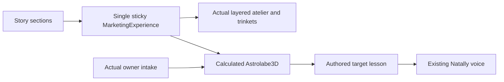
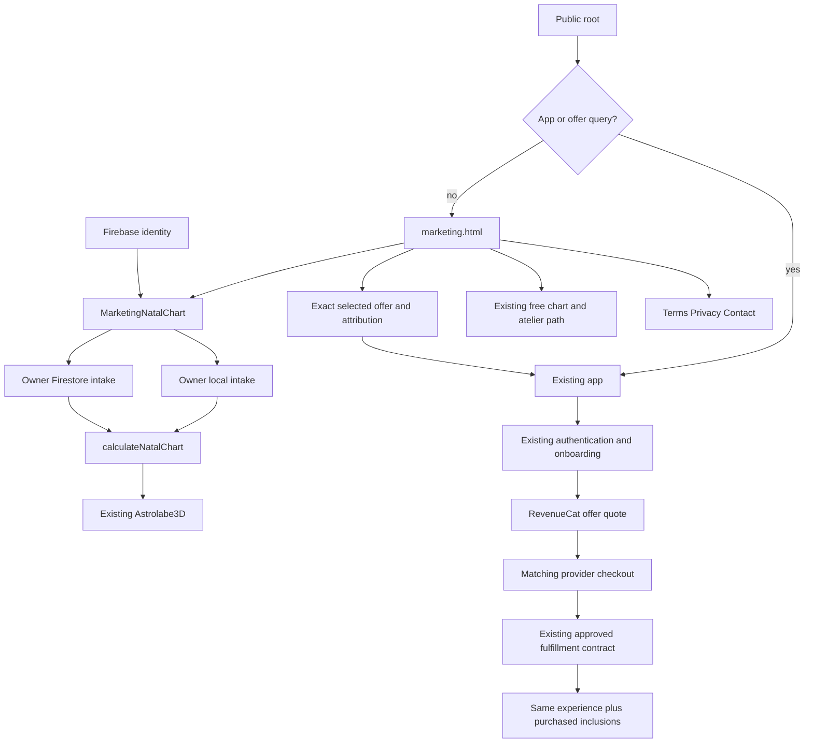
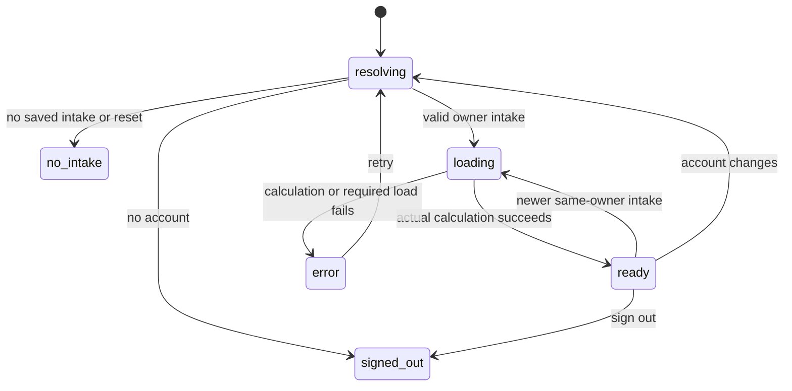

# Landing-page architecture contract

## Current live visual amendment — MFRAME

Root ARCHITECTURE.md MFRAME-01..06 enumerates the single MarketingExperience in
src/marketing.tsx, src/marketing.css, story mount and reused atelier/chart/voice/
lore entities. It replaces static hero/attention art with the actual room and the
authenticated owner's calculated educational chart in a responsive sticky frame.
No example chart. Existing Phase/load ownership guards remain. Older separate
MarketingNatalChart and pause/reset inventory below is superseded. Build is
authorized; recording alone is held.

This defines the landing-page boundary and maps the existing operator requirements
in [SPEC.md](SPEC.md). It is not authority to add hosting, databases, payment rails,
or unapproved update behavior. Architectural changes require operator discussion
in architect mode; coding follows the settled contract. Current gaps are explicit
in [../AUDITS/divergences-20261028.md](../AUDITS/divergences-20261028.md).

## Ownership and dependency contract

The operator's 29 October keepsake amendment is defined by KEEP-01 through KEEP-05
in the root architecture. Report positioning includes the no-install personalized
atelier frozen in time, generated by static template on existing shared Stack
hosting. Revisiting it requires no inference; add-ons hand off to the live app.
The subsequent operator direction selects a $29.99 optional souvenir, retaining
the configured currency, with inference packs as the primary offer. KEEP-06..10
defines the in-atelier contextual promotion and explicitly defers any free-reading
subsidy model. Do not claim this delivery path implemented merely because the
architecture records it.

| Entity / interface | Owner | Input → output / responsibility | Spec |
|---|---|---|---|
| Public landing shell, anchors, cards, footer | marketing.html | Static semantic sections plus actual offer presentation and app-entry links | LP01–06, LP11–12 |
| Root/app dispatch | src/main.tsx | app=1 or recognized offer → app; ordinary root → marketing page | LP01, LP06 |
| MarketingNatalChart | src/marketing.tsx | Authenticated owner's intake → explicit Phase state and Astrolabe3D props | LP07–10 |
| Phase | src/marketing.tsx | Closed union: resolving, signed-out, no-intake, loading(intake), ready(intake,chart), error(message) | LP08–09 |
| load(uid), generationRef, mountedRef | src/marketing.tsx | Owner-bound asynchronous local/cloud lookup; discard stale results | LP09 |
| onAuthStateChanged | src/services/firebase.ts integration | Auth account changes → reset selection and reload intake | LP09 |
| loadNatalIntake / fetchUserIntake | src/services/onboarding.ts | Same-account local and Firestore intake; no separate marketing profile | LP07–09 |
| requiresFreshOnboarding | src/services/natallyHistory.ts | Existing onboarding-reset state → no-intake | LP08 |
| calculateNatalChart | src/services/ephemeris.ts | Existing NatalChartInput → actual NatalChartResult | LP07 |
| Astrolabe3D | src/components/Astrolabe3D.tsx | Reused renderer; chart, selections, rotation, pause, reduced motion and visibility | LP07, LP10 |
| onToggleComponent / onSelectPlanet / resetTrigger | src/marketing.tsx | Chart interaction → selected components/planet and view reset | LP07 |
| Purchase intent | src/services/purchaseIntent.ts and PurchaseAccess.tsx | reading or conversation + source → selected purchase preserved through app flow | LP06, LP16 |
| getCheckoutOffer / purchaseCheckoutOffer | src/services/revenueCatCheckout.ts | Actual owner-bound catalog quote → provider checkout; RevenueCat is commercial authority | LP04–06 |
| Price-bearing DOM | [data-product], [data-bind=price], [data-buy] | Each rendered price/action maps to one real quoted offer; static price text alone is insufficient | LP05 |
| Legal/contact links | /terms.html, /privacy.html, mailto:support@rochemediaservices.com | Existing public documents and operator contact | LP11 |
| Build identity | vite.config.ts / build coordinator | Canonical release metadata → visible [data-natally-version-badge] | LP14 |
| Optional PWA entry | public/manifest.webmanifest, public/pwa.js, scripts/pwa-build.mjs | Existing release → browser installation and generated shell; no independent stamp | LP15 |

## Structured flow

## DOM contract

Public URL fragments describe the customer's destination: `meet-natally`,
`your-chart`, `reading-aloud`, `talk-with-natally` and `prices`. The existing
`top` and `how-it-works` destinations remain valid. These section IDs are distinct
from the stable internal design/attribution hooks below.

The existing inline initialization IIFE owns `legacySectionFragments` and
`normalizeSectionFragment`: map `usp-hero` -> `meet-natally`, `usp-precision` ->
`your-chart`, `usp-attention` -> `reading-aloud`, `usp-conversation` ->
`talk-with-natally`, and `offer-scope` -> `prices`. On initial execution and
`hashchange`, a known legacy fragment with an actual matching section is replaced
using `history.replaceState`, preserving path, query and history state, then
scrolled into view. Unknown fragments remain unchanged. This is compatibility
with existing shared links, not a second router or a new app-entry path.

Preserve existing externally authored `data-od-id` design identifiers: `site-header`,
`primary-nav`, `usp-hero`, `usp-precision`, `usp-attention`, `usp-conversation`,
`offer-scope`, `how-it-works`, `site-footer`, `natal-chart-root`.
Purchase cards retain `data-product=reading|conversation`, corresponding
`data-buy` values, and `data-source` identifying the section. These are integration
hooks, not proof of a working checkout. The chart renders only from actual intake.
The app-owned three-screen paywall remains a separate component with its own
approved offer sequence; this document does not replace it with landing sections.

## Explicit implementation gaps

Current static prices and ten-turn exploration wording do not implement the full
LP04/LP05 contract. Product selection links exist, but direct purchase continuity
requires deployed verification. Production currently lacks marketing.html and the
native auth helper. These deficiencies remain checklist work, not design exceptions.
No new pricing service or customer persistence is introduced by this contract.
