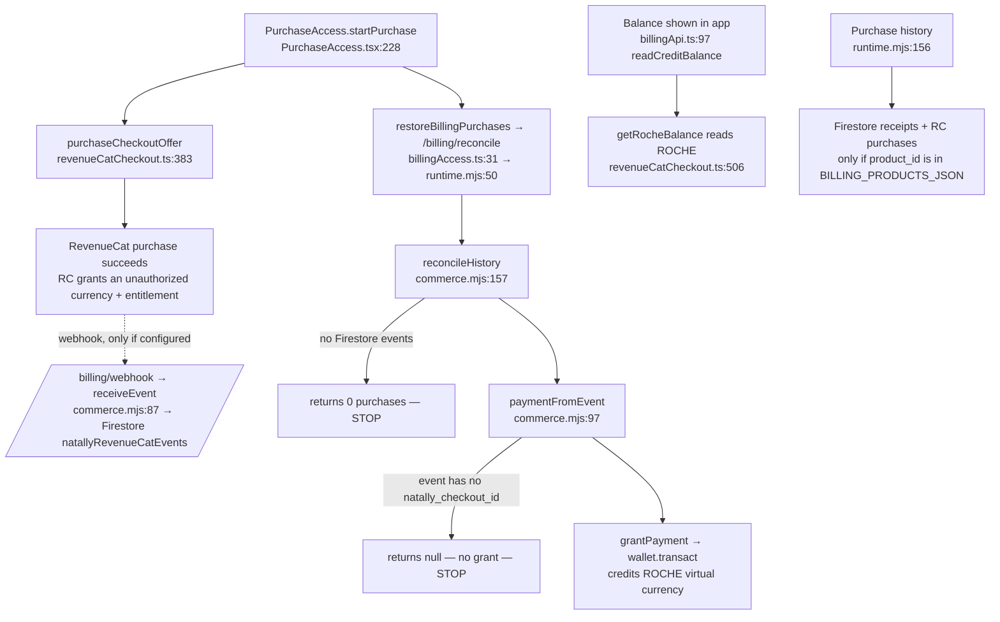

# Payment → credit → history: what the code does, and the proposed correction

## 1. What happens today when a customer pays (master 2fbc353)

Observed result for Robin's account (`UojW5tCB1HUnjfcSseQyP49daL63`, US$1.98, two US$0.99 purchases):

| Defect | Cause in code | Effect |
|---|---|---|
| D1 Credit never granted | Fixed-price offers carry no `natally_checkout_id` (only quoted offers do: `revenueCatCheckout.ts:379`); `paymentFromEvent` returns null without it (`commerce.mjs:98-99`). Grants also require a webhook event already stored in Firestore (`commerce.mjs:158-159`). | Paid money never becomes credit. |
| D2 Balance 0 | App reads the `ROCHE` virtual currency; RevenueCat products grant an unauthorized currency. Two currencies, neither is the paid money. | Shows 0 Cr after paying. |
| D3 History empty | History starts from Firestore receipts; RevenueCat purchases are shown only when their `product_id` is in `BILLING_PRODUCTS_JSON` (`runtime.mjs:165-171`). Any failure is swallowed to a message. | "No purchases on record" while RevenueCat shows them. |
| D4 Firebase acting as authority | Firestore events/receipts gate everything, contrary to "RevenueCat is authoritative". | Missing Firestore row = lost customer money. |

## 2. Proposed rule (revised 2026-11-03 after operator ruling)

Operator ruling: **The only currency is
ROCHE. It is stored in Firebase; Firebase draws from ROCHE.** This matches the
existing architecture (`ARCHITECTURE.md:325-328` ROCHE literal currency;
`ARCHITECTURE.md:761` `creditUnits` = ROCHE units on the Firebase account;
`ARCHITECTURE.md:783-790` Firebase is the working copy). No new currency or store.

1. **Currency:** RevenueCat code `ROCHE` (name "Roche Credit") only. Any other currency is unauthorized and never read. ROCHE only, 100 ROCHE = US$1 of spend limit (Cr = cents). A US$10
   purchase grants 400 ROCHE (40%). Robin's US$1.98 → 79 ROCHE.
2. **Grant at payment:** each paid RevenueCat purchase grants ROCHE once, keyed by
   its RevenueCat purchase id, from what RevenueCat shows paid. No checkout id or
   stored webhook row is a precondition (fixes D1).
3. **Firebase draws from ROCHE:** `natallyCreditAccounts.creditUnits` is refreshed
   from the ROCHE balance; the key limit and the displayed Cr both read that one
   number (fixes D2). Firebase never originates credit.
4. **Redemptions** add ROCHE by each code's own record (`redemption-codes.mjs`).
5. **History:** every RevenueCat purchase for the customer, unfiltered; a failed
   read says so (fixes D3).
6. **Restore purchases:** same read, automatic on open; button is reassurance only.
7. **Unauthorized currency:** removed from RevenueCat products; never read.

## 3. Changes this would require (none made yet)

| Step | Where | Change |
|---|---|---|
| S0 | RevenueCat | Unauthorized currency: grants removed and archived (inactive), 2026-11-03. Done. |
| S1 | `billing/revenuecat-commerce.mjs` | Grant ROCHE per paid purchase id from `listPurchases`, idempotent, no checkout-id/webhook precondition. |
| S2 | `billing/firebase-wallet.mjs` + `runtime.mjs` | Firebase `creditUnits` drawn from ROCHE; key limit uses it. |
| S3 | `billing/runtime.mjs` | `/billing/history` lists all RevenueCat purchases unfiltered. |
| S4 | `src/services/billingApi.ts` | Displayed Cr = the same ROCHE number. |
| S5 | `src/components/AccountBillingDialog.tsx` | Show transactions and the failure reason verbatim. |
| S6 | `tests/` | Two US$0.99 purchases, no webhook, no checkout id → 79 ROCHE, two history rows. |
| S7 | Deploy | `node scripts/deploy-billing-netlify.mjs --site natally-hosted-chat`, then `bash build_all.sh`. |

## 4. Decision needed

- **Approve** sections 2–3 as written, or mark what to change.
